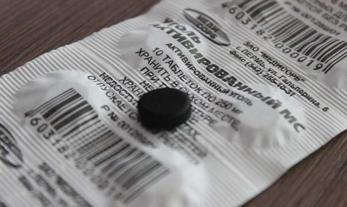

# Энэ эм, таны эмийн санд байнга байх хэрэгтэй

1831 онд нэгэн гайхалтай зүйл болсон нь, Францын шинжлэх ухааны академийн профессор Toyery мэргэжил нэгтнүүдийнхээ өмнө үхлийн дозоор алкалоид уучихсан боловч идэвхижүүлсэн нүүрс хэрэглэн амьд гарсны гэрч болцгоосон академичид, удаанаар итгэж чадахгүй байсан гэдэг. Өнөөдөр ч уг, нүүрсэн эмийг хор, хордлого тайлах гарын дорх бэлдмэлд тооцон хэрэглэдэг. Идэвхижүүлсэн нүүрс нь ямар ч амт үнэргүй, хоргүй ба биеийн хордолтыг 60% хүртэл багасгах чадвартай бөгөөд архины шарталт тайлах, гэдэс дүүрэлтийг дарах, цөсний өвчлөл, цусандах холестеринийг бууруулах үйлчлэлтэй. Үүний зэрэгцээ, бие организмыг гайхалтай цэвэрлэж өгдөг байна. Идэвхижүүлсэн нүүрсийг, хүний бие дэх ашигтай, тэжээллэг бодисуудыг шингээн хорны хамт гадагшлуулдаг гэж үздэг байсныг, эрдэмтэн Дэвид О.Куни туршилт судалгаагаараа үгүйсгэн нотолсон байдаг.
