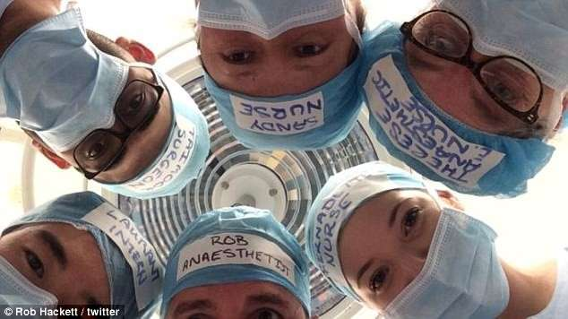

# Энэ эмчийн бяцхан санаа олон зуун хүний амийг аврахад тустай үйлдэл болжээ

Сиднейн эмч, Роб Хаггетс, өөрийн нэр болоод мэргэшлээ малгайн дээрээ бичсэнээрээ, эмнэлгийн тусламж үзүүлэх үеийн аюулгүй байдлыг хангах асуудалд дэлхий нийтийн хэмжээнд шинэ хандлага гаргалаа гэж үзэж байна. Энэ үйлдлийг ялангуяа хагалгааны өрөөнд, эмнэлгийн ажилтнууд бүгд маскатай, бараг ижил хувцастай байдаг үед андуурал гарахгүй байхад тустай гэж үзжээ. Роб, малгайн дээрээ ингэж биччихээд, эхний үед, -“Та өөрийнхөө нэрийг тогтоодоггүй юм уу?” гэсэн асуулттай ихэд тулгардаг байсан ч, 6 сарын дараа энэ санааг өөр бусад эмнэлгүүд ашиг тустайг нь ойлгон хэрэгжүүлж эхэлсэн бөгөөд дэлхий нийт хүлээн зөвшөөрч эхэлсэн гэнэ. Энэхүү бяцхан санаа, хагалгааны үед, цаг алдахаас хамгаалж, мөн туршлагагүй, дадлагын оюутнуудыг андуурч үүрэг өгөх, алдаа гаргах, бие биенээ цаг тухайд нь дуудаж хандах, зөвлөлдөх зэрэгт, хүний амь настай холбоотой алтан цагийг алдахгүй байхад ашигтай гэж дүгнэжээ.

