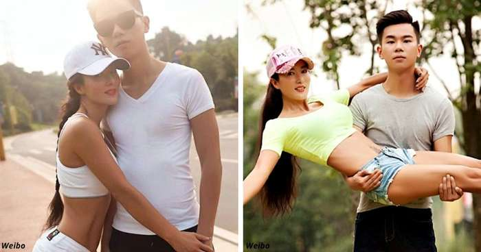
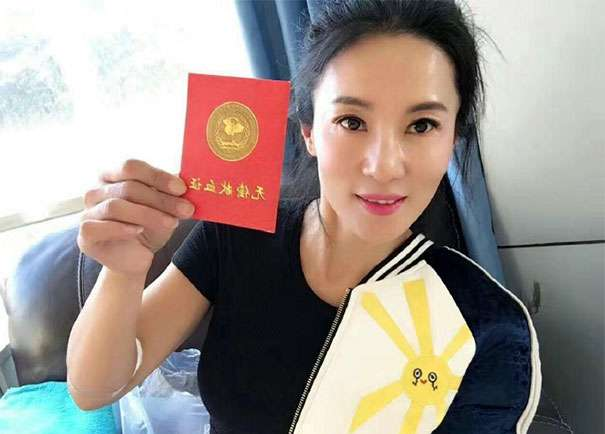

# Энэ эмэгтэй 50 настай, дэргэдэх нь түүний хүү

Энэ эмэгтэй 50 настай. Тэрээр 22 настай хүүгээсээ ялгарахгүй залуу харагддаг бөгөөд түүнийг Лю Елинь гэдэг. Түүнийг Хятадын хамгийн залуу харагддаг эмэгтэй гэж үздэг ба хүн наснаасаа хоёр дахин залуу харагдаж болохыг харуулдаг амьд жишээ гэж хятадын сайтуудаар шуугиж байна. Огт үрчлээгүй нүүр царай, залуу сайхан бие галбирыг нь хэн ч хараад гайхмаар.

Тэр, -“Намайг 50 настай гэхэд хэн ч итгэдэггүй, хүүг минь үргэлж найз залуу минь гэж боддог. Нотлох баримтаа үзүүлсний дараа, хүн бүр залуу насаа хэрхэн ийнхүү хадгалсан нууцаа хэлээч гэж хүсдэг. Үүнийг нууцад тооцох шаардлагагүй, энэ бол миний спортоор хичээллэдгийн ач тус юм. Би спортоор тасралтгүй 30 жил хичээллэж байна. Өдөр бүр нууранд сэлж, өвөл ч задгай бассейн, нууранд сэлэх дуртай. Мөн хөнгөн атлетикаар давхар хичээллэдэг. Миний амжилтууд гэвэл, Хятадын Янцзы мөрөн, Өмнөд Солонгосын Ханган мөрнийг сэлж гаталж байсан. Өнгөрсөн жил Малайзын Пинанг эргээс Малаккийн хоолойн 12 километр зайг 4 цагт сэлж гаталсан. Би, хүмүүст, хэрэв та өөртөө таалагддаггүй, бусдад сайхан биш, муу харагддаг бол, муу хичээж байна даа гээд хэлчихдэг” гэж ярилцлага өгсөн байна. Үнэхээр, бүх хүн сайхан харагдахыг хүсдэг ч, тэр хүслийнхээ хирээр хичээж чаддаг билүү? Спортын ач тусыг таних нэгэн сайхан жишээ энэ биз ээ. Залуу насаа хадгалах боломж бидний, өөрсдийн маань гарт байдгийн амьд жишээ гэж бахархалтайгаар дахин тэмдэглэе.

---

---

---

