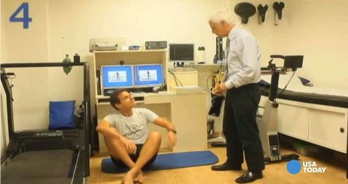
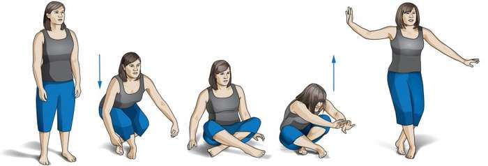

# Энэ тестээр биеийн байдлаа мэдээрэй

Бие организмын үйл ажиллагаа ямар байгааг мэдэхийн тулд, төрөл бүрийн шинжилгээ хийлгэх шаардлагатай болдог. Харин бразилын эрдэмтэн Клаудио Гиль Аруджо энэхүү энгийн тест боловсруулсан бөгөөд бие мах бод хэвийн байгаа эсэхийг дараах хөдөлгөөнүүдийг хийснээр шалгаж болох юм гээд олон хүн хамруулсан судалгаан дээр батлагдсан болохыг итгэлтэйгээр хэлжээ.

Танд одоо 10 оноо байгаа. Хөдөлгөөнүүдийг хэрхэн хийж буйгаас тань шалтгаалан, харгалзах оноо хасагдах маягаар гарсан тоо, таны биеийн байдлыг заах аж.\
1. Хөлөө зөрүүлж зогсно. /Хөл нүцгэн байх ёстой/ Аажмаар доошилж завилж суухыг оролд. Суух үед тулсан биеийн хэсгийн тоогоор нэг оноо хасагдна.\
2. Хөлөө завилж сууна. Энэ үед биеийн аль ч хэсгээрээ түшиж тулаагүй байх ёстой. Хөл, гар аль нэг хэсгээрээ тулсан бол тулсан хэсэг тус бүрийн тоогоор нэг нэг оноо хасагдна. Суусан ч тэнцвэрээ алдаж байвал 0.5 оноо мөн хасагдна. \
3. Завилж сууснаараа хэсэг байгаад гарынхаа тусламжгүй босох гээд үз. Чадахгүй, хөл гараараа тулж боссон бол мөн л тулсан хэсгийн тоогоор нэг нэг оноо хасагдна.

---

#### Одоо үр дүнгээ үзье:

8-10 оноо. Маш сайн. Эрүүл зөв амьдралыг мөрддөг юм байна. Биеийн байдал тань эрүүл сайн байна.\
6-7.5 оноо. Муугүй. Эрүүл байхыг эрмэлзэх багахан шалтгаан байна. Гэхдээ эрсдэл алга. \
3.5-5.5 оноо. Асуудлууд байна гэж сануулж байна. Ойрын 6 жилд эрүүл мэндийн хүнд байдалд орох магадлал эрүүл хүнийхээс 2 дахин их байна. \
0-3 оноо. Муу. Хүчтэй сануулга! Дараагийн 6 жилд эрүүл мэндийн гунигт байдалд орох асуудал эрүүл хүнийхээс 5 дахин их байгаад анхаар. Эмчлүүл. \
Энэ тест нь, тодорхой зарим өвчтэй хүмүүст хамаарахгүй нь ойлгомжтой. Эхний хоёр ангилалд багтсан хүмүүс тайван байж болох бөгөөд харин сүүлийн хоёрт хамааралтай хүмүүс, эртхэн эрүүл мэнддээ анхаарах цаг болсныг сануулдаг аж.

Ер нь, эрүүл мэнддээ анхаарах асуудлыг орхигдуулахгүй байхыг зөвлөе.
