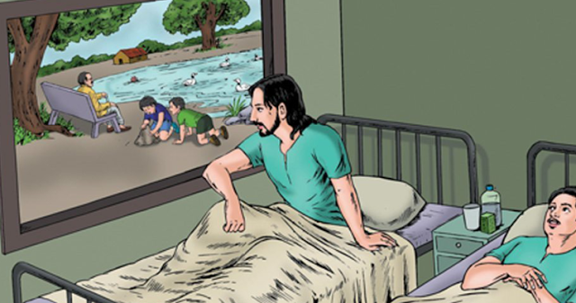

# Энэ түүх, ганцхан минутын дотор сэтгэлгээг өөрчилнө

Хүн бол сэтгэлийн амьтан, урмаар тэжээгдэж, амьдралын гоё сайхан зүйлсээс эрч хүч авч, сайхан сэтгэл нь, байхгүйг ч бий болгох, байлгах хүчтэй, сэтгэлийн агуу их хүч чадлыг агуулж байдаг.

Эмнэлгийн нэгэн өрөөнд, хоёр хүнд өвчитөн эрэгтэй хэвтэн эмчлүүлж байна. Нэг нь хэвтрийн дэглэмд, босох чадалгүй, харин нөгөө нь өдөрт хагас цаг уушигны шингэнээ авахуулахаар өндийж суух боломжтой. Өрөөний ганц цонх, өнөөх босч сууж болдог эрэгтэйн орны хажууд байх бөгөөд тэр хоёр, амьдралын эсэн бусын зүйл ярилцахын хажуугаар, босч суудаг эрэгтэй нь, хэвтрийн хөршдөө, өдөр бүр, цонхоор харж буй зүйлсээ зураглан ярьж өгнө. Хэвтэрт байгаа өвчитөн, нөгөө эрэгтэйнхээ цонхоор харж буй зүйлсийг төсөөлөн хэвтэж, орчины амьдралын өнгө, үйл хөдлөл үйлдэл, өөрчилөлтийг сонсож, өөрийн өвчин болон гунигт тавилангаа мартагнана. Түүний сонсдогоор, өрөөний цонх, нэгэн сайхан нууртай цэцэрлэг рүү хардаг бөгөөд тэнд, нугас, хун шувууд хөвцгөөж, мөн залуу хосууд хөтлөлцөн төрөл бүрийн цэцэгс ургасан зөргөөр хөгжилдөн алхдаг. Цонхны дэргэдэх хүн эдгээрийг, сайхан зураглан ярьж, нөгөөх нь төсөөлөн хэвтэх байдал өдөр бүр болдог байлаа. Нэг сайхан дулаахан өдөр, салхивчаар бүлээн салхи сэвэлзэх бөгөөд, энэ үед, цонхны дэргэдэх эрэгтэй, хажуугаар нь өнгөрч буй баярын парадыг мөн зураглан ярихад, нөгөөх нь түүнийг сэтгэлдээ харж, харин дуу чимээ нь сонсогдохгүй байгааг гайхан өнгөрүүлэв. Маргааш өглөө нь, сувилагч орж ирээд, цонхны дэргэдэх хүн, өвчин нь хүндэрч гэнэт нас барсаныг мэджээ. Өрөөнд ганцаар үлдсэн өвчитөн, сувилагчийг, орныхоо байрлалыг сольж өгөхийг гуйснаар тэр, цонхны хажууд хэвтсэн бөгөөд өндийн сууж цонхоор хартал, цонхны цаана мухар хананаас өөр зүйл үгүйг харж ихэд гайхан, сувилагчаас, -Хажуудах эрэгтэй маань, цонхоор харсан сайхан зүйлсээ надад ярьдаг байсан. Яагаад ингэдэг байсан юм бол? гэж асуухад, сувилагч, -Тэр хүн, цонхны цаадах ханыг ч харах боломжгүй сохор хүн байсан. Магадгүй таны сэтгэлийг өргөх гэж тийм зүйл ярьдаг байсан биз ээ гэчихээд гарч явжээ. Тэр, ганцаар үлдэн бодлогоширон суухдаа, хүний өөрийнх нь байр байдлаас гадна бусдыг аз жаргалтай байлгах хүсэлтэй ухаалаг нэгэн өөрт нь амьдралыг бэлэглээд явсаныг ойлгожээ. Аз жаргал бол хуваалцах тусам нэмэгддэг зүйл юм. Хэдийгээр, юм хардаггүй ч, нэгэндээ амьдрах хүсэл, эрмэлзэл өгч байсан ухаант нэгэн үүрд явсан ч, тэрээр сэтгэлийн жаргалыг амсаж, амьдын буян хийсэн нь ойлгомжтой юм. Хэрэв та, аз жаргалтай байхыг хүсвэл, амьдралдаа байгаа мөнгөөр үнэлэн худалдаж авч болдоггүй таатай зүйлсээ тоочоорой. Тэдгээр зүйлст аз жаргал байдаг юм.
