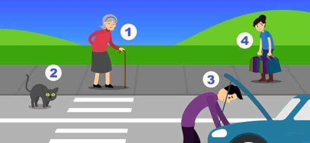

# Энэ тохиолдлуудад, хэнд нь туслах вэ?

Хүний сонголт нь, тухайн хүнийхээ тухай олон зүйлийг хэлж чаддаг. Сонголтод, хүний дотоод зан чанар, сонирхол нөлөөлдөг бөгөөд дараах тохиолдлуудаас хэнд нь туслахаа сонгон өөрийнхөө тухай сонирхолтой зүйлсийг уншаарай.

**№1.**Та өндөр ёс суртахуунтай, уламжлалаа хүндэлдэг хүн юм. Амьдралыг бодитоор харж, шийдвэрээ нягтлан авч үздэг. Сайн хүмүүжилтэй, тиймээс амьдралд ихээр тохиолдож байдаг шударга бус зүйлтэй эвлэрч чаддаггүй.\
**№2.** Та, амьтад төрлөх чанараа хүнээс илүү хадгалдаг, мөн, тэдгээр нь бие биедээ муу зүйл хийж чаддаг хүмүүсээс илүү гэдгийг анзаардаг, сайн сайхан сэтгэлтэй хүн юм. Амьдрал таны хувьд, амар биш санагддагаас амьдралыг сайн талаас харахыг эрмэлзэж явдаг аж. \
**№3.** Та, төлөв зантай, хариуцлагатай хүн. Маш хөдөлмөрч, бусдад туслах болон амьдралын аливаа хүнд хэцүү асуудлаас бэрхшээдэггүй. Та хүмүүсийн итгэл төрүүлдэг тул олон сайхан найз нөхөдтэй байдаг. Та, сайн манлайлагч болох чадвартай. \
**№4.** Та бол, бусдад тусалсанаасаа жинхэнэ таашаал авч байдаг сайн хүн. Танд, бусдад хэрэгтэйгээ мэдрэх сайхан байдаг. Үүнээсээ та сэргэж байдаг. Та анхаарлын төвд байх дуртай, өөрийн чадвараа харуулах боломжийг алдахгүй. \
Тус дэм бүрийн цаана агуулагдаж буй зүйлсийг мэдээд авах нь, дээрх сайхан чанаруудыг нэгтгэн эзэмших боломжийг нээнэ бус уу?
