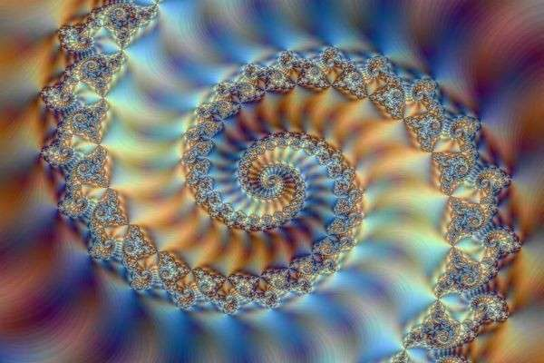

# Энергийн 7 цикл

Амьдралд тань, жил бүр зарим зүйлс, тохиолдол, үйл явдал тодорхой хугацаанд давтагдах мэт байдал анзаарагдаж байсан уу? Хэрэв анзаарч ажиглах юм бол жилийн хугацаанд амьдралд үйлчилдэг 7 цикл байдагтай холбоотойгоор давхцаж давтагдаж байдгийг анзаарч болдог байна. Үүнийг мэдсэнээр, аливаа зүйл тодорхой байвал хөнгөн тусдагийн жишгээр, амьдралыг хөнгөвчилж болно гэж үзэж байна. Энэхүү 7 циклийг тооцоход хялбар. Төрсөн өдрөөсөө хойш 52 хоногийг тооцоход 1 дэх цикл, түүнээс хойш 52 хоног гэх маягаар дараагийн төрсөн өдөр хүртлээ тоолоход 7 цикл тодорхой болно. Жишээ нь, 6 сарын 6-нд төрсөн хүн 52 хоногийг 6 сарын 6-с хойш тооцоход 8 сарын 27-нд 1 дэх цикл дуусч, 8 сарын 28-с хоёрдох цикл эхэлж 10 сарын 17 дуусна гэх мэт. Эдгээр циклүүдийн учир шалтгаан, үр нөлөөллийг мэдэж амьдрал ахуйдаа ашиглах боломжтой юм

1-р цикл: боломжуудын үе гэдэг. Нэр нөлөө бүхий хүмүүсийн нөлөөгөөр бодсон санаснаа хэрэгжүүлэх боломжтой байдаг үе бөгөөд бусдаас дэмжлэг авах, удаан хүсэн хүлээсэн зүйлс биелэх, мөнгө зээл авах, хувийн бизнестэй болох, итгэлтэй хамтрагчидтай болох, ашигтай хөрөнгө оруулалт хийхэд ихэд тохиромжтой үе гэдэг байна. Яг энэ үед, өөрийгөө бусдад таниулах, албан тушаал ахих үйлдлүүд хийх үр дүнтэй байдаг гэнэ.\
2-р цикл: их, бага өөрчилөлтүүдийн үе. Энэ үед аялах, томилолтоор явах амрах зэрэгт зарцуулах үр өгөөжтэй. Мөн, ямар нэг хөдөлгөөн шилжилттэй холбоотой үйлдлүүдэд их таатай байдаг. Машин авах, худалдах, ачаа тээврийн үйл ажиллагаа, түүнтэй холбоотой зүйлс зохион байгуулах, шингэн зүйлийн наймаа арилжаа хийх зэрэгт үр ашиг дагуулах боломжтой. Олон нийтэд хандсан үг хэлэх, уриалга гаргах, бусдыг дагуулах үйл ажиллагаа үр дүнтэй болдог. Харин энэ циклийн үед, шинээр бизнес эхлүүлэх, ажилаа солих, богино хугацааны гэрээ хэлэлцээр байгуулах, зээл авах, өгөх, үнэт цаасны арилжаанд оролцох, мөрийтэй тоглоом маягийн зүйлд оролцох эрсдэлтэй гэдэг байна.\
3-р цикл: энерги хамгийн өндөр байх үе. Бүх зүйлс аятайхан. Урд өмнө байгаагүй эрч хүч, энергийн үйлчлэлээр чухал алхмууд хийгдэх боломжтой. Биеийн байдал илт сайн. Өрсөлдөгчидтэйгээ тэмцэлдэхэд тохиромжтой үе. Хэрэв ямар нэг зүйл зарах гэж байгаа бол, энэ үед амжуулах хэрэгтэй. Санаснаас тань их ашигтай наймаа хийгддэг. Эрэгтэйчүүд хайр дурлалын асуудалд няхуур хандах үе, харин эмэгтэйчүүдийн хувьд амьдралыг нь өөрчилөх хүнтэй учирах боломжтой. Мөн дайсантай болохыг хүсэхгүй байгаа бол энэ үед хэрүүл маргаанаас зайлсхийх хэрэгтэй байдаг.\
4-р цикл: оюун санааны цикл. Ялангуяа уран бүтээлчидэд хамгийн онгодтой үе нь байдаг. Боловсрол, оюун ухаанаа өсгөх хөгжүүлэхэд хамгийн тохиромжтой үе. Төрөл бүрийн сайхан санаануудаар дүүрэн байж хэрэгжүүлэх боломж энэ үед гарч ирсэн байдаг бөгөөд зоригтойгоор эхлүүл. Аз завшаан гарт тань байдаг. Харин хууран мэхлэлтээс ихээхэн болгоомжлох үе гэдгийг сануулах нь зүйтэй. Гэрлэх, томоохон худалдан авах хийхэд таагүй үе.\
5-р цикл: хувийн амжилт гаргах үе. Хүрээлэл, сонирхолоо өргөсгөх, бодит ирээдүйгээ бүтээх, хөгжүүлэх боломжуудын үе. Таны санаа санаачлагыг бусад хүмүүс сонсч хүлээж авах, итгэл өгөх, харилцах сайхан боломжоор дүүрэн үе. Бүрэг зангаа хойш нь тавьж, өндөр тушаалтан ер нь хэнээс ч айхгүй харьцах, тэдний нөлөөг ашиглаж болох үе. Мөн шүүх, заргатай холбоотой зүйлд заргаа авах өндөр магадлалтай. Томоохон худалдан авалт хийх, ашигтай хөрөнгө оруулалт хийхэд тохиромжтой. Хууль бус зүйлд оролцохоос туйлаас болгоомжлох хэрэгтэй үе. Зөв хооллолтын дэг сахих ялангуяа мацаг барих хамгийн тохиромжтой үе гэдэг байна.\
6-р цикл: амрах, зугаалах, дуртай зүйлээ эрхлэхэд хамгийн таатай үе байдаг гэнэ. Өөртөө анхаарч, хайрлаж халамжлах цаг. Мөн энэ үед тогтоосон ямар ч харилцаа тогтвортой урт удаан байдаг. Хөрөнгө оруулалт хийхэд таатай.\
7-р цикл: болгоомжтой байх үе. Ямар нэг томоохон өөрчилөлт хийх, бодлогогүй зүйл хийхээс болгоомжилох, урд өмнөх үеийн туршлага дээрээ дүн шинжилгээ хийж, чиг баримжаагаа сайтар тунгаан бодох ёстой. Хуучин асуудлуудаа орхиж, шинээр төлөвлөгөө зохиоход таатай. Энэ үед хийсэн өөрчилөлт алдагдалд хүргэх магадлалтай. Сэтгэл санаагаа өөдрөг байлгахад анхаарах. Хүн бүрт, аливааг ажих, бодох, өөр өнцгөөс харахаас өөр аргагүй зогсонги үе таардаг. Гэхдээ энэ үе хэзээ ч дэмий, талаар өнгөрдөггүй болохыг ойлгох хэрэгтэй байдаг. 1-р цикл: боломжуудын үе гэдэг. Нэр нөлөө бүхий хүмүүсийн нөлөөгөөр бодсон санаснаа хэрэгжүүлэх боломжтой байдаг үе бөгөөд бусдаас дэмжлэг авах, удаан хүсэн хүлээсэн зүйлс биелэх, мөнгө зээл авах, хувийн бизнестэй болох, итгэлтэй хамтрагчидтай болох, ашигтай хөрөнгө оруулалт хийхэд ихэд тохиромжтой үе гэдэг байна. Яг энэ үед, өөрийгөө бусдад таниулах, албан тушаал ахих үйлдлүүд хийх үр дүнтэй байдаг гэнэ.\
2-р цикл: их, бага өөрчилөлтүүдийн үе. Энэ үед аялах, томилолтоор явах амрах зэрэгт зарцуулах үр өгөөжтэй. Мөн, ямар нэг хөдөлгөөн шилжилттэй холбоотой үйлдлүүдэд их таатай байдаг. Машин авах, худалдах, ачаа тээврийн үйл ажиллагаа, түүнтэй холбоотой зүйлс зохион байгуулах, шингэн зүйлийн наймаа арилжаа хийх зэрэгт үр ашиг дагуулах боломжтой. Олон нийтэд хандсан үг хэлэх, уриалга гаргах, бусдыг дагуулах үйл ажиллагаа үр дүнтэй болдог. Харин энэ циклийн үед, шинээр бизнес эхлүүлэх, ажилаа солих, богино хугацааны гэрээ хэлэлцээр байгуулах, зээл авах, өгөх, үнэт цаасны арилжаанд оролцох, мөрийтэй тоглоом маягийн зүйлд оролцох эрсдэлтэй гэдэг байна.\
3-р цикл: энерги хамгийн өндөр байх үе. Бүх зүйлс аятайхан. Урд өмнө байгаагүй эрч хүч, энергийн үйлчлэлээр чухал алхмууд хийгдэх боломжтой. Биеийн байдал илт сайн. Өрсөлдөгчидтэйгээ тэмцэлдэхэд тохиромжтой үе. Хэрэв ямар нэг зүйл зарах гэж байгаа бол, энэ үед амжуулах хэрэгтэй. Санаснаас тань их ашигтай наймаа хийгддэг. Эрэгтэйчүүд хайр дурлалын асуудалд няхуур хандах үе, харин эмэгтэйчүүдийн хувьд амьдралыг нь өөрчилөх хүнтэй учирах боломжтой. Мөн дайсантай болохыг хүсэхгүй байгаа бол энэ үед хэрүүл маргаанаас зайлсхийх хэрэгтэй байдаг.\
4-р цикл: оюун санааны цикл. Ялангуяа уран бүтээлчидэд хамгийн онгодтой үе нь байдаг. Боловсрол, оюун ухаанаа өсгөх хөгжүүлэхэд хамгийн тохиромжтой үе. Төрөл бүрийн сайхан санаануудаар дүүрэн байж хэрэгжүүлэх боломж энэ үед гарч ирсэн байдаг бөгөөд зоригтойгоор эхлүүл. Аз завшаан гарт тань байдаг. Харин хууран мэхлэлтээс ихээхэн болгоомжлох үе гэдгийг сануулах нь зүйтэй. Гэрлэх, томоохон худалдан авах хийхэд таагүй үе.\
5-р цикл: хувийн амжилт гаргах үе. Хүрээлэл, сонирхолоо өргөсгөх, бодит ирээдүйгээ бүтээх, хөгжүүлэх боломжуудын үе. Таны санаа санаачлагыг бусад хүмүүс сонсч хүлээж авах, итгэл өгөх, харилцах сайхан боломжоор дүүрэн үе. Бүрэг зангаа хойш нь тавьж, өндөр тушаалтан ер нь хэнээс ч айхгүй харьцах, тэдний нөлөөг ашиглаж болох үе. Мөн шүүх, заргатай холбоотой зүйлд заргаа авах өндөр магадлалтай. Томоохон худалдан авалт хийх, ашигтай хөрөнгө оруулалт хийхэд тохиромжтой. Хууль бус зүйлд оролцохоос туйлаас болгоомжлох хэрэгтэй үе. Зөв хооллолтын дэг сахих ялангуяа мацаг барих хамгийн тохиромжтой үе гэдэг байна.\
6-р цикл: амрах, зугаалах, дуртай зүйлээ эрхлэхэд хамгийн таатай үе байдаг гэнэ. Өөртөө анхаарч, хайрлаж халамжлах цаг. Мөн энэ үед тогтоосон ямар ч харилцаа тогтвортой урт удаан байдаг. Хөрөнгө оруулалт хийхэд таатай.\
7-р цикл: болгоомжтой байх үе. Ямар нэг томоохон өөрчилөлт хийх, бодлогогүй зүйл хийхээс болгоомжилох, урд өмнөх үеийн туршлага дээрээ дүн шинжилгээ хийж, чиг баримжаагаа сайтар тунгаан бодох ёстой. Хуучин асуудлуудаа орхиж, шинээр төлөвлөгөө зохиоход таатай. Энэ үед хийсэн өөрчилөлт алдагдалд хүргэх магадлалтай. Сэтгэл санаагаа өөдрөг байлгахад анхаарах. Хүн бүрт, аливааг ажих, бодох, өөр өнцгөөс харахаас өөр аргагүй зогсонги үе таардаг. Гэхдээ энэ үе хэзээ ч дэмий, талаар өнгөрдөггүй болохыг ойлгох хэрэгтэй байдаг.
