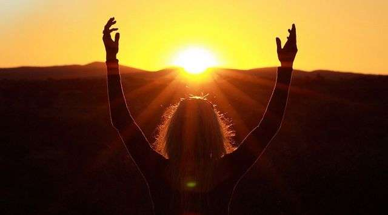

# Эрч хүч буюу энерги авах аргууд

Хүн энергээ хоол хүнс, ус, нар, газар дэлхий, дасгал хөдөлгөөн, хамгийн гол нь агаараас байнга авч байдаг байна. Гэвч таагүй нөхцөл байдалд хүн алдсан энергээ нөхөх боломжгүй болдог. Тиймээс энерги авах, ялангуяа байгаль дэлхийгээс авах олон аргууд байдаг бөгөөд цувралаар танилцуулах юм. Эдгээр аргуудаас таалагдсаныгаа авч хэрэгжүүлэхийг зөвлөж байна.

**Нарнаас энерги авах арга:**\
1. Хоёр гарын алгаа нар руу харуулан өргөж, өөр зүйл бодолгүй наранд анхаарлаа төвлөрүүлэн, сэтгэлээрээ эрч хүчийг нарнаас гуйх үед бие организмд мэдрэгддэг. Нарандаа заавал талархаарай.\
2. Цэлмэг буюу бүрхэг өдрийн алинд ч хийж болно. Мөн алгаа нар руу харуулан, гарын алгаараа дамжуулан нарны илч, туяа хэрхэн алгаар дамжин биед нэвчин орж байгааг төсөөлөн, гарын алга үл ялиг чимчигнэх хүртэл зогсно. Талархахаа мартаж болохгүй.\
3. Зөвхөн цэлмэг өдөр, наранд бүх биеэ ил байхаар зогсон, нарны туяа хэрхэн биеийг тань нэвчин, биеийн гол хэсгийг нарны туяа багана мэт ороон тэлж биеийг тойрон бөмбөлөг хэлбэрээр өсөн нэмэгдэх мэдрэмжийг төсөөлөх. Энэ үед, хүн эрч хүчээр дүүрч, энергийн бүрхүүл гайхалтай идэвхжидэг. Нарандаа талархаад, дасгалаа зогсооно.
