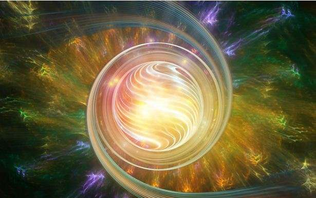

# Эрч хүчээ хаана алдаж, харин хаанаас авдаг вэ?

Хүн амьдралд тохиолддог ижил зүйлсийг нэг тохиолдолд маш хүндээр, нөгөө тохиолдолд тайван хүлээж авах байдал байнга анзаарагддаг. Энэ нь, тэр зүйл, хүн эрч хүчээ алдсан, нэг бол эрч хүчээр дүүрэн байх үед тохиолдож байгаагаас хүний сэтгэл хөдлөл шалтгаалдаг болохыг харуулдаг байна. Танд эрч хүч алдах болон авах нөхцлүүдийг танилцуулъя.

#### Эрч хүчээ алддаг:

-“үгүй” гэж хэлмээр байвч, “тийм”, “за” гэж хэлэх үед\
-уйлмаар байсан ч инээмсэглэх хэрэгтэй үе\
-амрахгүй байхад\
-“зорилго”-тань тодорхой бус үед, өөрөөсөө тэвчээр шаардах\
-гомдох\
-өөрийн дургүй зүйл хийх, эрхлэх\
-дургүй, хүсэхгүй хүнтэйгээ харьцахаас аргагүй байдалд орох\
-эргэн тойрны тань хүмүүс дан сөрөг зүйл ярьж хэлдэг\
-улс төр, замын түгжрээ, амьдралын өсч буй өртөгийн тухай хэт анхаарах, ярих \
-хов жив ярих\
-амьдралаас айх\
-өөрийгөө голох, буруутгах\
-хэн нэг хүн, таныг янз бүрээр хэлж, тодорхойлж буйг хүлээн зөвшөөрөх

#### Эрч хүч авдаг:

-шинэ хүмүүстэй танилцах үе\
-шинэ мэдлэг авах\
-аялалын үе\
-өөрийнхөө айдсыг дарах үед\
-ямар нэг зүйл хийхийг оролдох үе\
-зугаалж алхах\
-хөнгөхөн айлгүйтэх\
-ямар нэг бүтээлч зүйл хийх /зураг зурах, нэхмэл, хобби г.м/\
-аятайхан хүмүүстэй харилцах\
-итгэж, дэмждэг хүмүүстэйгээ харилцах үед\
-биеийн тамирын дасгал сургуулилтын үе\
-амьдрах орчноо шинэчлэх /байрны засвар, их цэвэрлэгээ, тохижилт г.м/\
-сэтгэл зүйн орчноо шинэчлэх /сөрөг хүмүүсээс ангижрах/\
-“үгүй” гэж хэлмээр үедээ “үгүй”, “тийм” гэмээр үедээ “тийм” гэж хэлж чадах\
-хүсч буй зүйлээ хийж эхлэх

Нэгэн ухаантан, “Бурханаас та, эрч хүч л гуй, амьдрал бол эрч хүч юм” гэсэнтэй та, санал нэг байгаа гэдэгт итгэлтэй байна.
