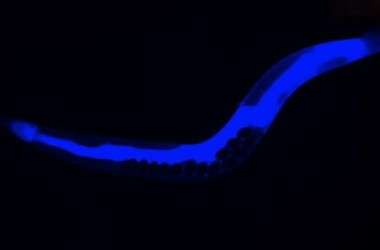
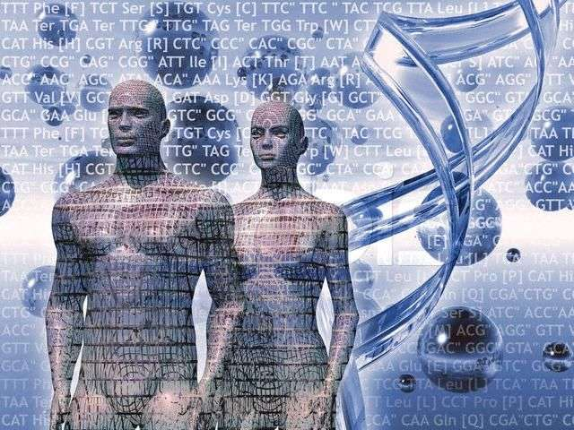

# Эрдэмтэд, үхлийг олж харж чаджээ

Английн эрдэмтэд, үхэж байгаа биеэс, хөхөлбөр туяатай долгион гарахыг дуран авайгаар ажиглан шуугиан тарьсан нээлт хийлээ гэж svit24.net мэдээлэв.

Энэ туршилтад, өт ашигласан бөгөөд уг туршилтын удирдагч, Лондоны их сургуулийн профессор Дэвид Джемс, амьд организмын өөрөө устах химийн замналыг, хөхөлбөр туяаны хэлбэрийн үед нь буулгаж авч чадлаа гэж цохон тэмдэглээд, “ Энэ туршилт нь, молекулууд гэмтэн хуралдсанаар, хөгшрөлт явагддаг гэсэн онолыг, эргэлзэхэд хүргэж байна. Бид, хөгшрөлт, үхлийн үеийн биологийн процессыг түлхүү судлахад анхаарч, аль болох удаашруулах, таслан зогсооход чиглэсэн ажиллагаа явуулахад анхаарах болно” гэж мэдэгджээ. Мөн өт хорхой болон хүний бие организмын, хөгшрөлт, үхэл хоорондоо зарчмын ялгаагүй гэсэн аж.

Тиймээс энэ салбарын мэргэжилтнүүд, энэ шинэ нээлтийг, хүний насыг уртасгахад тус болох, найдлага төрүүлсэн туршилт гэж үзэж байна.
