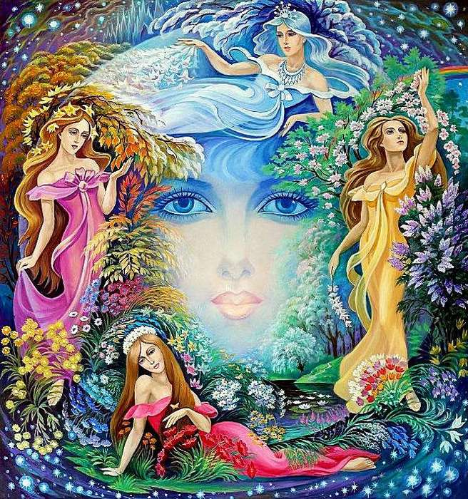

# Эрдэмтэд, хүний зан чанар тухайн төрсөн үеийн улиралтай нь холбоотой болохыг тогтоожээ

Хүүхдийн төрсөн улирал нь, тухайн хүүхдийн хувь хүний онцлогт тодорхой хэмжээний нөлөө үзүүлдэг гэж үзэж байна. Гэхдээ энэ нь, одон зурхайчидийн үздэгчилэн, тухайн удирлын од эрхэсийн байршилтай холбоогүй гэсэн бөгөөд судлаачид, олныг хамруулсан, оюутан сурагчид болон бүх насныхны зан чанар ба төрсөн улирлыг холбосон туршилт судалгаа явуулж, хэвлий дэх үр хөврөлд улиралуудын нөлөөлөх чадварын талаар ерөнхий дүгнэлт гаргахаар ажилласнаар, эхний урьдчилсан дүгнэлтүүд гараад байгаа аж. Хавар төрсөн хүүхдүүд Гипертимид өртөмтгий буюу ерөнхийдөө маш өөдрөг сэтгэлгээтэй, аливаа сөрөг зүйлсийг эерэг болгон харах, эерэг өөрчилөлтөд итгэдэг болох нь харагдав. Гэхдээ “Хаврын”-хан, хүнд хэлбэрийн сэтгэл гутралд автагдах магадлалтай болох нь мөн анзаарагджээ. Зун төрсөн хүүхдүүд, мөн хаврын хүүхдүүдтэй адил өөдрөг, гэхдээ сэтгэл санаа нь өөрчилөгдөмтгий, унах сэргэх нь хурдан боловч, энэ чанар нь бүгдийг нь хамарсан эмгэгийн хэмжээнд биш, жишээ нь 8 сарын хүүхдүүдэд энэ байдал огт ажиглагдахгүй байгаа нь судалгаагаар илэрч байв. Намрын хүүхдүүд бухимдуу байх магадлалтай ч, харин ургац хураах үед төрсөн хүүхдүүд сэтгэл гутралд ордоггүй, сэтгэхүйн ямар нэг эмгэгт өртдөггүй аж. Харин өвлийн улирлыг, төрөхөд таатай биш улирал гэж үзсэн бөгөөд, энэ үед төрсөн хүүхдүүд сэтгэц, сэтгэхүйн эмгэгт өртөмтгий гэж харагдсантай холбоотой аж. Гэхдээ өвлийн хүүхдүүд, намрынхантай харьцуулахад харьцангуй тайван, нухацтай болох нь ажиглагджээ. Мөн тэдний талаар дурдахгүй байж болохгүй нэг сайн тал нь, оюуны чадавхи өндөртэй байдгаас ихэнхи алдартнууд энэ улиралд төрсөн байдагтай холбон үзжээ. Гэвч, эрдэмтэд энэхүү судалгааны үр дүнг, хүний анхны суурь чанарыг ерөнхийлөн авч үзсэн дүгнэлт гэж үзэж байгаа бөгөөд хүүхэд төрснөөс хойш туулах амьдрал, төрсөн улирлаас хамаарахаас илүүтэйгээр хувь хүний зан чанарт ул мөр үлдээх чадвартай гэдгийг анхааруулан сануулсан байна.

