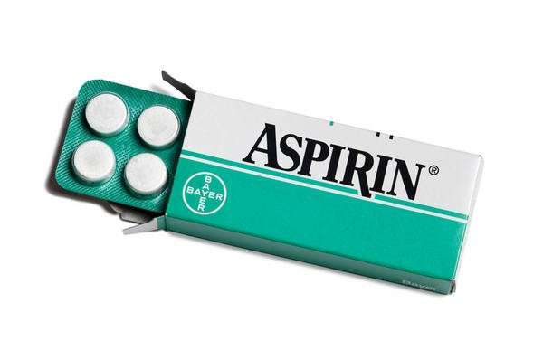

# Ердийн аспиринаар, цагаан өнгөтэй хувцасны өнгийг сэргээх арга

Цагаан өнгийн хувцас, өмсөх эдлэх явцад, шарлан эсвэл сааралтаж, өнгөө алддаг.

Үүнийг аптекийн ердийн аспириныг ашиглан цайруулж болох нь. Бусад зориулалтын цайруулагч бодисуудтай харьцуулахад найдвартай, хямд, үр дүнтэй байдаг байна. 5 ширхэг /325мг/ аспириныг, 6 литр халуун усанд найруулж, үүндээ цайруулах хувцсаа хийн 8 цаг дэвтээж орхино. Дараа нь угаалгын машиндаа, ердийн аргаар угаана. Угаах усандаа 3-4 ширхэг аспирин хийвэл мөн үр дүнтэй. Аспирины, сулхан хүчиллэг уусмал, цайруулахаас гадна толбо арилгах үйлчлэл үзүүлдэг байна.
