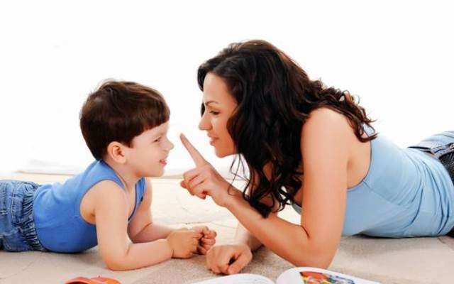

# Ердийн ба ухаантай ээж, аавуудын 7 ялгаа

1. Ердийн эцэг эхчүүд, өөрийн сонирхол, дуртай зүйлсээ хойш тавин хүүхэддээ хэт анхаарал тавьдаг. Харин ухаантай ээж аавууд, өөрийгөө орихгдуулахгүй, мөн хүүхдээ үүнд сургаж байдаг.
2. Энгийн ээж аавууд, хүүхдийнхээ гэрийн даалгаврыг хамт хийх нэртэй, бараг оройжингийн юм болдог. Ухаантай ээж аав, гэрийн даалгаврыг нь өөрт нь хариуцуулж, хариуцлагыг нь өөрөө үүрэх ёстойг ойлгуулна. Биеэ дааж хийж чадахгүй байгаа зүйлс дээр нь хийх аргыг нь заах маягаар тусалж байдаг.
3. Ихэнхи эцэг эхчүүд, амалсан зүйлээ биелүүлээгүй, эсвэл мартсан тохиолдолд хүүхэддээ бэлэг авч өгөх маягаар буруугаа цайруулж байдаг. Харин ухаалаг хүмүүс, хүүхэддээ бага хэмжээний мөнгө өгч зарцуулж сурахад нь тустай үйлдэл хийж, юунд зарцуулж буйг нь хянаж, чиглүүлж өгч байдаг.
4. Ээж аавууд ихэвчилэн, хүүхэд нь буруу зөрүү зүйл хийгээд байвал шалтгааныг нь олохын оронд, зүгээр сахилгажуулах арга хэмжээ аваад байдаг. Харин ухаалаг ээж аавууд, шалтгааныг нь олохыг хичээж, түүнийгээ шийдэхэд нь тусалдаг.
5. Ердийн эцэг эхчүүд, хүүхдээ амжилттай, нэр төртэй хүн болгож өсгөхийг эрмэлзэж байдаг. Ухаалаг эцэг эхчүүд, харин дотно, дулаан харьцаа тогтоохыг илүүтэй эрхэмлэдэг
6. Ихэнхи ээж аавууд, хүүхдээ янз бүрийн асуудлуудаас хамгаалж хаацайлж, хүсээгүй байхад нь ч оролцдог. Харин ухаалаг ээж аавууд, тодорхой хэмжээнд алдаа гаргах, түүнийгээ засах боломжуудыг олгож, түүнээс нь сургамж үлдээхийг хүсч байдаг.
7. Ердийн ээж аавууд, хүүхдээ уйлах, цухалдахад дургүй, уйлж орилох боломж өгдөггүй. Үүнийг нь хүүхдүүд ашиглаж байдаг. Харин ухаалаг ээж аав нар, хэзээ ч хүүхдээ тархин дээрээ гаргахгүй. Тэд, хүүхдийнхээсээ гадна өөрсдийнхөө ч орон зайд хүндэтгэлтэй ханддаг.

