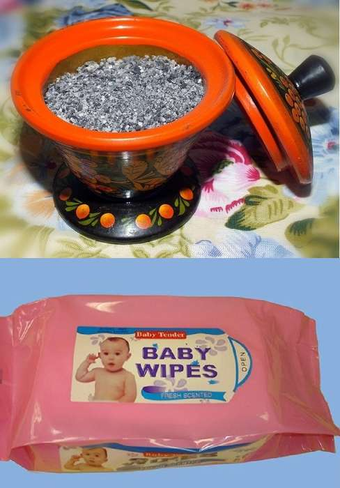

# Ердийн зүйлсийн ахуйд ашигтай гайхалтай хэрэглээ

-Хэрэглэсэн цайны пакет-эвгүй үнэр дарагч. Хөргөгч, шүүгээ, хайрцаг саванд хийхэд л болно\
-Корица хоол амтлагч, шоргоолжитсон газар цацахад, тэд ор мөргүй үргэнэ\
-Бананы хальсны дотор талаар төмөр эдлэлүүдийг өнгөлөхөд, ямар ч үнэтэй зориулалтын бодисоос дутахгүй өнгөлдөг\
-Шумуул хазсан газарт аспирин бутлаад түрхэхэд хазсан сорви үлдэхгүй\
-Шүдний оог, содоор орлуулж болдог\
-Арьсан гутлыг шинэ юм шиг болгохын тулд гарын тос түрхдэг. \
-Хүнсний тугалган цаасыг хайчлахад хайч ирлэгднэ\
-Хүүхдийн нойтон салфетка, гар утас, компьютер, хэрэгслүүдийг арчиж цэвэрлэхэд эвтэй байдаг\
-Модны шатсан нүүрс агаарыг сайн цэвэрлэдэг. Гоёмсог тавган дээр чимэглэл маягаар овоолоод тавиарай
