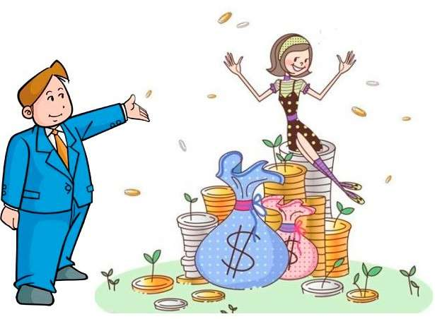

# Эрэгтэй хүнд үргэлж итгэх хэрэгтэй гэнэ шүү, хүүхнүүд ээ!

Эрэгтэй хүн, үргэлжид, найдвартай ар тал буюу “Та”, таныг байгаа гэдгийг мэдэж, мэдэрч байгаа тохиолдолд, ямар ч уулыг эргүүлж, агуу амжилтад хүрэх чадвартай байдаг гэнэ. Ер нь, амжилттай яваа эр хүн бүрийн ард, эмэгтэй хүн байдаг гэж зүгээр ч нэг ярьдаггүй байна. АНУ-ын ерөнхийлөгч Барак Обама эхнэртэйгээ нэгэн ресторанд ортол, тэр рестораны эзэн нь, эхнэр Мишелийнх нь, оюутан цагийнх нь үерхдэг байсан найз залуу нь байж таарчээ. Обама эхнэртээ, -Чи энэ залуутай суусан бол, одоо чи рестораны эзний эхнэр байх байжээ гэж тоглон хэлэхэд, Мишель, -Хэрэв би энэ залуутай суусан бол тэр өнөөдөр АНУ-ын ерөнхийлөгч байх байлаа гэж хариулсан гэдэг. Обама ч хүлээн зөвшөөрч таг болсон гэнэ. Иймэрхүү эр нөхрөө амжилтад залсан эхнэр байхын тулд яах ёстой байдаг юм бол? Нэг: Өөртөө байнга, би ямар эмэгтэй байвал, яавал, эр нөхөр минь хүчирхэг, амжилттай, өөртөө итгэлтэй, эрэлхэг хүн болж чадах вэ гэсэн асуултыг далд ухамсарынхаа түвшинд үргэлж тавьж, түүнийхээ хариултыг эрж хайж, олж, мөрдөж байх./эмэгтэйлэг эмэгтэй ямар байх ёстой вэ? биеэ яаж авч явах вэ? яаж ярьж байх вэ? ямар үйл хөдлөл гаргаж байх вэ г.м/ Хоёр: Хэт хянаж цагдах мөн хийсэн бүхнийг нь шүүмжилж голохоо болих, аливаад сэтгэл хангалуун бус байгаагаа илэрхийлэхгүй байх. Гурав: Өөрөө урдуур нь орж аливааг шийдэхийг оролдохоо, мөн өрсөлдөхөө болих. Бүхнийг өөрийнхөөрөө байлгах хүслээсээ салах. Дөрөв: Юбка өмссөн эрэгтэй хүн шиг байдаг зангаасаа салах. Та хэдийгээр, бүхнийг гартаа авч эрэгтэй хүн шиг байх чадах ч, харин эрэгтэй хүн, брюк өмссөн эмэгтэй хүн болохыг хэзээ ч хүсдэггүй. Чадсан ч, аз жаргалгүй амьдарч, найдваргүй гэр бүл үүсдэг. Тав: Эмэгтэй хүний харцнаас нь аз жаргал гийсэн, хосын зураг олж авч, нүдэнд тусах газар тавьж, харах болгондоо түүн шигээр өөрийгөө дүрсэлж байх. Энэхүү хэдхэн хялбар зүйлсийг гартаа оруулаад авчихвал та, эргэн тойрны тань бүх зүйлс, амьдрал гайхалтай өөрчилөгдөж, эр нөхөр тань, хүсэн хүлээсэн хүчирхэг, итгэлтэй, амжилттай эр хүн болон өөрчилөгдөхийг тун удахгүй харах болно.

