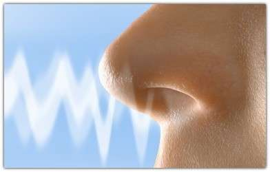

# Эрүүл мэнд, сэтгэл санаанд нөлөөлөх үнэрийн нөлөө

Үнэрийн ертөнц биднийг үргэлж хаана ч хүрээлж байдаг бөгөөд хүний эрүүл мэнд, сэтгэл санаанд байнга үйлчилж байдаг. Хүний хамраар хором бүрт олон арван өдөөгч үнэр ордог ч, тэдгээрээс тун бага үнэрүүдийг бид ухамсарын түвшинд ялгах чадвартай байдаг аж. Үнэрүүдийн ихэнхи нь далд ухамсрын түвшинд үйлчилдэг байна. Үнэрт үйлчилэл үзүүлдэг ухамсарын хариу үйлчилэл нь, бидний тархи гаднаас ирэх тоо томшгүй мэдээллийн урсгалаас компьютер мэт чухлыг нь ялган авч хариу үйлчилэл үзүүлэхийг хэлнэ. Эдгээр нь, бидний хоол хүнсний үнэр, муудсан зүйлийн үнэр, амь насанд аюултай үнэр, хорт хий зэргийг ялгах чадвар юм.

Түүнчлэн хүн баяр баясгалантай байхад тэмүүлж байдаг сэтгэлийн амьтан учираас, таатай мэдрэмж, сэтгэл хөдлөлөөр дүүрэн амьдрах дуртай байдаг бөгөөд үүнд тааламжтай үнэр гайхалтай нөлөөлж байдаг байна. Тиймээс хүн таатай үнэртэй орчинд байхыг таашааж, харин муу муухай үнэрээс зугтааж байдаг. Ой мод, цэцэгт нуга, хээр талд зугаалж, амарч байгаа үеийн хүний сэтгэл санаа эерэг, өөдрөг байдгийг мэдэхгүй хүн үгүй биз ээ. Харин муудсан ялзарсан үнэр, хөлс, хир, бохирын үнэр, утаа хиншүүний үнэр хүний сэтгэхүйд сөргөөр нөлөөлж, удаан хугацааны туршид үйлчилснээр эрүүл мэнд, сэтгэл санаанд маш муугаар нөлөөлдөг байна. Мөн зарим үнэрүүд, худалдаа наймаа, худалдан авалтын хэрэгцээг зохицуулахад нөлөөлдөг болохыг судалгаагаар тогтоосон байдаг бөгөөд, хүнсний дэлгүүрт шинэхэн талхны үнэрийг хиймлээр үнэртүүлэхэд тухайн дэлгүүрийн орлого ихээхэн нэмэгдэх байдал ажиглагдаж байдаг гэнэ. Япончууд худалдаа наймааны зорилгоор, жасмины үнэр, америкчууд грейфрукт, дундад азийнхан домогт пачулийн үнэрийг ашигладаг. Түүнчилэн, хүний тархины үйл ажиллагаа, оюуны идэвхижил, ажиллах чадварт нөлөөлөх үнэрийн эерэг үйлчилэл гайхалтай үр дүнтэй болохыг 1939 онд доктор Д.И.Шатенштейн шинжлэх ухааны үндэслэлтэй тогтоосон байна. Орчин үед, бизнес зорилгоор үнэрийн үйлчилэлийг өргөнөөр ашигладаг болсон бөгөөд Япончууд, ажилтан, ажилчидынхаа хөдөлмөрийн бүтээмжийг нэмэгдүүлэхийн тулд, ажилын байр, тасалгааны агааржуулалтын системийн төхөөрөмжид тодорхой үнэрүүдийг хийж үнэртүүлэх маягаар амжилттай хэрэгжүүлж байдаг. Мөн нэгэн барилгын корпораци, барилгын нийт талбайгаар үнэр тараах компьютерийн систем бүтээгээд ашиглаж байна. Энэхүү үнэрийн үйлчилэлийг ашиглах аргыг, ялангуяа нэгэн хэмийн ажил үүрэг гүйцэтгэдэг ажилтнуудтай байгууллага, үйлдвэрүүд ихээхэн ашигладаг байна. Японы “Сумуци” хэмээх компани, ажилчин, албан хаагчидаа эрч хүчээ сэргээхийн тулд орж үйлчилүүлэх зориулалтаар тусгай үнэрт өрөөг ажиллуулж, албан тасалгаанд нь тодорхой үнэрүүдийг үнэртүүлдэг. Хурал, зөвлөгөөний өмнө тухайн танхимдаа үнэр цацах, ууршуулах ажиллагаа явуулдаг гэнэ. Үүний үрээр, ажилтан албан хаагчидын гаргадаг ажлын алдаанууд, жасмин үнэртэх үед 3%, лаванда 20%, лимоны үнэртэй орчинд 54%-р буурдаг болохыг тогтоожээ. Мөн энэхүү 18 жилийн турш, бүх насныхныг хамруулан явуулсан судалгаагаар, лимон, эвкалиптын үнэр ядаргаа тайлж, мэдрэлийн системийг сэргээж оюуны чадавхийг сайжруулж, хөдөлмөрийн бүтээмжийг дээшлүүлдэг, розмарин танин мэдэх үйл ажиллааны явцыг өсгөх, ой санамжийг дээшлүүлэх, сарнай анхаарлыг хурдан төвлөрүүлэх, аливааг хурдан гүйцэтгэхэд хүргэх үйлчилэлтэй болох нь тогтоогджээ. Мөн тодорхой үнэрүүд тайвшруулах, стресс тайлах гайхалтай үр дүнтэй байсан байна.
