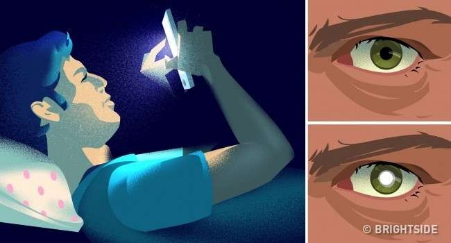
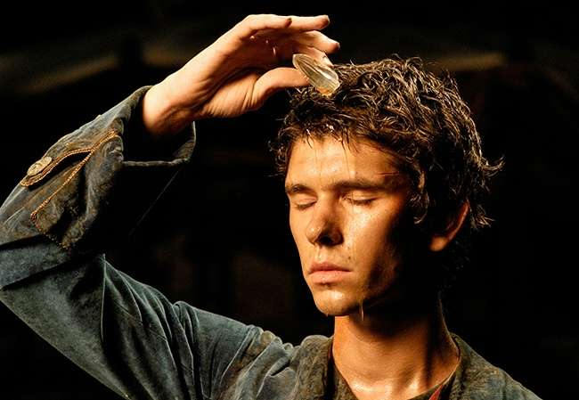
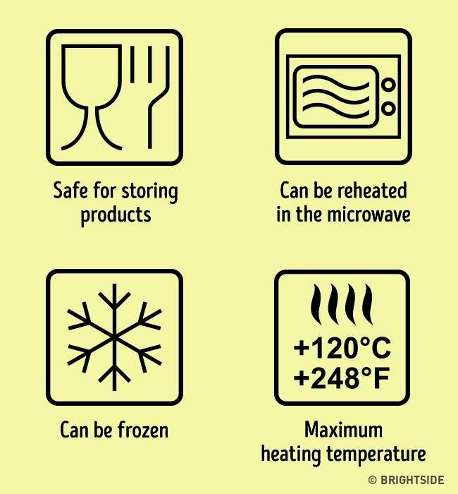
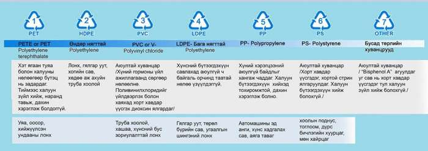
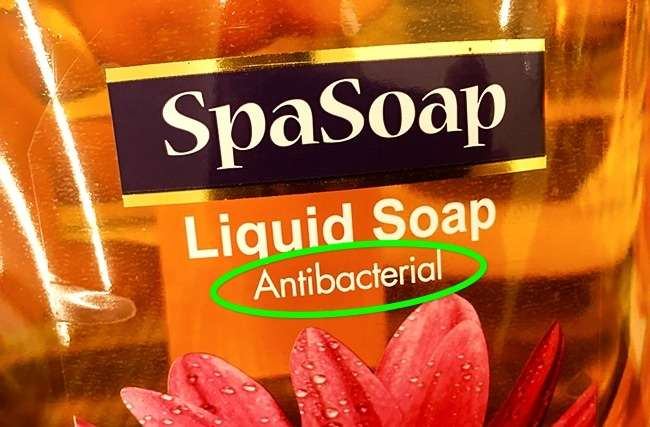
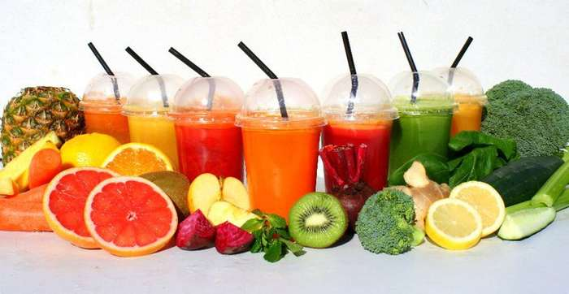

# Эрүүл мэндэд сөргөөр нөлөөлдөг 8 зуршил

Бидний өдөр тутамд хийдэг энгийн үйлдэл, зуршлууд нь бидний бие организмд нөлөөлж байдгийг та мэдэх үү? Хэрвээ бид эдгээр зуршлуудаа засаж чадвал эрүүл байх хамгийн энгийн алхам юм.

#### 1. Найтаах

Бид найтаах гэж байх үедээ, амаа дарах эсвэл хамраа чимхэж найтаахаас сэргийлэх нь тархины даралтыг ихээхэн өсгөдөг. Энэ үед тархинд ирдэг цусны эргэлт тасалдаж улмаар судас болон мэдрэлийн эд шахагддаг. Ингэснээр толгой өвдөж, сонсголын систем болон судсанд гэмтэл учруулдаг. Найтаахаа зогсоох нь энгийн мэт боловч, бидний бие организмийн хэвийн үйл ажиллагааг алдагдуулдаг.

---

#### 2. Сүрчиг хэрэглэх

Үнэртэй ус үйлдвэрлэгч нар байгалийн гаралтай үнэртүүлэгч /эфирийн тос/ ашиглахаас илүүтэй хямд болон илүү хүчтэй үнэр гаргадаг синтетик бодисыг сонгон ашигладаг. Эдгээр бодисууд нь хүний биед толгой эргэх, дотор муухайрах, нойр хүргэх зэрэг сөрөг талтай. Мөн нүд, хоолой болон арьсыг цочроодог. Эдгээрээс сэргийлэхийн тулд үнэртэй уснаас татгалзаж байгалийн гаралтай эфирйин тос ашиглах нь хамгийн тохиромжтой арга юм.

---

#### 3. Унтахаасаа өмнө утас ашиглах

Унтахаасаа өмнө эсвэл орондоо утасаа ашиглах нь нойр болон сэрүүн байх үеийг зохицуулдаг мелотонин гэх дааврын ялгаралтыг бууруулдаг. Ингэснээр нойргүйдэл, сэтгэл гутрал, хорт хавдар, хэт таргалалт, зүрх судасны өвчин, дархлааны систем буурах үндсэн шалтгаан болдог. Утсаа унтраагаад, эрт унтах нь эрүүл мэндэд тустай сонголт юм.

---

#### 4. Хоол хүнсээ хуванцар саванд хадгалах

Ихэнхи хуванцар сав уян хатан байлгах шинж чанартай фталат болон бисфенол гэх бодисуудыг агуулсан байдаг. Удаан хугацаагаар хоол хүнс хадгалахад эдгээр бодисууд нь хоол хүнсэнд шингэдэг. Эдгээр бодисууд нь дотоод шүүрлийн системд нөлөөлдөг. Үүний оронд шил, зэвэрдэггүй ган эсвэл керамик материалаар хийсэн сав сонгох нь зөв. Түүнчлэн хуванцар саван дээрх тэмдэглэгээг анхаарч, хэрэглээндээ тохирсон савыг сонгоорой.

---

---

#### 5. Хооллосны дараа шүдээ шууд угаах

Шүдний эмч нар хоол идсэнийхээ дараа дор хаяж 30 минутын дараа шүдээ угаах нь тохиромжтой хэмээн зөвлөж байна. Хэрэв боломжтой бол цагийн дараа угаах нь илүү сайн. Хоол хүнс, ялангуяа хүчиллэг хоол хүнс /лимон, улаан лооль, жүрж, ханборгоцой/ нь шүдний пааланд тогтдог. Хүчиллэг хоол идсэнийхээ дараа шууд угаах нь пааланг гэмтээдэг.

---

#### 6. Бактерийн эсрэг саван байнга ашиглах

Бие организмд сөрөг нөлөө үзүүлдэг маш олон төрлийн бактер бидний арьсан дээр байдаг. Эдгээр бактерийг утгахын тулд бактерийн эсрэг саван ашиглах нь зөв боловч байнга хэрэглэснээр бидний дархлааг хамгаалдаг ашигтай бактеруудийг ч мөн устгаж байдаг гэдгийг анхаарах хэрэгтэй. Долоо хоногт бактерийн эсрэг саванг хоёроос дээш ашиглах хэрэггүй.

---

#### 7. Хэт бариу жинс өмсөх

Сүүлийн жилүүдэд залуучууд бариу өмд ихээр өмсөх болсон. Гэвч энэ нь сөрөг талтай. Эмч нар хэт бариу өмд өмсөх нь эрүүл мэндэд сөргөөр нөлөөлдөгийг анхааруулж байна.

---

#### 8. Шинэхэн шүүс уух

Хүн бүр шинэхэн шүүсийг эрүүл мэндэд сайн гэж боддог. Гэсэн хэдий ч, зарим өвчтэй хүмүүст энэ нь эсрэгээрээ үйлчилж болно. Жишээлбэл, чихрийн шижин болон илүүдэл жинтэй хүмүүст усан үзмийн шүүс нь тохиромжгүй. Түүнчлэн, зарим шүүс харшил өгч болзошгүй байдаг. Хүүхдэд шинэ шүүс шахаж өгөхдөө анхааралтай хандах нь зүйтэй.
