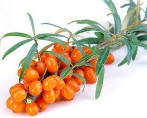

# Эрүүлээр турахад тустай арга

Илүүдэл жингээс салахад тань, амтлаг гурилан бүтээгдэхүүн, чихэр, шоколад, амттан идэх хорхой хүрэм хүсэл үргэлж саад болж байдаг. Тэгвэл, энэ “хөөрхөн” хүслийг тань, хоёрхон “гоё” хүнс хэрэглэснээр дарж болно

. Амттан идэхээ больсноор, аюултай илчлэг үгүй болж, эрүүлээр турж эхэлдэг. Энэ хоёр хүнс маань, ердөө л, гарын доорх, тараг, чацаргана. Бидний, нүүрс усны солилцоонд олон төрлийн эрдэс бодисууд оролцож, үйлчилж байдаг бөгөөд хэрэв организмд кальци, хром хоёр хангалттай байвал, организм хураасан өөхөө дахин боловсруулж, гаднаас нүүрс ус нэхэхээ больдог гэнэ. Кальци нь, тарганд ихээр агуулагддаг, харин чацаргана хромоор маш баялаг байдаг байна. Мөн, кальци, хром нь, бэлдмэлээр, эмийн сангуудад худалдаалагддаг. Аль аль нь хэрэглэхэд үр дүнтэй, харин би, байгалийн гаралтай бүтээгдэхүүн үнэлдэг, тиймээс, эхнийхийг нь сонгосон шүү.
