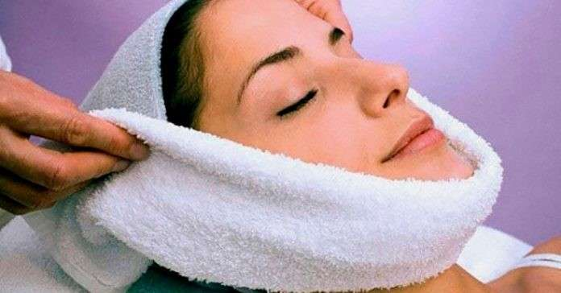
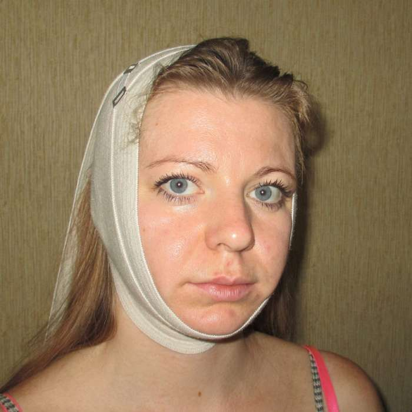

# Эрүүний суларсан арьс давхар эрүүг арилгах арга

Энэ аргыг франц боолтын арга гэдэг. Үр дүн нь, 2 удаа, боолт хийсний дараа илт мэдэгддэг. Гэрийн нөхцөлд өөрөө хийж болдог гайхалтай арга бөгөөд унжсан булчинг чангалж, нүүрний хэлбэрийг V хэлбэртэй болгож, хялгасан үрчлээсүүдийг арилгана. Энэ аргыг франц эмэгтэйчүүд, Людовик XIV хааны үеэс хэрэглэж ирснээс, “франц гоо сайхны боолт” гэж нэрлэгджээ.

-1 стакан халуун бүлээн ус\
-1 цайны халбага далайн давс\
- өргөн бинт буюу эмнэлгийн боолтын марль\
-уян, резинэн бинт, эсвэл гоо сайхны зориулалтын боолт. /гоо сайхны хагалгааны дараа хэрэглэгддэг/\
Боолтыг хийх арга:\
-бинтээ, эрүүг тойруулах урттай, 5-6 давхарлаж бэлдээд, түүнийгээ давстай усандаа дүрж бага зэрэг усыг нь базаад, эрүүний доод талаар түвэнх хүртэл, боломжоор нь хацраа оруулан тавьж, уян бинтээрээ толгойн оройгоор ороон, дээш нь татаж, дахин ороохдоо, дагз руу татаж бооно. Хэвтээ байрлалд хийхэд эвтэй байдаг. Мөн, хэт чанга цусны эргэлтэд саад болохооргүй байх хэрэгтэй. Цаг орчим байлгаад авч, хүйтэн бүлээн усаар тэр хэсгээ угаана. Эхлээд, “эмчилгээ” маягаар, 10 өдөр дараалан хийгээд, дараа нь үр дүнгээ хадгалахын тулд долоо хоногт 1-2 удаа хийж байх хэрэгтэй байдаг. далайн давс болон энэхүү таталт гайхалтай үр дүнд хүргэдэг. Энэ арга нь хийсэн хүн бүхний сэтгэлд хүрдэг сайн арга гэнэ.
