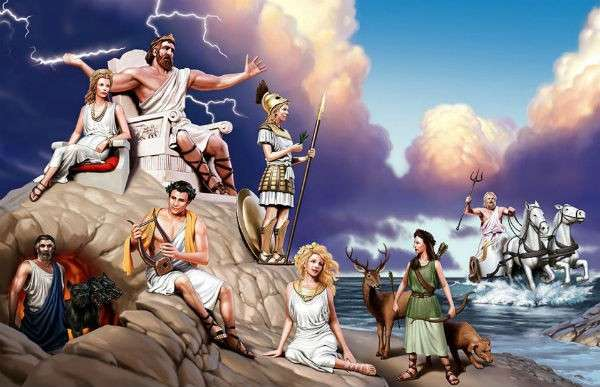
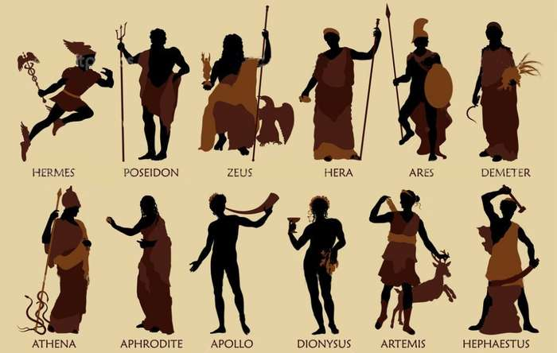

# Эртний грекийн бурхадын зурхай

Эртний грекчүүд , хүний хувь тавиланг, оддыг харгалздаг бурхадтай холбон тодорхойлж болно гэж итгэсээр иржээ. Тиймээс бурхадын түүх домгууд дээр суурилсан энэхүү грекийн зурхай байдаг байна. Одон зурхай учраас, ордуудын үргэлжлэх цаг хугацааны хувьд бараг ижил, нэр нь л өөр байдаг нь ромчууд, эртний грекийн одон зурхайн мэдлэгийг өрнөдийн зурхайд ашигласан гэж үздэг аж. Ингээд өөрсдийнхөө ордын Грек бурхад болон хувь заяа, авъяас чадвараа мэдэж авцгаая.

#### Шар шувуу /21.03-20.04/

Шар шувуу нь Афин бурханы билэг тэмдэг. Энэ хугацаанд төрсөн хүмүүсийг Афин бурхан тэтгэдэг гэнэ. Афиныг Аянгын бурхан Зевсийн толгойноос төрсөн гэдэг бөгөөд Зевсийн оюун санаа гэж үздэг ажээ. Тиймээс грекчүүд энэ ордны хүмүүсийг мэргэн цэцэн, бодсоноо биелүүлэх чадвартай гэж үздэг. Мөн маш зоримог, өндөр үнэлэмжит төгс төгөлдөрийг бий болгохын төлөө тэмцэгч байх авъяас чадварыг Афин бурхан тэдэнд өгдөг.

#### Тагтаа /21.04-20.05/

Тагтаа нь гоо үзэсгэлэн, хайр дурлалын бурхан Афродитагийн билэг тэмдэг аж. Афродитаг Зевс бурханаас ч эртний бурхан гэж үздэг бөгөөд хорвоо ертөнцийг бүхэлд нь сансар огторгуйн хүчээр хайраар тэтгэж байдаг. Түүний өлмий дор бүх бурхад, хүн төрөлхтөн, байгал дэлхий сөхөрдөг. Тэрээр өөрийн ордын хүмүүст эрх мэдэл, төгс төгөлдөр харьцаа, эд баялаг, гоо үзэсгэлэнг харамгүй өгдөг.

#### Лира /21.05-21.06/

Энэхүү хөгжмийн зэмсэг нь нарны бурхан , урлагийн шүтээн Апполлон бурханд зориулагдсан. Энэ эрх дураараа бурхан, хүнд, нэг гараараа авъяас билэг, нөгөө гараараа доройтлыг ч өгч чаддаг гэх бөгөөд тэр өвчнийг илааршуулах, эсвэл өвчин илгээх аль алийг нь хийдэг гэх. Тиймээс энэ сарын хүмүүс сэтгэл санааны зөрчилтэй байх магадлалтай байх ба хэрэв аливаад хөнгөмсөг хандахгүй, зорилгоо бүрэн тодорхойлж чаддаг бол агуу зүйлсийг бүтээх чадварыг Апполлон өгдөг аж.

#### Яст мэлхий /21.06-22.07/

Яст мэлхийг Гермес бурханы сүлд гэж үздэг. Энэ билэгдэл нь бурхадын тайлагдашгүй нууцлаг чанарыг харуулдаг. Гермес бурхан, бурхадын ертөнцийг үхэгсэд ба хүний ертөнцтэй холбож байдаг гэх бөгөөд өөрийн шидэт таягаараа дохин хүмүүст зүүд, зөн билгийг өгдөг гэнэ. Өөрийн ордынхонд зөн совин, болох гэж буй зүйлсийг урьдчилан харах чадварыг харамгүй өгч байдаг гэдэг. Эдгээр ордынхон хүчтэй, хүссэндээ хүрдэг нууцлаг тайван хүмүүс.

#### Бүргэд /23.07-23.08/

Бурхадын хаан Зевсийн шувуу. Зевс бурхан нь бурхад болон хүмүүсийн эцэг, бүхий л сайн сайхан, мөн бүх гай зовлонг эрхшээгч юм. Бурхадын хааны эрх мэдлээ, тэр урдны бурхадын аймшигт харын хүчүүдийг дийлж байж авсан гэх бөгөөд ертөнцөд эв нэгдэл, үр удам, баяр баясгалан, хүн чанар ичгүүр зэргийг өгсөн гэдэг. Өөрийнхөө бүтээлүүдийн хувь тавиланг алтан жинлүүрээр хэмждэг гэнэ. Энэ сард төрсөн хүмүүст сайхан сэтгэл, шударга занг өгдөг бөгөөд хэрэв хүн өөрийн алхам бүрээ хянаад байвал мөн эрх мэдлийг өгдөг байна.

#### Хайрцаг /24.08-23.09/

Энэ бол Деметра бурханы өмч. Деметра гэх үг нь газар гэсэн үг аж. Энэ бурханыг үр жимс бэлэглэгч, хэв журам тогтоогч, үр хүүхдээ хамгаалагч эхийн бурхан гэж үздэг. Энэ ордод төрсөн хүмүүс аж ахуйч, зохион байгуулах авъяас чадвартай, шударга байдаг. Тэд Деметра бурханы адил үр хүүхэд, гэр орондоо хайртай байдаг.

#### Дуулга /24.09-23.10/

Бурхадын дархан Гефестийн дуулга. Эрэлхэг Гефест, бурхадын хамгийн хүнд бэрхийг гүйцэтгэн Зевс бурханы аянган илдийг, Пандорагийн гайхамшигт хайрцгийг урласан гэдэг. Гефест хүмүүст ур чадвар өгдөг. Өөрийнхөө хүмүүст ертөнцийн амьдралыг бурхадын ертөнцрүү дөхүүлэх шинэ шинэ төгс төгөлдөр зүйлсийг бүтээх, бусдыг үлгэрлэх сайхан чадваруудыг өгдөг. Аливаад нөр их зүтгэлээр хүрэх магадлалтай. Тэд хэзээ ч залхуурч болохгүй.

#### Чоно /24.10-22.11/

Дайны бурхан Арест энэ цаг үе хамаарна. Тэр үхэл, сүйрлийг авчирах боловч Афродитаг хайрладаг. Тэдний дундаас гармония ба Эрос /хайр/, Фобос /айдас/, Деймос /аймшиг/ гэх хүүхдүүд төрсөн. Арес бурхан өөрийн хүмүүстээ аз жаргал, дур тачаал, мөн бүхнийг замаасаа арчин зайлуулах хүч чадлыг өгсөн. Энэ сарынхан амжилтад хүрэхийн тулд гэр бүлийн аз жаргалтай байх ёстой байдаг.

#### Анч нохой /23.11-21.12/

Ангийн бурхан Артемидагийн ноход. Аполлон бурханы ихрийн өрөөсөн, эмэгтэй бурхан. Эдгээр бурхадын харгалздаг сарууд жилийг хоёр хуваадаг гэдэг. Артемида бурхан бол, байгал дэлхий, хүмүүс бүр бурхадын уул Олимпынхоо шударга ёс хэв журам сахиулагч. Энэ бурханд эрхшээгч хүмүүс оюунлаг, оюун ухааны багш, маш зарчимч, өөрийн төгс үзэл бодлынхоо төлөө хүнд бэрхийг даван туулах чадвартай байдаг. Мөн тэд Артемида бурханыхаа адил аялах, зэрлэг аглаг байгалд дуртай.

#### Гэрэлтүүлэгч /22.12-20.01/

Бурхадын хаан Зевсийн эгч Гестиягийн билэгдэл . Гестия бурхан нь бурхадын ертөнц, хүний ертөнц, гэр бүлийн холбоог нэгтгэх мөнхийн галын эзэн. Энэ галыг улс орны агуу хүч, тогтвортой байдлын төлөө эртний грекийн сүм дуганад асаадаг байжээ. Энэ хугацаанд төрсөн хүмүүст бусдыг гэгээрүүлэх, төгс төгөлдөрийг бий болгох, эхэлсэн ажлаа төгс гүйцэтгэх чадвар уламжилсан байдаг. Гестия нь өөрийн хүмүүсийн заримыг дуу цөөтэй суурьтай болгодог. Эдгээр хүмүүст, аливаа зүйлийн тайлагдашгүй нууцлаг мөн чанарыг тайлах харах мэдрэх чадварыг харамгүй өгсөн байдаг.

#### Тогос /21.01-19.02/

Зевс бурханы гэргий Герагийн хайртай шувуу. Энэ эмэгтэй бурхан, өөрийн нөхрийн эсрэг биеэ даах, хамааралгүй байхын төлөө тэмцэлдэж, хардалт сэрдэлтийн олон тэмцэл явуулдаг байсан гэдэг. Энэ сарын хүмүүс эрх чөлөөнд дуртай, зоримог. Гера бурхан нь хот суурин газрын хотын хүмүүсийн бурхан. Өөрийн хүмүүстээ Гера бурхан чөлөөт сэтгэлгээ, үл хамаарал, шинийг санаачлах чадвар, гэнэтийн зүйлд бэлэн байх чадвар, их хотын амьдралд дуртай байх чанар зэргийг өгдөг аж. Тэд зальжин.

#### Далайн гахай /20.02-20.03/

Зевс бурханы ах, лусын хаан Посейдоны албатууд. Посейдон газрын гүн, ашигт малтмал, далайн ёроолын эзэн. Хэрэв энэ ордод төрсөн хүн Посейдон бурханы таалалд нийцэж байвал, тэр бүх хүслийг нь биелүүлж өгдөг. Яг л, хүн сайхан зантай байгаа үедээ хүнд тусалж баярлуулдагийн адил. Мөн, Посейдон бурхан, өөрийнхөндөө, ертөнцийг гүн гүнзгий хүлээж авах, өөрийн дотоод нууц дүрмээр амьдрах, бусдад нөлөөлөх чадвар зэргийг харамгүй өгсөн байдаг. Тэд өөрсдийн лусын хаан шигээ, амьдрал нь далайн шуурга мэт эсвэл хамгийн намуун гэх зэрэг, өөрсдийнх нь сэтгэл санааны байдлаас нь болж янз бүр байх нь бий.
