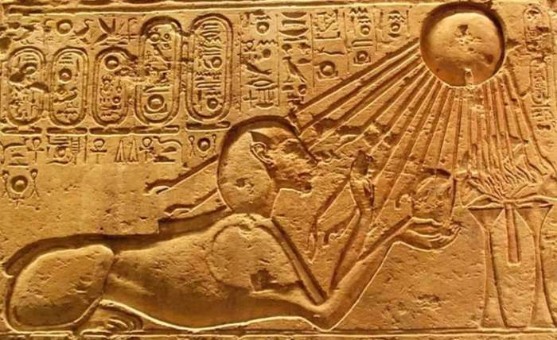

# Эртний хүмүүсийн  авъяас чадвар, оюун сэтгэхүйгээ хөгжүүлдэг байсан арга

Энэхүү аргыг “нартай ширтэлцэх” гэж нэрлэдэг бөгөөд эртний хүмүүсийн дунд ихээхэн дэлгэрсэн байсан гэдэг. Майя омгийн индианчууд, эртний египетчүүд, энэтхэгчүүд зэрэг олон эртний улс үндэстэнүүд нарны хүчинд туйлаас итгэдэг байсан бөгөөд тэд, нар, нарны туяаг өвчин эмгэгийг анагаах, хоол хүнсийг орлох, оюун ухаан, зөн билгийн авъяасыг хөгжүүлэх чадвартай гэж үздэг байжээ. Энэ нь шинжлэх ухааны уран зөгнөл мэт, хачин санагдах хэдий ч, тэр үеийн түүхэнд нэр нь үлдсэн ухаантан мэргэд онцгой сонин, гойд чадваруудтай байсан гэж тэмдэглэгдэн үлдсэн байдаг гэнэ. Энэ арга нь, үүр цайх үед мандаж буй нар, мөн шингэх үеийн нарыг 10 секундээс эхлэн өдөр бүр хугацааг уртасгах маягаар ширтэх маягаар гүйцэтгэгддэг байна. Энэ үедээ, хөл нүцгэн газар дээр зогссон байх ёстой байдаг. Энэ аргын үр нөлөөллийг эрдэмтэн мэргэд үгүйсгэдэггүй бөгөөд домогт Никола Тесла хүлээн зөвшөөрч, бие мах бодын хоол хүнснээс авах энергийг нар, орчиноос авч болно гэж үзэж байжээ. Мөн энэ аргыг, Хита Ратан Манек гэгч, НАСА-н хяналт дор өөр дээрээ туршиснаар “ХРМ” гэсэн шинжлэх ухааны нэршилтэй болсон байна. Энэ туршилтаар, энэхүү арга нь, боргоцой булчирхайн /эпифиз/ энерги өсгөх үйлчилэлтэй мелатонин, серотин дааврын ялгаруулалтыг өсгөдөг. Нас явахын хирээр агшиж жижгэрдэг боргоцой булчирхайг томруулдаг. Оюун ухаан болоод бие мах бодын тэжээл болох боломжтой энергийн эх үүсвэр болдог. Эрүүл мэнддээ хор нөлөөгүйгээр биеийн жингээ хасах боломж олгодог гэсэн олон эерэг үр дүнг харуулсан аж.

Шинжлэх ухааны үүднээс харсан ч, орчин үеийн хүмүүс, асар баялаг өнгөрсөн үе, арвин их мэдлэг бүхий өмнөх үеийнхнийхээ туршлага болон ёс заншил, зан үйлийг анхаарах, сонирхох, сонсч мэдсэнээ судлах, нягтлах үүрэгтэйн нэг жишээ энэ буюу.

