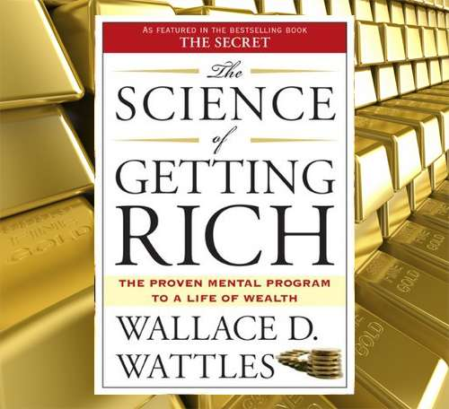

# Ертөнцийн эд баялаг, бүхэнд хүрэлцэхүйц хангалттай байдаг

Өдөр бүр, энэ дэлхийн сая сая хүн “хэрхэн баяжих вэ?” гэсэн асуултыг тавьж, бодож толгойгоо гашилгаж байдаг гэхэд хилсдэхгүй. Энэ асуултын жинхэнэ хариултыг мэддэг хүнийг Уоллес Делоис Уотлз гэдэг байсан бөгөөд тэрээр, 1910 онд яг дээрх асуултын адил нэртэй ном хэвлүүлж, орчин үеийн хамгийн их моодонд ороод байгаа бодит зүйлсийн трансформинг, эд баялагийн төсөөлөл зэрэг аргуудыг, тэр үед, номондоо, нарийвчлан шинжилсэн судалгааны аргаар зөвлөгөө болгон үлдээсэн ажээ. Түүний судалгааны ажлын, энэхүү арга зөвлөгөөнүүд, амьдралд хэргэжүүлэхэд хялбар, маш энгийнээрээ гайхагддаг, итгэмээргүй боловч үр дүнг нь хэн ч үгүйсгэдэггүй гэнэ.

-Загас байхгүй нуурнаас, загас барихаар зорьдоггүйтэй адил, өөрт танил, ойр орчин, хүрээлэлд зориулсан бизнес хийвэл ашиг олно\
-Шударга бус бизнесээс зайлсхий\
-Хэрэв танд, тодорхой хэмжээний мөнгө, үнэт зүйлс хэрэгтэй байгаа бол, тэдгээр зүйлсийг өөрт чинь байгаа юм шиг байдалтай байж, хүмүүстэй харьцах харьцаандаа харуул эсвэл тэдгээрийг танд илгээчихсэн түүнийгээ авахыг хүлээж байгаа юм шиг байж сур\
-Баян, чинээлэг хүмүүсийг, бүр авлига авдаг хүмүүсийг ч бүү зүх. Тэдний хүчээр их мөнгө эргэж, амьдрал өрнөж, хүмүүс мөнгө хийдэг\
-“Эд баялаг, элбэг хангалуун байдал хаана байна, байхгүй”, гэх мэт бодлыг хэзээ ч бүү сэтгэлдээ тээ. Ертөнцийн эд баялаг хязгааргүй бөгөөд түүний, ёроолгүй гүн эд баялаг, элбэг хангалууны худгаас, баялаг чинээлэг байдлыг чадварлагаар шавхан авах аргыг эзэмших зөвлөгөөг та, уншиж байна\
-Мөнгөний зориулалт тань, ойр тойрныхноо баярлуулах, бэлэг өгөх, хайртай дотны хүмүүсээ баярлуулах, эргэн тойрноо гоё сайхан болгох гэх мэт зүйлст зарцуулахыг эрхэмлэж байгаа бол баялаг зайлшгүй ирнэ\
Эдгээр зөвлөмжийг мөрдөж, хичнээн хүн баян болсон нь тодорхойгүй боловч ямартаа ч энэ аргуудыг зохиогч, өөрөө, америкийн хамгийн баян хүмүүсийн тоонд орж чадсан гэдэг. Баян хүмүүс, баяжуулдаг ямар нэгэн тайлагдашгүй мэдрэмж зөн совинтой байдаг гэх бөгөөд тэрхүү мэдрэмж нь хүчтэй төсөөлөлтэй болгож, төсөөлөл нь бодитжих процесс явагддаг гэж уг номондоо дурджээ. Мөн мөнгөний тухай сонирхолтой жишээнүүдийг тусгасан байдаг гэнэ. “Мөнгө үнэргүй” –эртний Римийн император Веспасиан, төлбөртэй жорлон гаргаж улсын сандаа ашигтай зүйл хийсэн боловч, хааны нэр гутаасан гэж буруутгагдаж байсан аж. Үүнийг, мөнгө үнэргүй гэдэг тодорхойлолтод ашигласнаараа, аливаа зүйлээс олсон мөнгө хаанаас яаж ирсэн нь мэдэгдэхгүй, хамаагүй гэдэгтэй холбож үзсэн бололтой. Сүүлийн үеийн судалгаагаар, мөнгийг сэтгэхүйн маш сайн өдөөгч, өвчинийг ч дарах чадвартай, хагацал зовлонг хөнгөвчилдөг гэсэн дүгнэлтийг хэсэг сэтгэл судлаачид гарган нотолсон байна.
