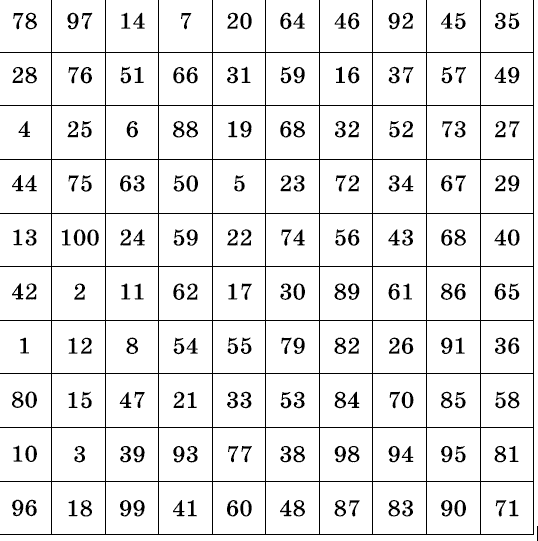

# Ертөнцийн нууц хүч, асуултад тань, хариулах боломжийг олго

Нүдээ аниад, асуултдаа анхааарлаа төвлөрүүлж, хүснэгт дэх тоонуудын нэг дээр дарж, харгалзах хариултыг уншаарай.

---

Тоонуудын утга:\
1. Таны өмнө зорилгодоо хүрэх шулуун зам байна. Бодсон бүр тань биелнэ. \
2. Хэрэгтэй хүмүүс эсвэл азтай тохиолдол, хүссэндээ хүрэхэд тань тусална\
3. Ар араасаа гарах саад бэрхшээл, төлөвлөснөө биелүүлэхэд тань саад болох нь, бүх зүйл цаг хугацаатай\
4. Зорилго тань таны хүчин зүтгэлээс хамаарч байна. Тэвчээр тань хүрэх юм бол амжилт магадлалтай\
5. Мэдлэгээ өсгө. Энэ үед танд түүнээс илүү хэрэгтэй зүйл алга байна\
6. Та, алхам алхмаар зорилго руугаа дөхөж байна. Таны хувьд нөхцөл байдал, “удаан явбал хол явна” гэсэн үгтэй дүйхээр байна. \
7. Түр зуурын бэрхшээл. Нэр төрөө хамгаалан, зорилгоосоо бүү няцаарай\
8. Байр байдал тань аятайхан байна. Төлөвлөсөнд тань саад болох багахан зүйлсийг давж гарах хүчээ хуримтлуул\
9. Тэвчээртэй байвал, хүссэн болгондоо хүрнэ. Яарч хэрэггүй\
10. Зөвхөн өөртөө найдаарай. Хөндлөнгийн тусламж, хариу нэхсэн тус байх болно\
11. Та, бүхнийг хожно. Таны бодоогүй цаг үед, ирэх жинхэнэ гэнэтийн бэлэг гэсэн үг. \
12. Хүчээ буруу тооцоолохоос болгоомжил\
13. Бие, сэтгэлийн ядаргаанаас болгоомжил. Төлөвлөсөн тань бага зэрэг хойшлогдно\
14. Тайван байгаарай. Бүх зүйл хэрэгтэй хугацаандаа болно. Одоохондоо, амьдрал ахуй, өдөр тутмын асуудлуудаа оролд\
15. Одоохондоо, төлөвлөснөө гүйцээх гэж хэрэггүй. Ганцаардна\
16. Толгойдоо орсон бүхнийг биелүүлэх өргөн боломж байна\
17. Энэ зүйлийг үнэхээр хүсч байна уу, гэдгээ дахин сайн бодоорой\
18. Мухардах магадлал. Тайван хүлээ, аясын салхийг\
19. Амьдралын шинэ шатанд хүргэх амжилт, зөвхөн танаас, өөрөөс тань шалтгаална. Ертөнц танд, боломж хайрлаж байна, бүү алдаарай\
20. Хүмүүс болон ертөнцтэй харилцах харилцаа тань тэнцвэртэй. Сайн үйлс хий, хэд дахин нугарч буцаж ирэхээр байна\
21. Төлөвлөснийг тань, өөрчилж, цоо шинэ боломж сонирхол өгөх нь\
22. Хувиа бодох асуудлаа хойш нь тавьж, хамтын ажиллагаанаас хожно. \
23. Бүх зүйлс хүссэнээр тань биелэж, танд болон хамт буй хүмүүст тань үр ашгаа өгнө\
24. Зөвхөн төсөөлөл мэт байгаа санаа тань бодит болох боломж байна\
25. Төлөвлөгөө, биелэлт хоёр зөрчилтэй. Зорьсондоо хүрэх хамгийн найдвартай замыг эрж хай\
26. Амьдрал тань, гэр бүлийн сонирхолд зориулагдна. Энэ хугацааг алдсанд бүү тооцоорой. Гэр бүлдээ нэр хүнд авах нь бас л чухал асуудал шүү\
27. Урагшлахдаа хэрэгтэй мэдлэг, туршлага хуримтлуул. Өөрийгөө боловсруулах цаг\
28. Өөдрөг “шинэ” үзэл бодол тань, зарим тооцоологдоогүй зүйлсийг засна\
29. Ажлаа амжилттай явуулахад, бусад хүмүүстэй харилцах харилцаа тустай. Ажил хэргийн болон найз нөхдийн бат холбоог бий болгож сур\
30. Хүмүүст хандах ухаалаг хандлага тань, их амжилтад хүргэнэ. \
31. Хамгийн биелэшгүй зорилтуудаа биелүүлэх цаг иржээ\
32. Амьдралаа өөрчилж хямралаас гарах гарц хайх цаг болжээ. Удалгүй байдал сайжирна\
33. Өөртөө болон бусдад итгэхгүй байгаа байдал тань, ажил, амжилтыг тань чөдөрлөж байна. Зогсонги. \
34. Мөрөөдөл биелэхэд хугацаа хэрэгтэй байна. Санаснаасаа их зүтгэл гаргах болох нь\
35. Зөрчилтэй. Хүссэндээ хүрэхээр улайрвал, урд нь олсныгоо алдах магадлалтай\
36. Таны амжилт, урагшлалт атаархал төрүүлэхээр байна. Атаархал нь хов живнээс хэтрэхгүй. Урагшил\
37. Бүх зарлагаа гартаа авч хяна. Дараа нь харамсав\
38. Санаачлага, биеэ даасан байдал, ажил хэрэгч байдлаа эрчимжүүлвэл, хүсэл тань биелэнэ\
39. Хэрэгцээтэй мэдээлэл ирнэ\
40. Гаргасан цаг хугацаа, хүч хөдөлмөрийн хэмжээнээс амжилт тань шалтгаална\
41. Ажил хэргээ яаралгүй аясаар нь явуул\
42. Тодорхойгүй цаг үе. Төлөвлөгөөгөө тодорхой болгож, сайтар мөрд\
43. Их хэмжээний мөнгө үрэх нь. Бусдын зөвлөгөө, ятгалгад авталгүй, өөрийнхөө зөн совинг сонс\
44. Ойрын ирээдүйд санаа зовох зүйл алга. Бүх ажил хэрэг тань тодорхой, биелэлт нь сайн\
45. Баярлаж баясах цаг\
46. Өөрийнхөө шаардлага хэрэгцээг даруу байлгавал, хүссэндээ хүрнэ\
47. Таны, аялал, томилолт төлөвлөсөнд тань хэрэгцээт зүйлсийг өгч үр ашигтай байх ба албан тушаал дэвших боломж гарч ирж байна\
48. Та, зүтгэл, сэтгэл зүрх, хөдөлмөрч, сахилга баттай зангийнхаа үр шимийг хувь заяанаас, хангалттай хүртнэ. \
49. Хувь заяандаа итгэн урсгалаар нь хөв. Хүссэнд тань хүргэж өгөх нь\
50. Одоо итгэхгүй болгоомжлоод байгаа зүйлс, таны хувьд ашигтай эргэнэ\
51. Ажил үйлс тань бодсоноос тань хурдтай явагдах тул хоцрохгүйг хичээ\
52. Бодит байдлыг хийсвэр хүлээж аваад байна. Аливааг олон талаас нь харах чадвараа хөгжүүл\
53. Тааламжтай сайхан үйл явдлууд ар араасаа хөвөрнө\
54. Таны амьдралд, үнэнч найз нөхөд болох шинэ хүмүүс орж ирнэ\
55. Таныг, сайхан үйл явдлууд, эд материалын өсөлт хүлээж байна\
56. Таны чадавхи, хөдөлмөр үнэлэгднэ. Шагнал, албан тушаалын ахилт, ашигтай хамтрагч хүлээж байна\
57. Төвөгтэй төвөггүй зүйлсийг шийдэхээс эхлэн өөр зүйлд зориулах ямар ч завгүй байна\
58. Сэтгэл тань нэг л эмх цэгцгүй байна, тиймээс алдаа гаргахаас болгоомжил\
59. Тэвчээртэй, биеэ барьсан байдлыг эрхэмлэ. Хуучин зөрчлүүд сэдрэх магадлалтай\
60. Өөрийн хүчиндээ найдаагүйгээс эсвэл хөнгөдөж боломжоо алдах вий\
61. Хувийн зохион байгуулалтаас хамаг зүйл шалтгаалж байна. төлөвлөж буй зүйлээ график зохиож түүнийхээ дагуу хийвэл амжилтад хүрнэ\
62. Өөрийнхөө амьдралыг хөндлөнгөөс хараад үз. Олон зүйлийг эрүүлээр харах чадвар тань нэмэнгднэ 63. Өөрийгөө өөрчил, эргэн тойрон тань мөн өөрчлөгднө. Шинэ үзэл бодлоор цэнэглэгднэ\
64. Бүх зүйл тань бусдаас хамааралтай байна. Ялангуяа, удирдлага, дээрх хүмүүсээс\
65. Хоосон яриа хэлэлцээ, сонирхол, анхаарал татсан зүйлсээс дэмий догдолж хэрэггүй\
66. Хувь заяа, бурханд найдан, бүх зүйлийг аясаар нь явуул\
67. Эрч хүчээ дэмий үрээд байна, идэвхи зүтгэлээ зөв хуваарил\
68. Бүх байдал хоёрдмол, зөв баримжаалал баримтал\
69. Эргэн тойронд байгаа хүмүүсийн талаар бодох цаг болж. Анхааралтай байж, өөрийн амжилт төлөвлөгөөний талаар ярьж хэрэггүй\
70. Өөрийгөө хуурахгүйгээр, төлөвлөсөн зүйл тань хэн нэгэнд хор учруулахгүй гэдэгт бүрэн итгэлтэй байгаа бол байр байдал тань сайжирахаар байна\
71. Нэр төрөө өсгөх сайхан цаг. Шагнал урамшуулал хүртнэ\
72. Өөрийн хийх зүйлийг бусдын мөрөнд тохохгүй бол бүх зүйл тань бүтэхээр байна\
73. Их, бага олон амжилтууд хүлээж байна. Амтанд нь бялуурна\
74. Эхэлсэн зүйл тань, бусдын хүсэлд саад болж байгаа тул бүтэх магадлал бага\
75. Ажил хэрэг тань, танаас их хүчин зүтгэл гаргахгүйгээр хурдан түргэн бүтнэ\
76. Өөрчлөлт эхэлж, амьдрал тань орвонгоороо өөрчлөгднө. Ирж буй үйл явдал, амьдралын шинэ үе шатанд гарахад тусална. Доторх зөрчилдөөнөө давна\
77. Ажил төрөл тань дажгүй. Шинэ сонирхол, шинэ танилуудтай болно\
78. Өөрийн зөн совин, сэтгэл зүрхэндээ найд, зорилгод тань хүрэх замыг тань зааж өгнө\
79. Алдагдал, бэрхшээлтэй тулах магадлалтай, бүх хүчээрээ сөрөн зогс\
80. Ирээдүй тань гэгээлэг байна. онгод урам зоригоор жигүүрлэн амжилтад хүрэх цаг иржээ\
81. Байр байдал тогтвортой. Та, зөв замаар явж байна. зорилгодоо хүрч, дараагийнхийг эхлүүлнэ\
82. Таны ухаан, бодол санаа нэгдвэл, олон зүйлийг олж авна\
83. Хувь тавилан, цагхугацаа, үргэлж, эрхшээгч хүндээ шалгуур тавьж байдаг. Таны тэрхүү цаг иржээ\
84. Яг одоо, мөн урт хугацааны ашигтай, материаллаг зүйлийн ашиг орлого нүүрлээд байна. Хүлээж авагтун\
85. Биеэ барьж, сэтгэлийн хөдөлгөөнөө хянаснаар, төлөвлөснөө дуусгах нөхцөл бүрднэ\
86. Таны өмнө урд өмнө бодож байгаагүй, хүрч байгаагүй, шинэ ирээдүй, шинэ орон зай гарч ирж байна\
87. Их хүчин зүтгэл гаргахгүйгээр, хялбар ирэх амжилт хүлээж байна. Үр дүн нь таныг баярлуулж, гайхуулна\
88. Туйлбартай, тууштай, итгэлтэйгээр зүтгэ, бүх давуу талууд таны гарт байна\
89. Та, илбийн ертөнцөд агаарын цамхаг бариад байна, харин хувь заяанд түүнийг барих материал байдаггүй\
90. Өөрийн найдвар бололцоог нарийвчлан тооцох хэрэгтэй байна, тэгвэл зөв зам руу хөтөлнө\
91. Хэрэв нэгийг ярьж, нөгөөг бодоод байвал юунд ч хүрэхгүй. Оюун санаагаа цэгцэл\
92. Байр байдал тань төөрөгдөлд орчихоод байна. Анхаарлаа, амьдралын гэгээлэг тал дээр төвлөрүүлж, хамтын хүч, хөдөлмөрийг үнэлж харьцаагаа ашиглан хүссэндээ хүрдэг гэдгийг ойлгох хэрэгтэй байна\
93. Яг одоогийн байдлаар, төлөвлөсөн зүйлд тань, санамсаргүй тохиолдол саад болж байна\
94. Хувь заяа, тавилан, бурхны хүсэл, аль аль нь, ямар нэг шалтгаанаар хаалттай байна\
95. Бүх зүйл сайн. Итгэлтэй бай\
96. Аливаа асуудал эргэлзээтэй боловч, төгсгөл нь маш сайн\
97. Хийсэн сайн, муу зүйл тань эргэж ирэх тул үйл хөдлөлөө хяна\
98. Аз, амжилт таныг ивээж байна\
99. Эргэн тойрныхондоо санаа тавих цаг. Үр өгөөж нь гайхалтай\
100.Амьдралын хамгийн сайныг мэдэрнэ, хувь заяа, бурханд талархаарай
