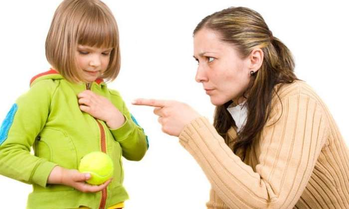
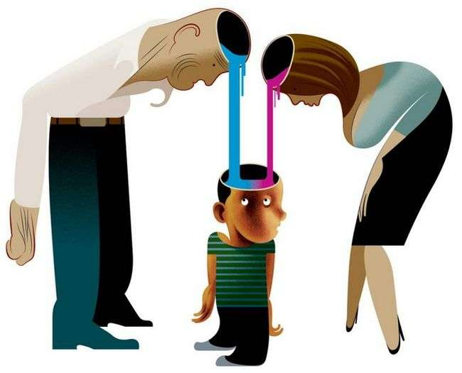

# Эцэг эхчүүд, хүүхдийнхээ ирээдүйг програмчилдаг

Нэг охиныг, гадаа тоглох гээд гарах үед, ээж нь, “ хувцасаа муухай болговол, ална шүү” гэжээ. Өнөөх охин, эхний үед болгоомжтой тоглож байсан боловч, хүүхдүүдтэй тоглон сатаарч мартаад, санамсаргүй унаж даашинзаа урсан хойноо ээжийнхээ захиасыг санаж, уйлж, гэртээ орохоос айн нуугдаж байсныг эцэг эх нь олж аваад, гэртээ оруулсан ч тайтгарахгүй уйлсаар, оёдлын газар даашинзыг нь засуулсны дараа тайвширч байснаа, мөн насан туршдаа энэ тохиолдлыг мартаагүйгээ, дөч гаран насны эмэгтэй ярьж байсан юм.

Бид хүүхдүүдийнхээ өмнө хэлж буй зүйлсийг хүүхэд яг үнэн гэж хүлээж авч, жинхэнээсээ итгэж, тэд, биднийг хэлснээ хийдэг чухал хүмүүс гэж боддог бөгөөд бидний хэлж буйг тушаал, заавар, баталгаа, онош мэт хүлээн авдаг. Эцэг эхчүүд хүүхдээ, “юм цээжилдэггүй”, “сурдаггүй”, “энэ чадахгүй” “ энэ яаж амьдарна даа”, “азгүй амьтан” гэх мэт үгсийг өөрт нь болон бусдад хэлэх үед, хүүхэд, үүнийг эцсийн онош гэж хүлээн авч, энэхүү сөрөг тодорхойлолтуудын золиос болдог. Энэ нь, хүүхдийнхээ хөгжил, авъяасаа нээх чадвар, өсөх боломжуудыг хаачихдаг бөгөөд ийм хүүхдүүд, том болсон хойноо ч тэр зүйлийг хийх хүсэлгүй, чадахгүй гэдэг үгээр хаацайлан өнгөрүүлдэг хүмүүс болдог. Хүүхдийн сэтгэхүйг, эцэг эхийнх нь хүүхэддээ хэлдэг үгс, хүүхдээ, бусдад /хажууд нь/ тодорхойлдог үгс гэмтээн, ирээдүйг нь тодорхойлдог гэж үзэх бүрэн үндэслэлтэй байдаг. Хүүхдээ хайрлах гэдэг нь, ямар ч нөхцөл байдалд, ямар ч үед, хүнд байдлаас гарах гарц хайх чадвар, өөртөө итгэх итгэл, ирээдүйгээ харах чадварт сургахыг хэлнэ.Мөн ” Бүх зүйлс сайхан болно” гэдэг итгэлийг суулгаж өгснөөр хүүхэд өөдрөг, итгэлтэй амьдралаар амьдарч эхэлдэг. Мөн , өөрсдөө хүүхэд байснаа марталгүй, болох болохгүй зүйл хийхэд нь, бага байсантайгаа харьцуулж ойлгон, хүүхэддээ, өөрийн бага насны тухай, ичимхий бүрэг байснаа явцын дунд засарснаа, бяцхан заль хийсэн тухайгаа, ганц хоёр “муу” авч байснаа, анхны бүтэлгүй хайрын тухай, гунихралыг цаг хугацаа эдгээдэг болон үеийнхэнтэйгээ маргаж муудалцаад хэрхэн эвлэрдэг байсан тухайгаа гэх мэт хүүхдэд тань таарч болзошгүй амьдралын бэрхшээлийг ярьж, таниулж, аливаа зүйлс болоод өнгөрдөг, өөрчлөгддөг гэдгийг ойлгуулж, бэлтгэж байх хэрэгтэй.
