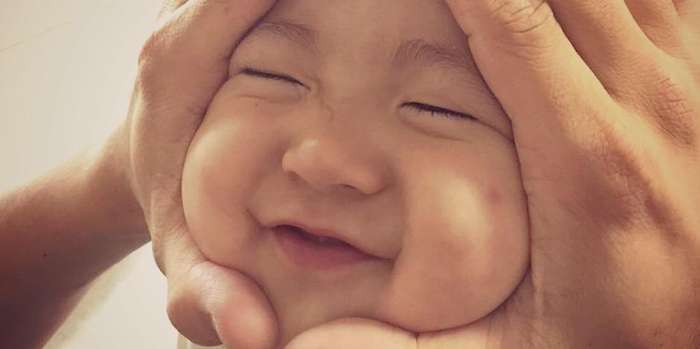
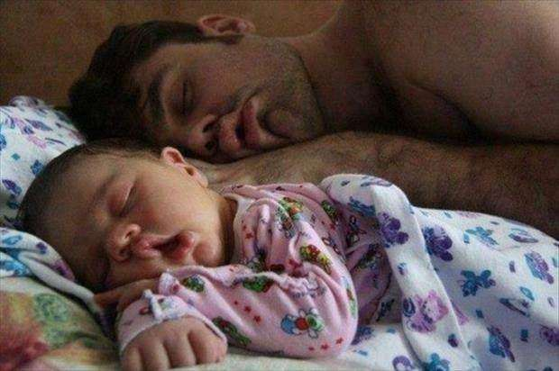
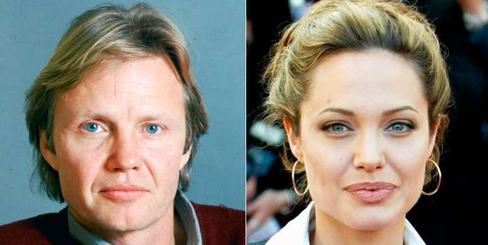
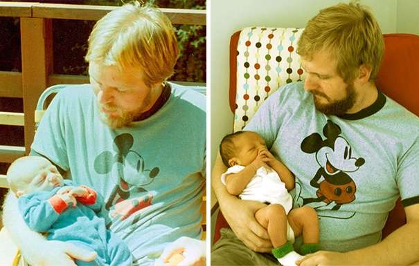

# Эцгээс нь хүүхдэд дамжих өндөр магадлалтай генүүд

Генийн удамшил нь, тааварлаж, таахын аргагүй, ихээхэн сонирхол татсан зүйл байсаар ирсэн билээ. Олон зуун ажиглалт, судалгааны үндсэн дээр гаргасан нэгэн судалгаагаар, эцэг эхийн ген үр хүүддэд нь ижил хэмжээгээр нөлөөлөх ч, эцгээсээ арай давуу авдаг болохыг тогтоожээ. Эцгээсээ давуу авдаг, эцгээс удамших өндөр магадлалтай, хүчтэй генүүдийг харуулвал:

-Нүдний өнгө, ихэвчилэн эцгийгээ дуурайдаг\
-Нүүрний төрх. Эцгийнхээ нүүр царайнаас хамгийн их дуурайх магадлалтай зүйлс нь, хэрэв эцэг нь урт эрүүтэй бол, мөн хөмсөгний хэлбэр, хамрын хэлбэр, дэлдэн чих яалт ч үгүй хүүхдэд удамшин илрэх магадлалтай хүчтэй генд багтна\
-Хацрын хонхорхой, эцгээс удамшин илрэх хүчтэй генүүдийн нэг\
-Шүдний гажуу ургалт эцгээс дамжих өндөр магадлалтай\
-Үсний өтгөн шингэн, эрт бууралталт, буржгар үс эцгээс ихэвчилэн дамжина\
-Оюун ухааны түвшиний хувьд, хэдийгээр хүний амьдралын турш, оюуны хөгжил явагдаж байх хэдий ч, хүүхэд нь эцгийнхээ оюуны түвшнээс дээш давж гарах амаргүй байдаг гэнэ. Эрдэмтэд, оюуны чадавхийг генээс хамгийн их хамааралтай, ялангуяа эцгийнх нь оюуны түвшинээс голчлон хамаардаг болохыг тогтоожээ\
-Хурууны хээг давтагдашгүй гэж үздэг ч, зарим хурууны хээнүүд эцэг хүү хоёрынх адилхан байх тохиолдлууд ажиглагджээ\
-Уруулын хэлбэр. Эцгийнх нь уруул анзаарагдахуйц хэлбэртэй бол хүүхдэд хүчтэй нөлөөлж дамжина\
-Хүүхдийн өндөр эсвэл нам нуруутай байхад, эх эцгийн генүүд хоёулаа нөлөөлнө. Гэхдээ эцгээс илүү дамжих магадлалтай. Эцэг нь өндөр, эгц нуруутай бол хүүхэд нь мөн гоолиг сайхан байдаг. Судалгааны үед, хүүхдийн ирээдүйн өндөрийг тодорхойлох томъёо гаргасан нь ихэвчилэн таарч байсан байна. Эцэг эх хоёрын өндөрийн хэмжээг хооронд нь нэмж, хоёрт хуваагаад хүү бол 5 см нэмж, охин бол 5 см хасч тооцдог гэнэ\
-Биеийн жин, ялангуяа охидод эцгийн генээр удамших нь олонтаа ажиглагджээ\
-Хөгжилтэй зан, хошин шогийн мэдрэмж, хурц ухаан ихэвчилэн эцгээс удамшдаг\
-Унтах үеийн хэвтэх байрлал болон эртэч байх, эсвэл оройдоо сэргэг байх зэрэг нойрсолтын төрлүүд эцгээс удамшдаг\
-Адал явдалд дуртай байх зан, мөн эрсдэлээс айхгүй байх зэрэг чанарууд эцгээс удамшин илэрч байдаг гэнэ

---

---

---

---

