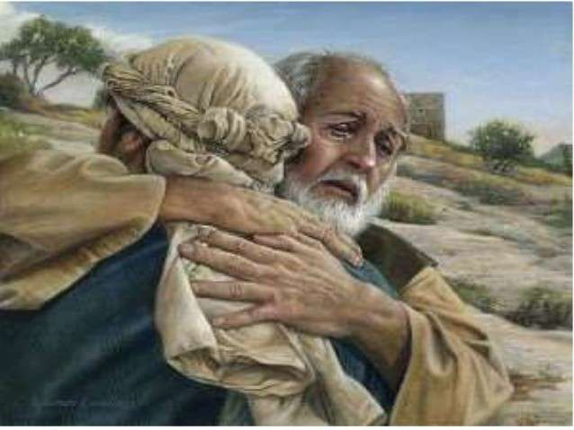
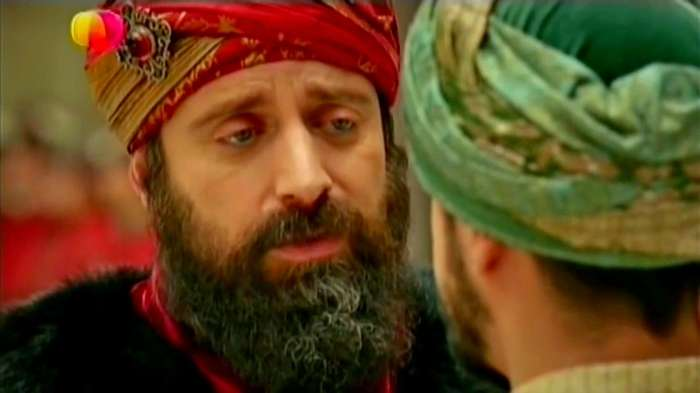

# Эцгийн сургаал

Зуун зууны туршид, эрт дээр үеэс, эцгийн захиас, сургаал, гэрээслэл үеэс үед уламжлагдан, үр хүүхдийнх нь сэтгэл зүрхэнд хадгалагдан дамжсаар уламжлал болон ирсэн билээ. Эдгээр, мэргэн захиас, сургаал эцэг хүний амьдралын гашуун туршлага дээр үндэслэсэн, үр хүүхдээ хүнд бэрхээс хамгаалах, аюулыг сэрэмжлүүлэх чин хүслийг агуулсан байдаг. Эцгийн захиас одоо ч уламжлагдан хадгалагдсан хэвээр бөгөөд үеэс үед дамжин явах мөнхийн үнэн сургаал билээ. Энэ сургаал, захиасыг мөрдөн, хэрэгжүүлэх нь үр хүүхдийн ариун үүрэг гэдгийг мэдэхгүй хүн байхгүй биз ээ. Энэ дэлхийн бүх аавуудын сургаал бүгд адил үр хүүхдийнхээ төлөө байдаг бөгөөд бидний аавуудын өгсөн сургаал зүрх сэтгэлд маань ариунаар хадгалагдаж байдаг. Харин эртний хаан эцгүүдийн, үр хүүхэддээ хайрласан сургаалыг тусгайлан тэмдэглэж үлдээдэг байжээ. Османы эзэнт гүрний эзэн хаан Султан Сулейман, хүүгээ аян дайнд явахад нь хайрласан, мэргэн сургаалыг толилуулъя.

-Хүү минь, чи бид хоёрын салах, чи, бие даан агуу үйлсийг хийх цаг чинь болжээ. Явахаас чинь өмнө чамд хэдэн зөвлөгөө өгье. Үүнийг санаж яваарай. Миний хүү, сонс! Хамгийн их хэмжээлшгүй баялаг бол оюун ухаан юм. Ядуу зүдүүгээс илүү аймшигтай зүйл бол, мэдлэггүй байх гэдгийг ойлго. Нүгэл нүглээс хамгийн аюултай нь, өөрийгөө өргөмжлөх. Үр удамдаа залгамжлуулах, хамгийн том бэлэг чинь чиний сайхан сэтгэл, хүнлэг чанар шүү. Хүү минь, чи, ёс зүйгүй хүнтэй бүү нөхөрлө, тэд хор хөнөөл учруулахаас өөр зүйл хийдэггүй. Шуналтай хүнтэй нөхөрлөхөөс болгоомжлоорой, чамд тусламж хэрэгтэй болох үед тийм хүмүүс яардаггүй юм. Атаархуу хүнтэй бүү ойрт, тэд хүнийг багахан үнээр худалдаад, хаяад явах сэтгэлтэй байдаг. Худалч, хуурмаг хүмүүсийг өөртөө бүү ойртуулаарай. Тэд холыг ойртуулж, ойрыг холдуулдаг зэрэглээ мэт, хажууд чинь байхдаа өмнө чинь байгаа бүхнийг холдуулж байдаг гэлээ. –Хаан эцэг минь би, таны эрх мэдэл, шударга ёсыг алс хязгаарт тогтоохоор явж байна. Таны үнэт зөвлөгөө надтай үргэлж хамт байх болно. Энэ зөвлөгөө тань, аав аа, миний замыг, харанхуйг гийгүүлэгч бамбар мэт гэрэлтүүлэх болно, гэж хүү нь хариулжээ
