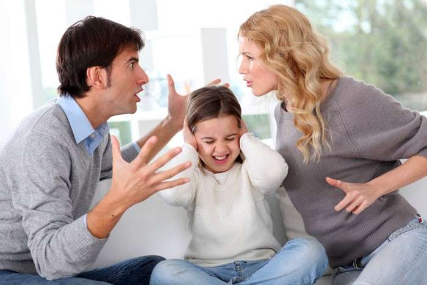

# Эв нэгдэлгүй гэр бүлийн гурван уршиг

Сэтгэл санаа, үзэл бодлын зохилдлогоогүй эхнэр нөхрийн харилцаа дараах уршигуудыг дагуулдаг. Тэд, үр хүүхдээ бодсондоо, эсвэл ёс суртахууны үүднээс, эд хөрөнгөний асуудлаас, мөн салалтаа “ичгүүр”-т тооцох зэрэг зарим нэгэн хүндрэлтэй шалтгаануудын улмаас хамтран амьдарч байдаг. Хэдийгээр өөрсдийгөө өөрчилөн, бие биеэ ойлголцон, хүндлэн, сэттгэхүйн нэгдэлд хүрч, аз жаргалтай амьдрах боломж байдаг ч, сайн харилцаанд хүрэхийг эрмэлзэн эрж хайхгүй тус тусдаа өөрсдийн бодлыг тээн, өөр өөрийн бодлыг зөвтгөн бие биеэ тэвчин жаргалгүй амьдарцгаадаг. Гэрлэлт нь, аз жаргал, аюулгүй байдал, тогтвортой байдлын билэгдэл юм. Гэтэл сэтгэл санааны нийцэлгүй, өөрийн дур хүслээр амьдрах хүслээр хэн нэгнээ дарамтладгаас үүдэлтэй ийм амьдрал дараах засашгүй гурван уршигийг дагуулдаг. Сэтгэлээр унамаар зүйл шүү. Гэхдээ, энэ нь гарцгүй зүйл биш гэдгийг ойлгох чадвар бүх хүнд байдаг. Эдгээр уршигийг мэдэж авсанаар, амьдралаа өөрчилөх, аз жаргалтай болох хүсэл сэтгэл төрж, боломжуудаа ашиглаж сурдаг.

1. Хүүхдүүд, эх эцгийнхээ хүйтэн хөндий харьцааг зүрх сэтгэлээрээ мэдэрч байдаг. Тиймээс, тэд ирээдүйн амьдралдаа, тэр л харьцааг гаргаж тэр л амьдарлаар амьдардаг. Хүссэн хүсээгүй, эх эцгийн хоорондын харьцаа, нуудаг ч байсан харилцааны загвар нь болдог бөгөөд тэд эх эцгийнхээ харьцааны байдлаар бусадтай харилцаж эхэлдэг. Эх эцгийнхээ хоорондын таарамжгүй харилцааг харж өссөн хүүхэд, ирээдүйд, тэр л харилцааг хань ижлээсээ хүлээдэг бөгөөд хайр хүндлэл-дургүйцэл, уур хилэн-ойлголцол, анхаарал халамж-хөндий байдал, хар сэр-хайр, сайхан сэтгэл-атаа жөтөө зэргээс хамаг мууг нь өвлөн авдаг. Джеймс Болдуин: “Хүүхдүүд ахмад хүмүүсийг сонсохгүй ч, харин гайхалтай дуурайх онцлогтой” гэж хүүхдүүдийг тодорхойлсон байдаг. \
2. Таагүй хоорондын харилцаа улам даамжирсаар үр хүүхдэд халдварладаг. Хүүхдүүд, азгүйтэл болон ямар нэг таагүй асуудалд, хэн нэгнийг буруутгах дуртай байдаг. Тэд, эцэг эхийнхээ таагүй харилцааны буруутныг хэн нэгд нь тохож, аль нэгнийх нь талд орох байдал үзүүлдэг ч, эцсийн эцэст энэхүү харьцааны буруутнаар өөрсдийгөө тооцож эхэлдэг. Энэ нь, өөрийгөө үнэлэхгүй болох, үргэлжид бүх зүйлд өөрийгөө буруутгах, түгшүүр, айдаст эзлэгдэх, уур хилэнгээ удирдаж чадахгүй болох, архаг сэтгэл гутралд өртөх зэрэг байдалд орж сэтгэхүй нь гэмтдэг. Хэн нэг нь хүүхдүүддээ, өөрийгөө буруугүй гэж харуулахыг эрмэлзэж гэмгүй царайлан хохирогч болж харагдахыг хичээх нь, худал хуурмагт сургахаас гадна, хүүхэд, эх эцэгтээ буруутай буруугүйгээс хамаарахгүй хоёуланд нь хайртай байдаг сэтгэлийг устган, үр хүүхдээсээ өөрсөддөө ирэх хайр хүндлэлийг алддаг. \
3. Хичнээн нуусан ч, хүүхдүүдийн сэтгэхүй хэрүүл маргаан, эх эцгийнхээ таагүй харилцааг мэдэрч байдаг бөгөөд бидний боддогоос хамаагүй их зүйлийг тэд мэдэж байдаг. Өглөөний цайн дээрх хүйтэн хөндий харьцаа л гэхэд, тэдний, хорвоогоос зөвхөн баяр жаргалыг л хүлээдэг эмзэгхэн сэтгэлийг гүн гүнзгий шархлуулж байдаг. Хэрүүл маргаан гарахгүй гэр бүл байхгүй. Гэсэн ч, хоорондын үл ойлголцолыг даамжруулсан, бие биеэ тэвчин амьдрах хор уршигтай харилцааг хүүхдүүдэд хэрхэвч харуулж болохгүй бөгөөд гэм зэмгүй бяцхан зүрхийг нь хайрлаж явах үүрэг эх эцэг хоёрт тавигддаг гол үүрэг, Бурханаас тавьдаг цааз юм.
