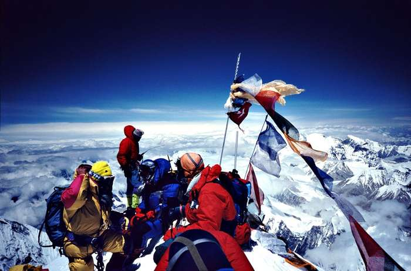
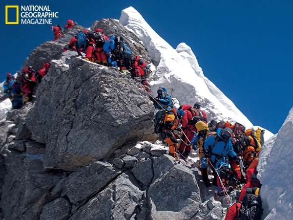

# Эверестийн тухай сонирхолтой баримтууд

Дэлхийн хамгийн өндөр уулын оргилыг, англиар-Эверест, түвдээр-Джомолунгм, непалаар-Сагарматха гэж янз бүрээр нэрлэдэг.

Оргил хэсэгт нь, таван хүн л багтаж зогсохоор хэмжээтэй учраас, хамгийн өндөр цэг рүү очих зөрөг дээр, уулчдын цувааны дугаар үүсээд зогсчихсон үе байдаг.\
Авиралт дуусах үед, уулчид 10-д кг жин хассан байдаг. Зарим хэцүү, авиралт хийгддэг газарт, цагт 10 000 ккал илчлэг /33 ш чизбургерын илчлэг/ зарцуулагддаг гээд боддоо. Оргил хүртэлх сүүлийн 300 метр газрын авиралтад 6 цаг зарцуулдаг. Ажиллах хүчин чадал 60% буурсан байдаг.\
Мөнгөн усны заалт, оргилд 250 мм-т хүрдэг учир, агаарын даралт унаж, ус маш хурдан буцалдаг. Тиймээс, уулчидын хувьд дутуу болсон ногоотой хоол идэх нь, дасал болчихсон байдаг ажээ.\
Хүчил төрөгчийн хэмжээ 2/3-р бага байдаг тул, хүчил төрөгчийн баллонгүй амьсгалах бараг боломжгүй. Нийт оргилд гарсан уулчидын 2.7% хувь буюу 200-д уулчин л хүчилтөрөгчийн баллон ашиглахгүй амьсгалж чадсан гэдэг.\
Эверестийн өндөр 8848 метр. Тив хоорондын тектоник түлхэлцлээс болж, жил бүр 4 метр өндөрсөж байдаг байна.\
Оргилд, 7414 уулчин амжилтттай гарсан. 281 авиралт, уулчид нь үхэж үрэгдэн, амжилтгүй төгсч байжээ.\
Оргилд авирах зөвшөөрөл, Непалд 11000 ам. долларын үнэтэй байдаг.\
Эверестийн хөрснөөс олддог, далайн амьтдын чулуужсан үлдэгдлүүд 450 сая жилийн настай. 60 сая жилийн өмнө, энэ нурууг үүссэн гэж үздэг.\
50 тонн хог /хүчил төрөгчийн баллоноос эхлээд, эвдэрхий майхан хүртэл/, Эверестийн бэлээр хаягдсан байдаг. Энэ нь сүүлийн 50-д жилд бий болсон хог ажээ.\
Непалын засгийн газар, уулчидыг 8 кг. хогийг буцахдаа авчирахыг шаарддаг.

50 000х8=6250. Эверестийн хаягдлыг цэвэрлэхэд, 6250 уулчин хэрэг болно. Байгал хамгаалагчид ойролцоогоор 13 тонн хог, жил бүр цэвэрлэдэг байна.
