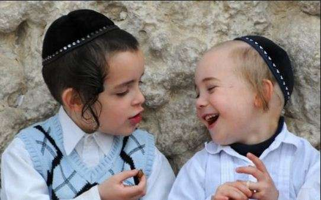

# Еврей эхчүүдийн хүүхдүүдээ хүмүүжүүлэх 7 нууц

Еврей үндэстэн шиг хүүхдүүдийнхээ хүмүүжилд онцгой анхаардаг ард түмэн байдаггүй бөгөөд хүүхдүүдийнхээ ирээдүйн амжилт, аз жаргалыг цогцлоох асуудлыг үндэстний бодлогын хэмжээнд тавьсаар иржээ. Тиймээс ч хүүхдүүд нь зорилгодоо хүрэх чадвартай, өөртөө итгэлтэй, амжилтаар дүүрэн, хангалуун амьдрах чадвартай болж өсдөг байна.

• Еврей ээж- Хэзээ ч хүүхэддээ “Муу хүүхэд”, ”Чи муу” гэж хэлэхгүй, харин “Ийм сайн хүүхэд буруу зүйл хийж болно гэж үү?” гэх маягаар шүүмжилдэг. Хүүхэд бол хэзээд “сайн”, харин үйлдэл “муу” байж болно гэж үздэг. \
• Еврей ээж- Хоёр эсрэг тэсрэг зарчмыг баримталдаг. Энэ нь эрх чөлөө ба хатуу шаардлага юм. Жижиг сажиг алдаа болон дүрсгүйтлийг ойшоож загнахгүй. Харин ахмад хүмүүсийг хүндлэх, сурлага, эрүүл мэндтэй холбоотой цөөхөн чухал зүйлс дээр алдаа гаргахыг хатуу хориглодог. \
• Еврей ээж- Хүүхдээ их магтдаг. Жижиг амжилтыг нь ч магтаж дараагийн хүрэх үе шат руу чиглүүлдэг. Магтаалыг, хүүхдийн өөрийн хүч чадалдаа итгэж сургах үр дүнтэй арга гэж үздэг. Бусадтай ярилцах үедээ, хүүхэд нь санамсаргүй сонсохоор байдалд, хүүхдээрээ хэрхэн бахархдаг талаараа ярьж магтдаг. Үүнийг сонссон хүүхэд эх эцгээ бүр илүү баярлуулах хүсэл тэмүүлэлтэй болдог гэж үздэг.\
• Еврей ээж- Өөрийнхөө биеэ авч явах байдалдаа маш хариуцлагатай ханддаг бөгөөд үүнийгээ еврей гэр бүлийн хүүхэд хүмүүжүүлэх гол зарчим гэж үздэг. /Хүүхэд юу харж байна түүнийгээ дуурайдаг/\
• Еврей ээж- Хүүхдийн хүмүүжлийн үндэс суурь нь гэр бүл дээр тулгуурлана гэж үздэг бөгөөд хүүхдээ аз жаргалтай болгоё гэвэл өөрсдөө аз жаргалтай амьдрах ёстой гэж үздэг. Хайр, харилцан хүндлэл дээр гэр бүлээ босгож, эх эцэгээ, хүүхэд нь, юуны түрүүнд зөвхөн “эцэг эх” гэдэг утгаар биш, харин “аз жаргалтай хосууд” гэж харахаар амьдардаг.\
• Еврей ээж- Хүүхдээ өлгийтэйгээс нь, тоглуулах, зугаацуулах хэлбэрээр “сайн эцэг эх” болгоход мөн гэр бүл, эцэг эх болох асуудлыг “аз жаргал” гэж хүлээн авахад сургадаг. Эцэг эх болгох харилцааг чухал “мэргэжлийн” хэмжээнд авч үзэн сургуулиудын дэргэд “эх эцэг” болох курс хүртэл байдаг байна. \
• Еврей ээж- Хүүхдийнхээ сурлагад онцгой анхаардаг. Хичээлээс гадна бүх боломжтой дугуйланд хамруулж “Мэдлэг бол амжилтын түлхүүр” гэсэн үгийг утгаар нь хэрэгжүүлдэг. Хичээл сурлагадаа анхаарал сулруулахыг огт зөвшөөрдөггүй. Энэ зарчим, хүүхдийг тууштай, мөрөөдлийнхөө төлөө уйгагүй ажилладаг болж өсөхөд тусалдаг гэж үздэг. Тиймээс еврей хүүхдүүд багаасаа завгүй, ачаалалтай ажиллаж сурсан байдаг.
