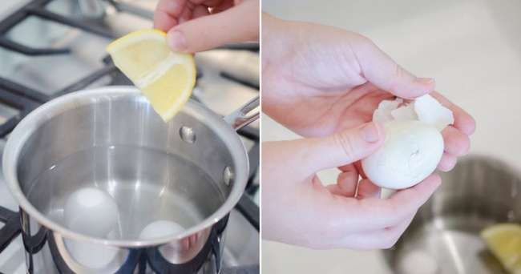
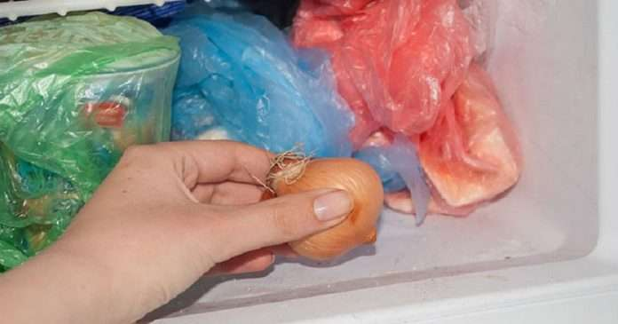

# Эзэгтэй нарт тустай зөвлөгөө

Гэр орондоо хоол ундаа бэлтгэх сайхан уламжлалаа хадгалсаар ирсэн,монгол эмэгтэйчүүдээ магтахын зэрэгцээ,орон гэртээ зарцуулах цаг хугацаагаа зохицуулахад нь тустай цөөн зөвлөгөөг хүргэе.

-Өндөгийг, хальснаас нь хялбар салгахын тулд, чанах усандаа хагас цайны халбага сода хийдэг. Мөн хэрчим нимбэг хийж болно

---

-Өндөгний орцтой зуурмаг бэлтгэхэд, өндөг байхгүй байвал өндөгийг тал бананаар орлуулж болдог

---

-Ахиухан сармис арилгах хэрэгтэй болсон бол, сармисаа богино долгионы зуухны хамгийн бага халаалт дээр тавьж 15 секунд болгоод арилгаарай. Маш хялбар болдог

---

-Амтат чинжүүг, ёроолоос нь харахад, 3 салаа хэсэгтэй байвал чихэрлэг амттай байдаг бөгөөд шууд хачиранд хэрэглэхэд тохиромжтой байдаг. Хэрэв, 4 хэсэгтэй бол гашуувтар, хоол бэлтгэхэд хэрэглэдэг.

---

- Сонгино арилгахдаа, нүдээ хорсгож нулимсаа гоожуулахгүйн тулд, сонгиноо хөргөгчний хөлдөөгчинд 15 минут хийгээд гаргаж арилгадаг

---

-Өтгөн йогуртыг, тортны крем шахагчид хийн хүнсний цаасан дээр жижиг жижгээр шахаж, хөлдөөх хэсэгт нэг цаг байлгаад хүүхдүүдээ дайлж баярлуулаарай. Дахин нэхээд л байх болов уу.

---

-Төмсийг угаагаад, хөндлөн нилээд гүнзгий хэд хэдэн удаа зүсэж тос түрхэн, давслаад духовканд жигнэхэд оройн хоолны сайхан хачир болно
