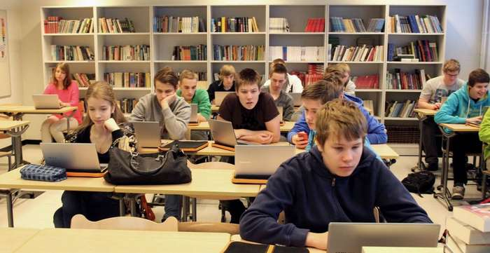
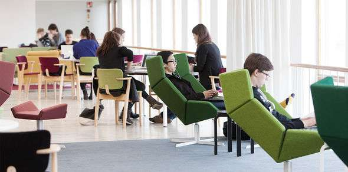

# Финляндын сургалтын онцлогууд, гайхмаар...

Энэ улс,боловсрол мэдлэгийг хүүхдүүдэд эзэмшүүлэх нь, улс өөрөө боловсролтой, амьдрах чадвартай иргэдээр хангагдана гэдэг талаас харж, авч үздэг.

Финляндад, энгийн эсвэл элит сургууль гэж байдаггүй. Бүх сургуулиуд ижил санхүүжилт авдаг бөгөөд мөн ижил сургалтын хэрэгсэл, тоног төхөөрөмж ашиглан сургалтаа явуулдаг. Бараг бүх сургууль улсынх байдаг. Бага сургуулийн сурагчидад, гэрийн даалгавар өгдөггүй, шалгалт авдаггүй, бараг дүн тавьдаггүй гэж хэлж болно. Сургалтдаа, маш их бичүүлэх аргыг ашигладаг бөгөөд эдгээр бичүүлдэг эссе, зохион бичлэгүүд, сурагчидыг өөрийн сэтгэгдлээ илэрхийлж сургах, асуулт тус бүрт, уран зохиолын цэвэр хэллэгээр хариулах, эх хэлээ төрөлх сайхнаар нь эзэмшихэд чиглэгддэг байна. Ямар нэг хичээлийг гүнзгийрүүлэн судлахыг тэр бүр сайшаадаггүй. Финляндчууд, математикийг урлагаас дээгүүр тавьдаг. Сурагчидыг хоооронд нь харьцуулахыг хориглохоос гадна, хүүхдүүдийг, амжилттай ба хоцрогдсон гэж ялгаварладаггүй. Хөгжлийн бэрхшээлтэй хүүхдүүдэд тусгай сургууль гэж байхгүй, энгийн сургуульд ердийн хүүхдүүдтэй хамт суралцдаг. Финляндчууд: “Амьдралд бэлтгэх, шалгалтад бэлтгэх хоёрын, эхнийхийг нь бид сонгодог” гэж ярьцгаадаг. Тиймээс, финляндын сургуулиудад, 16 насандаа өгдөг шалгалтаас өөр шалгалт байдаггүй. Хүүхдийг хамгийн гол сургах ёстой зүйл нь биеэ даах байдалд сургах ёстой гэж үздэг бөгөөд сургууль нь, хүүхдийн сэтгэн бодох чадвар, өөрсдөө биеэ даан мэдлэг эзэмшихэд сургах ёстой, нэр томъёо цээжлүүлэхээс илүү гарын авлага, интернет, тооны машин ашиглахад сургах ёстой гэж үздэг. Багш нар анги танхимд 4 цаг л ажиллах ёстой харин бусад цагийг мэргэжлийн дадлаа хөгжүүлэхэд зориулах ёстой гэж шаарддаг. Багшийн мэргэжлийг хамгийн хүндтэйд тооцдог бөгөөд их дээд сургуулиудын багшийн мэргэжлээр өгөх уралдаант шалгалт хамгийн олон өрсөлдөгчидтэй байдаг. Сургуулиуд ямар ч төлбөргүй, үүнд, өдрийн хоол, экскурс, сургуулийн унаа буюу такси, сурах бичгүүд, хичээлийн хэрэглэлүүд, тооны машин бүр нөутбук хүртэл ордог. Эцэг эхээс ямарваа хураамж авахыг хуулиар хориглодог.\
Энэхүү сургалтын онцлогуудаас хэрэгжүүлэх боломжийг ашиглахсан. Хичнээн таатай хүүхэд насыг өгнө вэ? Хүүхдүүдийн хувь хүнийг устгадаг гэж хэлж болмоор манай сургалтыг халмаар...
