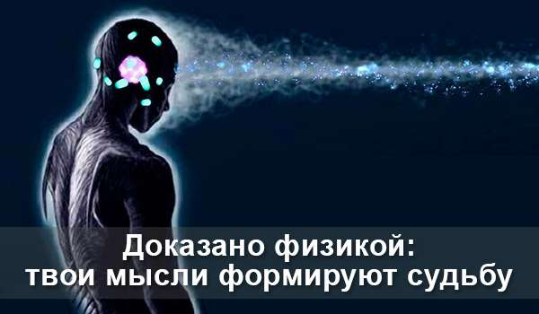

# Физикийн хууль: Бодол санаа хувь тавиланг зохиодог

Ихэнхи хүмүүс таагүй санагдсан зүйлээ уурлаж, бухимдаж, сөргөөр хүлээн авдаг бөгөөд дотроо эсэргүүцэн, тухайн нөхцөл байдалтай тэмцэлдэж, энэ үедээ уурлан бухимдах нь байр байдлыг сайжруулах юм шиг андуурч төөрөлдөж байдаг нь нийтлэг юм. Сөрөг зүйл юунд хүргэх вэ? Улам илүү сөрөг таагүй байдлыг л үүсгэнэ. Квантын ертөнцийг судладаг эрдэмтэд, -бүх ертөнц бол тэр чигтээ энерги, бүх бичил хэсгүүд нэг хугацаанд хаа сайгүй байдаг гэж үздэг бөгөөд үүнийг квантын тодорхой бус байдал гэж нэрлэдэг. Ажиглагч буюу хүн байхгүй бол ертөнц үгүй гэж шинжлэх ухааны үндэслэлтэй тайлбарладаг бөгөөд бүхий л элементар хэсгүүд энгийнээр ажиглах явцад хэв байдал нь өөрчилөгдөх боломжтой, өөрөөр хэлвэл, хүний аливаагаас хүлээх хүлээлт амьдралын үр дүнд нөлөөлдөг гэж үздэг. Хүн бүр аливааг ямраар ч хүлээж авах 100% эрхтэй, эхлээд ямар нэгэн зүйлд итгэн дараа нь түүнийхээ үр дүнг олж авдаг. Жишээ нь, мөнгө хүрэлцэхгүй байна гэж бодоход, үнэхээр л байнгын мөнгөний гачаал дунд амьдардаг. Эсвэл энэ газарт сайн ажил олдохгүй гээд бод. Үнэхээр л ажил олдохгүй. Гэтэл, хөрш зэргэлдээ өчнөөн хүмүүс элбэг хангалуун амьдарч л байдаг. Тэд сайн ажил эрхэлдэг эсвэл үнэхээр азтай хүмүүс үү? Үгүй, энэ бол квантын физикийн хууль юм. Энэ хууль,таныг үргэлж, бүр байнга, хүлээж буй хүлээлтийнхээ дагуу үр дүнг хүлээж авдагийг тань харуулдаг байна.

Үүнийг бичигчийн хувийн туршлага:

Би гараа гэмтээж, эмч нар намайг тахир дутуу болсонд тооцов. Би ч үүнд нь итгэдэг байлаа. Харин хэсэг хугацааны дараа азаар, аймшигт ослын дараа бэртэж гэмтсэн бараг махан таташ болсон хүмүүс хэрхэн өөрсдийгөө сэргээн эмчилсэн талаархи олон түүхүүдийг олж уншиснаар мөн үүнд итгэсэн. Үр дүнд нь миний гар өнөөдөр цоо эрүүл болсон. Би урт удаан хугацааны турш, ядуу байдал бол тавилан гэж боддог, маш их ажиллаж үр дүнгүй зүтгэдэг байсан. Энэ эдгэрэлтийнхээ дараа, санхүүгийн эрх чөлөөнд хүрэх амархан, хялбар зүйл гэж итгэж эхэлсэн, үнэхээр тийм зүйл болсон юм. Би, амьдралыг аюултай, хатуу бэрх зүйл гэж боддог, түүнтэй тэмцэж байна гэж боддог байлаа. Харин одоо би насан туршдаа хамгаалагдсан гэж итгэдэг. Миний ертөнц намайг хамгаалан халамжилдаг шүү. Эдгээрээс би бүх зүйлийг сайнаар харж итгэхийн чухлыг ойлгожээ. Бид хором бүр сонголттой учирч, тэр бүр өөрсдийн бодит ертөнцийг байгуулж байдаг бөгөөд таны хүсээгүй зүйл таарах бүрт сонголт тань мөн зэрэгцэн гарт тань л байж, квантын солбицолд орж байдаг байна. Энэхүү чухал үеийг уур хилэн бухимдлаар хүлээн авбал бүх юм буруутан уур хилэнгийн ертөнцрүү өөрийгөө залдаг байх нь. Уур уцаар, бухимдал дүүрэн амьдрал хүсүүштэй байхгүй нь лавтай. Хэрэв таалагддаг бол яая гэх вэ? Гэхдээ бодит ертөнцийн бүхий л зүйлс сайн эсвэл саармаг байдаг мөн эдгээрийг зөвхөн таны бодол, үнэлгээ л, сайнаар эсвэл муугаар “буддаг” гэдгийг ойлгоорой. Амьдралд тохиолдсон сайн муу аль ч туршлагаа эерэгээр хүлээн авч бараг баярлаж чадаж байвал амьдралын тань бүх л асуудлууд өөрөө шийдэгдээд явчихдаг юм шүү гэж зөвлөжээ.

