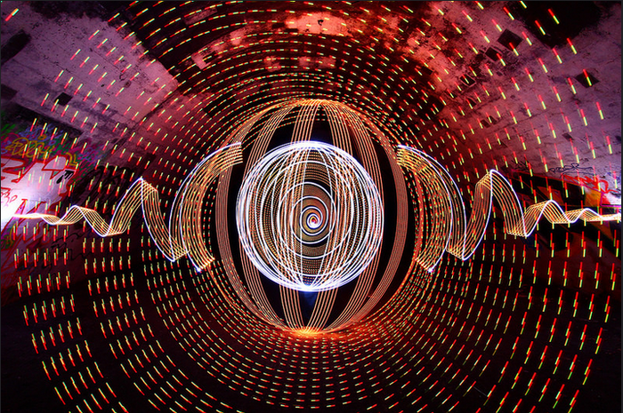
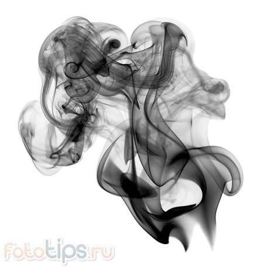

# Фото зургийн нууц шид

Био эрчим судлалын мэргэжилтэнүүд, нэгэн сонирхолтой судалгаа хийжээ.

Дөнгөж өндөгнөөс гарсан дөрвөн дэгдээхэйн фото зургийг авч, эдгээр дэгдээхэйд ялгах тэмдэг тавин, нэг дэгдээхэйний зургийг нь олон хүмүүст, сэтгэл санаа таагүй байх үедээ уг бяцхан дэгдээхэйний зургийг харж тайвширч байх зөвлөгөө өгөн тараажээ. Уг дэгдээхэйнүүдийг яг адил нөхцөлд байлгаж арчилж байсан хэдий ч хэсэг хугацааны дараа, зураг нь тараагдсан дэгдээхэйний өсөлт бараг зогсож, бусад гурваасаа хоцордог, сулбагар болж хувирсан гэнэ. Энэхүү туршилтыг фото зураг хүний био талбайд нөлөөлдөг эсэхийг нотлохоор хийсэн бөгөөд зураг хүний амьдралыг өөрчлөх боломжтой гэсэн дүгнэлтэд хүрчээ. Мөн энэ туршилтыг тасалгааны цэцэг ургамлууд дээр явуулахад адил үр дүн үзүүлж байсан байна. Урдны хүмүүс хүний хөрөг зургийг ид шидтэй гэж үздэг байсан гэдэг. Хөрөг зургийг зурж буй хүний сэтгэл санаа, үзэл бодол, хандлага зуруулж буй хүний амьдралд нөлөөлсөн талаар олон жишээ баримтууд байдаг байна. 19-р зууны дунд үед зургийн аппарат гарснаар хүмүүс зургаа авахуулах нь олширч, бие биенийхээ зургийг шууд харах, зурагтай хялбар харьцах боломж үүсэв. Алдар нэртэй жүжигчид, олны танил хүмүүсийн зураг, сэтгүүл сонин дээр гарч сая сая нүд тэдгээрийг сонирхон үзэж байдаг. Ийнхүү олон арван мянган хүний энергийн донор болсон хүмүүс өөрсдийн бие мах бод, сэтгэл санааны энергээ нөхөх асуудал нь асар хүндэрч байдгаас гэр бүл, амьдрал нь олон асуудалд орж байдаг гэсэн дүгнэлтэд хүрсн бөгөөд үүнийг фото зургийн энерги дамжуулах чанартай холбон үзсэн байна. Тиймээс, зураг авахуулах болон фото зурагтай харьцахдаа бодолтой байхыг, мөн гэр бүл болох гэж байгаа хосууд гэрлэлтээ батлуулахаас өмнө олон зураг авахуулах амьдралд нь таагүй нөлөөлдөг /судалгаагаар тайлбарлаж чадахгүй байгаа/, хүссэн үедээ л зургаа авахуулаад байх нь таагүй, ерөнхийдөө өөрийн дүр төрх болох нандин зүйл зургаа аль болох тараагаад байхгүй байхыг сануулсан байна.
