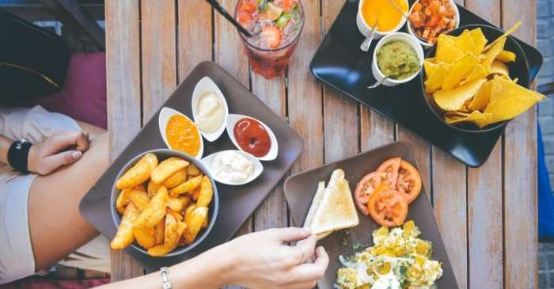
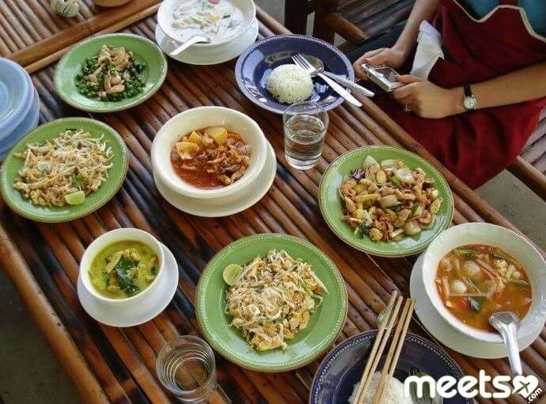

# Гадны улс оронд, хооллох үедээ хийж болохгүй зүйлс

Хооллох үедээ, тэгш сууж, салфетка ашиглан, амаараа элдэв дуу чимээ гаргахгүй, тохойгоо хоолны ширээн дээр тавихгүй байх... гэх мэт, хооллох үеийн нийтлэг соёл бидний дунд мөрдөгдөж байдаг, гэтэл эдгээр нь, өөр улс оронд таарахгүй, мөрдөх шаардлагагүй, бүр доромж байдал үзүүлсэнд тооцогдох байдалд оруулах нөхцөл үүсгэх боломжтой байдаг гэнэ. Жишээ нь, Японд дуу чимээтэй идэхийг, хоол хийсэн хүнд зориулсан магтаалын хэмжээнд хүлээж авч, таалагдсанаа илэрхийлж буйг харуулж байна гэж үздэг. Тиймээс, гадны улс оронд явахдаа, тухайн орны хооллох үеийн соёл, мөн хооллох үедээ анхаарч байх ёстой хэдэн зөвлөгөөг хүргэе. Эдгээрийг мэдэж авсанаар, орон орны хооллох ёс журмыг хүндэтгэн, сонин хачин хоолыг нь амтлан, гэдэс цатгалан явах боломж, дэлхийг тойрох аялалыг тань чимж өгөх юм.

---

**Тайланд.** Сэрээг, зөвхөн нийтийн тавагнаас зууш, хачирыг өөрийн таваг руу сэлгэж хийхэд ашигладаг. Сэрээгээр ам руугаа будаа хийхийг доромжлол гэж үзнэ. Сэрээний оронд харин халбага ашиглаж болно. Тухайн хоолоо халбагаар эсвэл сэрээгээр идэхээ, бусдыг анзаарч байгаад сонгож болох юм.\
**Чили.** Зарим орнуудад, ямар ч хоолыг гараараа барьж идэхийг хамгийн бүдүүлэгт тооцдог. Чилид, гараараа барьж иддэг гамбургер, пиццаг хүртэл сэрээгээр иддэг. Мөн хооллох үед, гар үргэлж ширээн дээр ил байх хэрэгтэй байдаг гэнэ. \
**Итали.** Спагеттиг хутгаар хэсэглэн идвэл тэднийг жинхэнэ доромжилсонд тооцогдно. Сэрээгээ ороож идээрэй. \
**Хятад.** Ихэнхи орнуудад, тавганд хоол үлдээхийг таалдаггүй, хоол үлдээхгүй байхыг, уг хоолыг таашаан идсэнийг харуулж байна гэж үздэг бол, харин, хятадад хоол багахан үлдээдэг бөгөөд, үүнийгээ хоол бэлтгэсэн хүндээ, амттай хоол, их аягалсаныг нь харуулж байна гэж тооцдог. \
**Египет.** Дундарсан ус, ундаа шүүсийг өөрөө нэмж аягалахыг тэвчихгүй. Зөвхөн өөр хүн аягалж өгдөг. Мөн өөрөө ч бусдад санаа тавьж, аягалж өгч байх хэрэгтэй гэнэ. \
**Япон.** Савхтай холбоотой маш олон дүрэм журам мөрдөгддөг. Бие биедээ савхаараа хоол дамжуулж өгч болохгүй. Будаанд савх зоож болохгүй. Савхыг долоож болохгүй. Савхыг хэрээслэж тавьж болохгүй, зориулалтын тавиурыг нь ашиглах ёстой, мөн савхаар юуг ч цоолж өлгөж идэж болохгүй. \
**Испани.** Талхыг шөлтэй хоолонд дүрж идэж болдоггүй. Мөн хоолны газраас бараагүй хоолоо авч гарч болдоггүй. \
**Танзани.** Хоолыг үнэрлэвэл жинхэнэ доромжлолд тооцдог. \
**Португали.** Давс, амтлагчийн сав ширээн дээр байдаггүй. Хэрэв эдгээрийг авах хүсэлт тавивал, тухайн хоолыг бэлтгэсэн тогоочийг доромжилж байна гэж тооцно. \
**Филиппин.** Хооллох үедээ зүүн гараа ашиглаж болохгүй, ширээнээс зайтай байлгадаг. \
**Өмнөд солонгос.** Настайчуудаа хүндлэх ёс хооллох үед, утгаараа хэрэгждэг. Хоолонд эхлээд ахмад хүн хүрсэний дараа л зөвхөн хооллох ёстой. \
**Франц.** Талхыг хооллох хэрэгслийн хэмжээнд хэргэлдэг. Хутга, халбага сэрээний зэрэгцээ, талхаар дэмнэсэн хөдөлгөөнөөр хоол нэмж идэх, сэлбэх, мөн шөлөнд талх дүрж идэж болдог.
