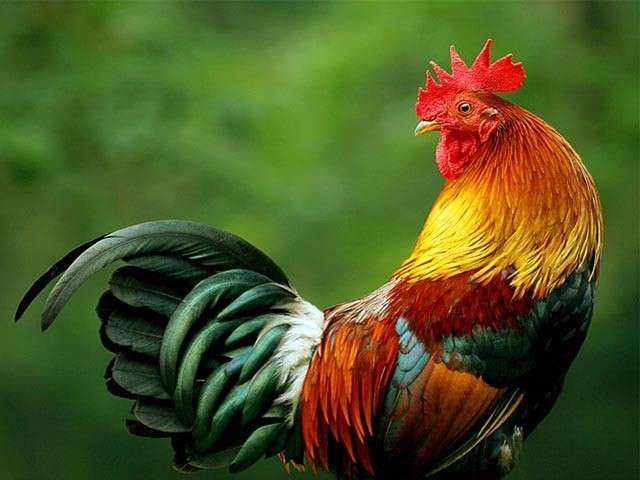
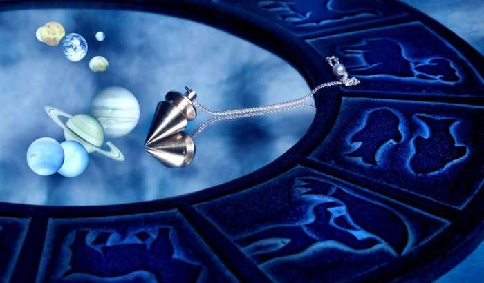

# Гал тахиа жилийн зурлага

Өрнөдийнхөн, гал бичин жилийг амжилтаар дүүрэн жил гэж дүгнэн, гал бичин жилээс улаагаа авах, гал тахиа жилийг, илүү амжилт ололтоор дүүрэн жил байх болно гэж үзэж, орд тус бүрээр гаргасан зурхайг танилцуулъя. Тахиаг, маш өвөрмөц, нууцлаг ид шидтэй, нар, сайн санаа, гавъяат үйлс, итгэл найдварын билэгдэл гэж үздэг ажээ.

#### Хонь

Хоёр жил үргэлжилсэн, “амьдрал бол тэмцэл” гэсэн, хүндхэн үе дууслаа. Урдныхаа хөдөлмөрийн үр шимийг хүртэх цаг ирж байна. Гэхдээ бүх зүйл хөлний тань өмнө унаад ирэх нь юу л бол. Тодорхой хэмжээний зүтгэл гарган, хамгийн гол нь анхаарал мэдрэмжтэй байхад л болох юм байна.

#### Үхэр

Бичин жил ард хоцорч, түүнтэй хамт азгүйтэл, уналт, байнгын ачаалал, сандрал цуг, улиран одож байна. Тайвширч, амьдралаас сэтгэл ханамж авах цаг үе ирж байна. Од эрхэс таны, эд материал, сэтгэл санааны алдагдлыг тань бүрэн утгаар нь барагдуулна гэж амалж байгаа аж.

#### Ихэр

Тахиа жил таныг, баяр баясгалан, амжилттай эхлэлүүдээр дүүрэн байлгана. Зөн совиндоо итгсэн цагт, хүсэж зорьсон бүх зүйл тань ид шидтэй мэт бүтэх бөгөөд өөдрөг сэтгэлийг тань урамшуулах юм байна.

#### Мэлхий

Хүнд, бэрх зүйлс ард хоцорч, “аз” таныг олон сонирхолтой хүмүүстэй уулзуулах бөгөөд таныг, хувь хүний хувьд өсч хөгжихөд тань нөлөөлөхүйц үнэнч найз нөхдөөр хүрээлүүлнэ. Зарим тань, хүнд ачаа мэт, зарим зүйлсээс салж хөнгөрнө.

#### Арслан

Аливааг өөрийн гараар бүтээх, олох дуртай арслангуудад, аз, ашиг орлого өөрөө орж ирнэ. Дасаагүй арслангууд, эхний үед нилээд сандарна. Хувь тавилан тэдэнд, урд нь санаанд ормооргүй, сайн үр дүнтэй олон зүйлийг өгөх нь.

#### Охин

Оны эхнээс л, үйл хөдлөлдөө хатуухан шаардлага тавих хэрэгтэй болж байна. Энэхүү шийдэмгий байдал, танд учрах олон зүйлийг давахад тусална. Болж буй зүйлсийг өөрт ашигтай эргүүлэх, зальжин аргуудыг ашиглахыг хичээгээрэй.

#### Жинлүүр

Хувь тавилан танд, анзаарахгүй өнгөрүүлчихгүй л бол аж амьдралаа дээшлүүлэх өргөн боломжийг олгож байна. Ямар нэг төсөл барьж авбал, бүх хүчээ зориулж, шийдэмгий, биеэ даасан байдлаар гүйцэтгэх нь үр өгөөжөө ханатал өгнө.

#### Хилэнц

Асар том өөрчлөлтийн босгон дээр зогсож байна. Энэхүү өөрчлөлтийн дараа, бүх хуучин зүйлсээс салах орхих хүсэл төрөх бөгөөд амьдралыг үзэх үзэл нь хүртэл бүрэн өөрчлөгднө.

#### Нум

Энэ ордынхон хүчтэй энерги, өөдрөг сэтгэлтэй байдаг бөгөөд тэдний өмнө гайхалтай ирээдүй, хэтийн төлөв нээгднэ. Аливаа асуудлыг хөндлөнгөөс, цаг хугацаа, элдэв нерв зарцуулахгүйгээр хялбар шийдвэрлэх боломжтой байх нь. Ямар ч тохиолдолд од эрхэс таны талд байна.

#### Матар

Ажил хэргээ, ач холбогдлоор нь, дараалуулан дахин авч үзэхийг зөвлөж байна. Хамгийн түрүүнд, өөрийгөө төгс төгөлдөр болгохын тулд ажилла. Таны шинэ ертөнцийг үзэх үзэл, таныг баярлуулж, орчин тойрон тань бүрэн өөрчлөгдөн, та, гайхшрах болно. Асуудлууд, тийм ч том бус болж, хамгийн энгийн зүйлээс ч баяр баяслыг олж чаддаг болно.

#### Хумх

Энэ жил бол тэдний жил! Энэ орд ба эрхшээсэн тахиа жил хоорондоо ижил төстэй байдаг. Эдгээр ордынхон, байгалаасаа, хэцүү бэрх даалгавар авдаггүй, хүнд зүйлээс зайлж чаддаг хүмүүс байдаг. Тиймээс, өөрсдийнх нь эрин эхэлж буй энэ үед, хумхын ордынхон өөрсдийн үзлээ тунхаглах боломжтой болно.

#### Загас

Энэ ордынхны хувьд, зогсонги гэж хэлж болмоор, бараг 10 жил үргэлжилсэн үе дуусч байна. Тэд, яг л нойрноос сэрсэн мэт хэрэггүй зүйлс, залхуурлыг сэгсрэн хаяж, гайхмаар их эрч хүчийг авна.
