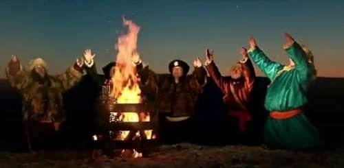

# Гал тахих ёсон

Монгол туургатнууд маш эртнээс галыг хамгаас илүү эрхэмлэн хүндэтгэж, нандигнан хамгаалж иржээ. Орчин үед гал голомтоо хүндэтгэх явдал багассан байна. Гал голомтгүй өрх бүлд аз жаргал гэж үгүй хэмээн үздэг. Гал голомт бол аугаа их хүчийг өгдөг төв, гэрийн амин сүнс. Түүнийг хүндэтгэвэл айл гэрийн хамаг бүхэн өөдлөн дэвжиж, гэр бүлийн гишүүн бүрт илч эрчим харамгүй түгээгдэнэ хэмээдэг ажээ.

Өвлийн адаг сарын билгийн тооллын 23, 24-нд галын их тахилга болдог. Энэхүү өдөр гал тахих болсон шалтгааныг бас нэгэн домогтой холбон тайлбарладаг. Галын бурхан буюу тэнгэр гэж байдаг. Галын тэнгэрийг дээд тэнгэрийн хүү гэж үздэг бөгөөд жилд 1 удаа тэр хүү аав, ээждээ золгодог гэнэ. Золгохоор явдаг өдөр нь 23, ирдэг өдөр нь 24 юм. 23-ны тахилгыг үдшийн цолмонгоор эхэлдэг бөгөөд 24-ний үүрийн цолмонгоор тахидаг. Үүний нэг нь үдэлтийн, нөгөө нь угталтын тахилга юм. Домог ёсоор жил жилийн сүүл сарын 23 –нд галын тахилга тэнгэрт одож, орчлонгийн түмэн амьтны байдлыг хурмаст тэнгэрт айлтган мэдүүлдэг учиртай гэжээ.

Галыг ариусган тахих нь айл бүрийг өршөөл ивээлдээ багтааж, тэдний гал голомтонд ариун үйлсийг хүргэж өгдөг гэж үздэг. Айл гэрийн гал голомт нь тэр айлыг ариусгадаг, гэрэлтүүлдэг, дулаацуулдаг, хоол хүнсээ боловсруулдаг гол зүйл билээ. Галын бурхан буюу тэнгэрт зориулан: “Сүмбэр уулын төдий идээг, сүн далай төдий ундааг ,сүрт галын бурхан танд өргөе!” гэж галдаа тос, өөх сэлтийг өргөн мөргөдөг заншилтай.

Монгол хүний "хөх тамганы гал", "зүрхний гал", "сэтгэлийн буюу сүнсний гал" гэсэн гурван гал нь дүүрэн байхад хэзээ ч гундахгүй, Түүнийгээ л бадамлуулж явах ёстой юм. Үүний тулд өндөр төрийн гал, өвөг дээдсийн гал буюу ертөнцийн галтай таны өргөө гэрийн гал холбоотой байж, таныг өргөж байх ёстой юм.

ГАЛАА ГЭРИЙН ЭЗЭН ТА ӨӨРӨӨ ТАХИХ НЬ ХАМГИЙН ҮР ДҮНТЭЙ\
Гэрийн эзэн бол ГАЛ-ын эзэн, харин гэргий бол түүнийг манагч юм. Иймд галаа өрх гэрийн эзэн эр хүмүүн удирдан тахина. Халуун ам бүлээрээ тахих нь хэнээр ч тахиулснаас илүү. Учир нь өвгөд дээдэс тань та бүхнийг харж байдаг. Домыг нь та хийгээд үйлдчихэд бусдыг нь таны өвөг, дээдэс, харсан тэнгэр тань гүйцээгээд өгнө. Тэд таны л сэтгэлийн хайраар тань сэрж манддаг юм. Галаа дээдэлж тахиж, шүтнэ гэж зүгээр л хайрлахыг хэлнэ. Тэрхүү хайр танаас л ундарч байж зөв болох юм. Үд шийн цагаан гэгээ тасарч харанхуй болон анхны од түгмэгц гэрийн эзэн галаа ноцооно.\
Гал тахихад бэлтгэх зүйлс: цай, сүүний дээж, будaa, тавгийн идээ, таван өнгийн хадаг эсвэл улаан хадаг, хонины үе сүүл / чанасан, 3 дахь үе/, шар тос, арц ганга байна.\
Эхлээд өөрийн сэтгэлийг ариусгаж, өндөр дээд тэнгэр, гал улаан 99 тэнгэр, өвгөд дээдэс, ээж, аав гээд шүтээндээ цай, сүүний дээжээ дөрвөн зүг найман зовхистоо өргөнө. Шүтдэг уул, ус, газар эжийдээ цайны дээж, үр тарианы дээдийг өргөнө. Эцэг /ахмад хөвгүүн/ хонины үе сүүлээ барьж байгаад овог нэрсээ таниулж, бүхий л сайхан ерөөл хүслээ дуулгаад галдаа өргөнө. Энэ нь эд, идээний дээдийг бүрэн төлөөлнө. Дараа нь гэр бүлийн гишүүд шар тос, арц гангаа галдаа өргөнө. Мөн галын бурхандаа хүндэтгэл илэрхийлж, тойрч мэхийж мөргөнө. Дээрх бүх өргөлийг өргөхдөө өөрсдийн овог нэрийг бүтнээр нь хэлнэ. Өргөлүүдээ өргөхдөө өвөг дээдсийн гал, өөрийн гал, үр удмын гал голомт ариун дагшин байж үргэлжид мандан бадарч байхын ерөөлийг айлтгаж хурайлж, уухайлна. Өргөлүүдээ өргөсний дараа таван өнгийн хадаг, тавагтай идээ зэргийг барьж, үр хүүхдээ даатган, сайн сайхан бүхнийг дуулгаж, орон дэлхийгээ магтаж, сайныг ерөөж хурайлна. Тавагтай идээний дээжээс нь өргөөд өөрсдөө идэж хүртэнэ. Мөн есөн төрлийн будаа аягалан хурайлаад даллага авч болно. \
Есөн төрлийн будаа: арвай, буудай, цагаан, шар, гөц, гурвалжин будаа, буурцаг, шош, эрдэнэ шиш. Ерөөл, магтаал, дуу хуур зэргийг өөрсдийн тааллаар өргөх ба инээж баясаж тэнгэр, бурхад, өвөг дээдсээ хөгжөөгөөрэй. Мөн та баярлан хөгжиж, хайр ивээлээр дүүрэн болоход таны эд, эсээр дамжин өвөг, дээдсүүд, харсан даасан тэнгэрүүд баясна. Өвгөд гэдэг нь өвөг-эд, дээдэс гэдэг нь дээд-эс гэсэн утгатай байдаг. Энэ бүхэн чин сэтгэл, биширлийн үүднээс хийгдэж байвал тэр сайхан эрчим чинь та бүхэнд арвин их хишиг буяныг дуудаж өгөх болно. Өнөө цагт байр орон сууцанд амьдардаг хүмүүст гал тахих хүндрэлтэй байдаг. Ам бүлээрээ цуглаж, цэвэрхэн газар очин түүдэг асааж, галаа тахиж болно. Сонгосон газартаа будаа өргөөд, түүдэг асаах газраа "түгээл" буюу өмнөх тахилгын үнс арц, ганга цацаж дэвсээд, дээр нь мод, аргалаа зэрэглэж галаа бадраана. Ингээд галын тахилгаа хийсний дараа үнснээс нь авч гэртээ хадгална. Үүнийг "түгээл" гэж нэрлэдэг. Энэ үнсийг гэртээ (байрандаа) авч ирж жижиг тулганд хийгээд тохирсон гал асааж явж бас болно. Гэргий хүн галаа өглөө, оройд мандааж, манаад байхад өрх гэрийн амьдралд сэв орохгүй ариун байдаг байна.
