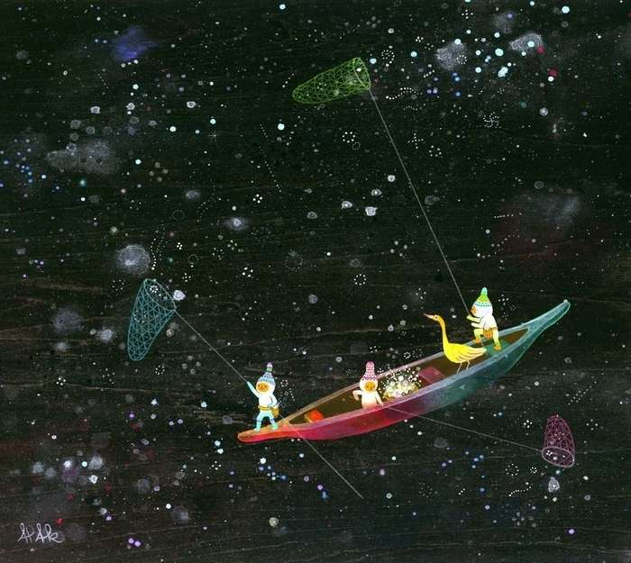

# Галт тэргэнд ганцаараа яваа балмагдан сандарсан бяцхан хүүхэд буюу амьдрал

Францын зохиолч, гүн ухаантан, Нобелын шагналт, олон нэр бүхий шагналуудаас татгалздаг байсан өвөрмөц зантай, суут хүн Жан-Поль Сартр, хүний амьдралыг, суудлын галт тэргэнд унтаж байхад нь, билет шалгахаар ирсэн шалгагч сэрээгээд мөнгөө төлөхийг шаардахад, тасалбаргүй, мөнгөгүй, учираа олохгүй байгаа ганцаараа явж байгаа бяцхан хүүхдийн байр байдалтай зүйрлэн бичсэн байдаг. Хүүхэд хаашаа явахаа мэдэхгүй, ямар ч өртөө хэрэггүй, яагаад явж байгаагаа ч мэдэхгүй. Тэгээд ч, тэр өөрийн шийдвэрээр бус уг галт тэргэнд явж буй тул энэ асуудлууд түүний хувьд шийдвэрлэшгүй юм. Ер нь яагаад энэ галт тэргэнд яваа юм бол? Яг иймэрхүү байдал орчин үеийн хүмүүсийн сэтгэлгээнд илүү ихээр ажиглагдах болсон нь, бид гарал үүсэл, төрөлх чанараасаа тасарч, бодох чадвар, бодлогогүй болж байгаатай холбоотой, гэтэл энэ зүйлс хамгийн ихээр амьдралд дутагдаж байдаг бөгөөд хүн, яагаад, хаашаа явж байгаагаа өнгөцхөн мэдрээд буй мэт боловч, хаашаа явж буй болон яах гэж явж байгаа, яагаад галт тэргэнд орчихсоноо мэдэхгүй хүүхдийн адил, тодорхой мэддэггүйгээс тасалбаргүй, мөнгөгүй, бууж болохгүй байгаа галт тэргэнд явж буй мэт амьдарлаар амьдарцгааж байдаг. Энэ байдал, төрөлх чанар үгүй болж, түүний салшгүй хэсэг хайр энэрэл устсанаас болдог гэжээ. Хүмүүс бие биенээ, орчин тойрноо хайрлахгүйгээр, амьдралын цаг хугацааг барахын тулд мэт амьдрах нь эмгэнэл. Гэхдээ, галт тэргэнд унтаж байснаа сэрж балмагдсан хүүхэд мэт байдал хүн бүрт мэдрэгдэх үе байдаг ч, амьдрал бол ялагдал цөхрөлөөр дүүрсэн зүйл биш учираас, энэхүү агуу том галт тэргэн дотор унтаж буй сая сая хүмүүсийн дунд хэн нэгэн унтаагүй сэрүүн хүн байж байдаг. Сэрж балмагдан сандарсан хүүхэд, энэхүү галт тэрэг хааш явахыг, мөн яах гэж явж буйгаа ухамсартайгаар мэдэж буй, тэрхүү сэрүүн байгаа хүнийг эрж олох явдал юм. Эрж олох чадвар ч бий. Тэр хүний дэргэд хүүхэд унтахыг биш ухаарч ухамсарлахыг сурна эсвэл амьдралын түмэн нууц, буман шалтгааныг дэлгэж байдаг ном зохиол уншиж луужингаа болгож болно гэж бодол төрүүлэм өгүүлэмжээр амьдарлыг тодорхойлсон байна.

