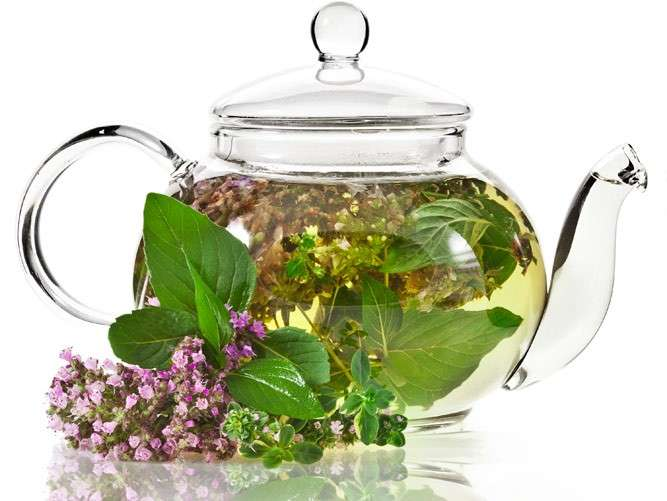
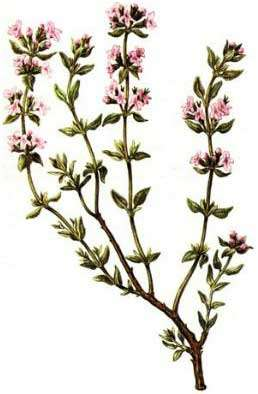

# Ганга өвсний ашиг тус

Энэхүү ургамалд, тимол хэмээх бодис агуулагддаг нь архинаас гаргах үр дүнтэй байдаг.

Бэлтгэх:\
Ганга – 15 гр\
Буцалсан халуун ус – 500гр\
Уг ургамал дээрээ, буцламгай усаа хийж, 10-15 минут, буцалж буй устай саванд, савтай нь тавиад, гал дээрээс авч, дээр нь дахин 500гр буцалсан ус нэмж ханд бэлэн болно.\
Хэрэглэх:\
Уг хандыг, өдөрт нилээд хэдэн удаа, 50-70 граммаар уухдаа, араас нь хагас хундага архиар даруулж уух хэрэгтэй. Удалгүй, огих, бөөлжис хүрэх шинж тэмдэгүүд илэрч эхлэх ба 1-2 долоо хоногийн турш хэрэглэхэд, архинаас гардаг. Онцгой тохиолдолд давтаж болно. Архинд дургүй болгож, жигшээдэг үйлчлэлтэй.\
Бусад эмчилгээ:\
Цус харвалтын дараах сэргээх эмчилгээний үед, 8 хоолны халбага ганга өвсөн дээр хагас литр сайн чанарын архи хийж, 2 долоо хоног харанхуй газар тавьсны дараа, өдөрт 35 дуслыг ууж хэрэглэн, мөн мэдээ алдсан биеийн хэсэгтээ түрхэж, массажилж хэрэглэхэд маш үр дүнтэй.\
Ой санамжаа алдах. Гэмтэл болон өвчний улмаас ой санамжаа алдсан үед, 1 хоолны халбага гангыг 2 стакан усанд хийж, буцалмагц гал дээрээс авч, 1 цаг орчим дулаан зүйлээр ороож тавьна. Дараа нь шүүж савлаад, ханд бэлэн болдог. Үүнийг толгойндоо үрж түрхдэг. Тархины үйл ажиллагааг сэргээдэг. Мөн нойр сайжруулдаг.
