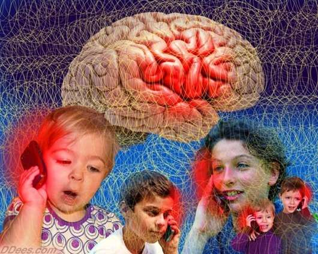

# Гар утасны хортой нөлөөллөөс сэргийлцгээе

Бид, урд нь гар утас гараагүй байх үед, яаж амьдарч байснаа төсөөлөхийн аргагүй, гар утаснаас хамааралтай үед амьдарч байна. Гар утасны гайхалтай технологийн тусламжтайгаар бид, харилцаа, бизнес, интернет, банк, санхүүгийн гүйлгээ гэх мэт олон чухал асуудлуудаа шийдэж байдаг. Гэтэл, зүйрлэшгүй ашиг тустай гар утас маань, цахилгаан соронзон долгион, хортой туяа гаргаж хүний бие организмыг хордуулдаг болохыг эрдэмтэн судлаачид нотолсоор байна.

Хүний мөн чанар нь, өөртөө тохиолдох ямар ч зүйлийг амар хялбар болгоход чиглэсэн байдаг бөгөөд шинжлэх ухаан технологийн хөгжил ч энэ зарчмыг баримталж байдаг. Амарчилж хялбаршуулсан зүйлс, хор уршиг дагуулдаг гэж хэзээ ч билээ уншиж байснаа санаж байна. Англид, хүүхдүүдийг сургууль дээрээ гар утас ашиглахыг хориглож, америкт, хүүхдүүдийн гар утсанд зориулалтын хяналтын төхөөрөмж суурилуулан, гар утасны хортой нөлөөллийн талаар дэлхий нийт шуугиж байна. Гар утастай хүний дэргэдэх, гар утас ашигладаггүй хүн ч уг хортой туяанд өртөж байдаг бөгөөд гар утсаар удаанаар ярих үед, цахилгаан соронзон долгионы үйлчлэлээр, хүмүүсийн тархинд халалт үүсч, богино долгионы зууханд өндөг хийхэд болгох үйлчлэл явагддагтай адил, тархины эд эсүүд чанагдах хэмжээний үйлчлэлд өртдөг гэсэн судалгааны дүгнэлт гарчээ. Өдөрт, 1 цагаас дээш хугацаагаар, гар утсаар ярьдаг хүмүүсийг үйлдвэрлэлийн хортой нөхцөлд ажилладаг хүмүүстэй адил хэмжээгээр хорддог гэж үзэж байна. Мөн, дархлаа, нүд, нөхөн үржихүй зэрэгт муугаар нөлөөлдөг талаар олон судалгаа шинжилгээний дүгнэлтүүд гарсаар байна. Энэхүү хортой нөлөөллөөс өөрсдийн эрүүл мэндээ хамгаалах, амьдралын хором бүрээ үнэлэх, өөртөө санаа тавих үүднээс дараах зөвлөгөөг хүлээн аваарай.\
-Гар утсаа, аль болох өөрөөсөө хол байрлуулж байх\
-Ялангуяа, унтах үедээ толгойноос хол тавих\
-Ашиглаагүй үедээ салгаж байх\
-Гар утсаараа ярих үедээ, спикер, чихэвч ашиглах\
-Гар утсаар удаан ярилцахаас зайлсхийх\
-Гар утасны дэлгэцийг удаан харж ашиглах үйлдлээс зайлсхийх

Эдгээр цөөхөн зөвлөгөөг хүлээн авснаар, бид, оюун ухааны эзэн тархиа нэн түрүүнд хамгаалах бөгөөд бусад олон өвчлөлөөс сэргийлж чадах юм. Эрүүл биед, саруул ухаан оршино.
