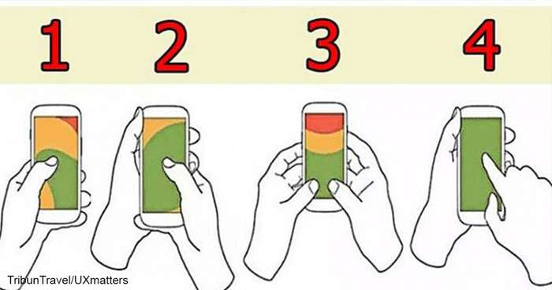
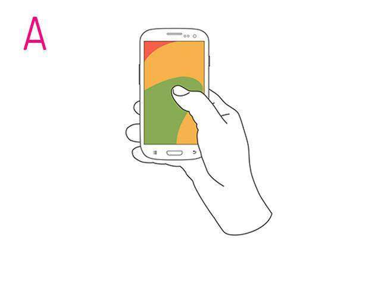
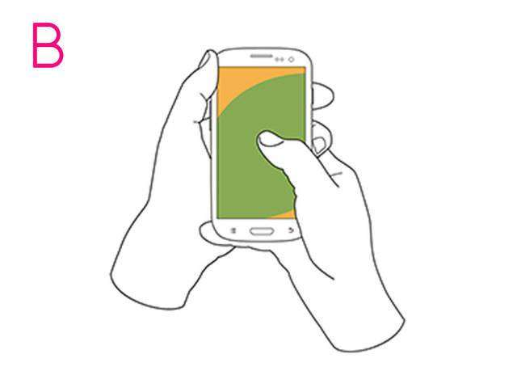
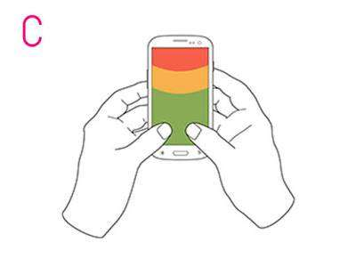
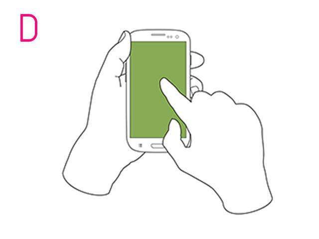

# Гар утсаа хэрхэн барьж ашиглаж байгаагаар илэрдэг хувь хүний шинж чанарууд

Хүмүүс гар утсыг 4 байдлаар барьж ашигладаг гэнэ.

**А** Нэг гартаа гар утсаа барьж, эрхий хуруугаараа гар утсан дээрээ ажилладаг хүмүүс, олон үйлдэлийг нэгэн зэрэг хийх сэтгэхүйн чадамжтай, зохион байгуулалт, хувийн сахилга бат сайтай, сайн мууг ялгаж ойлгох чадвартай, сонсохоосоо илүү ярих дуртай, үүнийг зориудаар хийж байдаг, хорхой ч гомдоохгүй хүн. Чин хайрыг, хуурмаг дүр эсгэсэн харьцаанаас ялгаж чаддаг, хань ижлийнхээ төлөө бүхнээ зориулдаг.

---

**B** Хоёр гартаа гар утсаа барьж, эрхий хуруугаараа гар утасныхаа үйлдлүүдийг хийдэг бол, та, хайр хамгаалалтыг хүсэмжилж, анхаарал халамж хүлээж байдаг хүн. Та, бодол санаагаа тэр болгон илэрхийлдэггүй учираас хань ижил чинь хайраар дутагдсан мэт байдалд ордог байх магадлалтай. Аливаад эерэг зөөлөн хандаж, сэтгэл санаагаа илэрхийлж байхыг хичээж байгаарай.

---

**С** Гар утсаа хоёр гартаа барьж, хоёр гарын эрхийгээр утасныхаа үйлдлүүдийг хийдэг бол, та, зүрх зориг султай, аливаад айдас болгоомжтой ханддаг, санаа зовиномтгой. Таныг 100% ойлгох хүн дэргэд тань байгаа тохиолдолд, өөртөө итгөх итгэлээр дүүрэн байдаг. Сонгосон хүнээ зүрх сэтгэлээрээ хайрладаг, өнгөрсөнд тохиолдож байсан таагүй зүйлсийг ч мартах чадвартай.

---

**D** Нэг гартаа гар утсаа барьж, нөгөө гарын долоовор хуруугаар гар утасныхаа үйлдлүүдийг хийдэг бол, та, тайван, тогтвортой зан байдалтай. Бусдын төлөө өөрийгөө золиослохоос буцахгүй, олон хүн цугларсан газарт дуртай биш, тайван чимээгүй, танил орчинд байх дуртай. Бусдын ялангуяа, ойр дотныхныхоо нулимсыг тэвчиж чадахгүй зовдог. Хайртай хүмүүсийнхээ алдаа дутагдал, гомдоолтыг асар түргэн уучилж байдаг.
