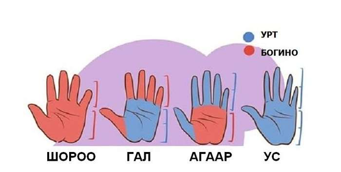
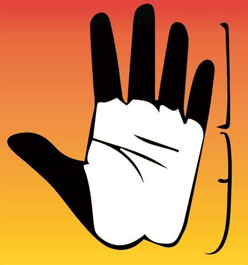
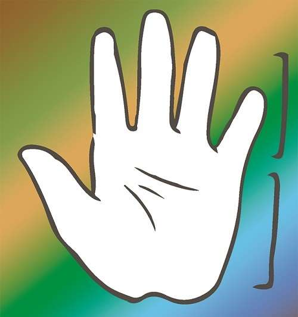
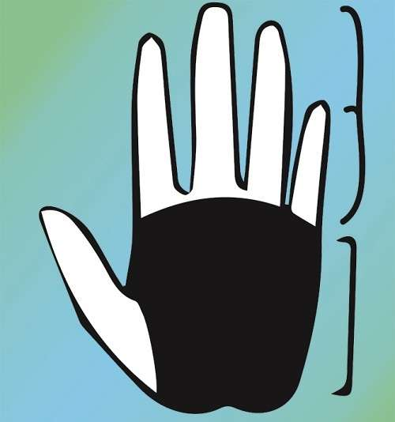
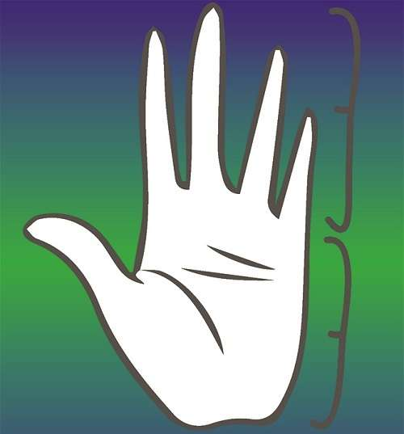

# Гарын алганы нууц

90-95 % таардаг. Өөрийгөө болон ойр дотныхноо таниарай. Хүмүүс гарын алганы зураасаар шинжих аргыг эртнээс мэддэг. Энэхүү зураасууд, эхийн хэвлийд байхад бий болдог бөгөөд, өнгөрсөн, одоо ирээдүйг тодорхойлдог нууцлаг шинж чанар нь гайхалтай байдаг. Гэхдээ гарын алганы хэлбэрээр шинжих энэ аргыг тэр болгон мэддэггүй. 4 төрлийн гар байх бөгөөд, хүний үндсэн дөрвөн зан чанарыг харуулдаг байна. Дараах гарын хэлбэрүүдээс, таарах гарыг сонгож харгалзах тайллыг уншиж өөрийгөө таниарай.

#### 1. “Гал”

Өргөн алга, богино хуруутай хүмүүс, галын шинжтэй байдаг. Гал мэт дүрэлзүүр, зөрүүд, юу хүсч буйгаа мэддэг. Хүсэл нь буцалж байдаг, идэвхитэй үйл ажиллагааны билэг тэмдэг л гэсэн үг. Ажилсаг, эхэлсэн ажлаа дуусгаж салдаг. Эдгээр хүмүүс, төрөлхийн удирдагч, хамт олон, ойр дотныхныгоо сайн сайханд хүргэх түлхэц нь болдог. Нийгэм олон нийтийн ажил болон спорт, ер нь хүмүүстэй харьцах дуртай.

---

#### 2. “Шороо”

Ийм гартай хүмүүс, маш болгоомжтой, аливаа зүйлийн хяналт,тогтвортой байдлыг эрхэмлэдэг. Даалгасан үүрэг даалгаврыг маш хариуцлагатай биелүүлдэг. Тогтуун, амьдралын хүнд бэрхийг ч тэвчээртэй, нэр төртэй даван туулахыг хичээдэг. Ямар ч ажлыг гардан хийх дуртай

---

#### 3. ”Агаар”

Гарын алга, хурууны урт нь тэнцүү хүмүүс, харилцааны чадвар сайтай, ихэвчлэн оюуны чадвар нь өндөр байдаг. Оюуны чадавхиасаа болж, эдгээр хүмүүс, өөр дээрээ болон өөрийнхөө сонирхдог зүйлсдээ төвлөрөх хандлагатай. Тэд бусдаас, бүр ойр дотныхноосоо ч хол хөндий юм шиг сэтгэгдэл төрүүлдэг болов ч дотроо зөөлөн уяхан хүмүүс. Ихэвчлэн зан чанартаа тохирсон багш, зохиолч гэсэн мэргэжил сонгон эзэмшдэг

---

#### 4.” Ус”

“Ус”-ны хүмүүс, урт нарийн алга, урт хуруутай, тэд, маш мэдрэг, эмзэг, романтик, ойр дотныхон болон хайртай хүндээ үнэнчээр өөрийгөө зориулах чадвартай. Өндөр хөгжсөн төсөөллөөрөө бусдыг ангайтал зугаацуулж хөгжөөж чаддаг гайхалтай чадвартай. Бусдыг халамжлахтай холбоотой мэргэжлүүд болон хөгжмийн урлагт хүчээ зориулдаг.
