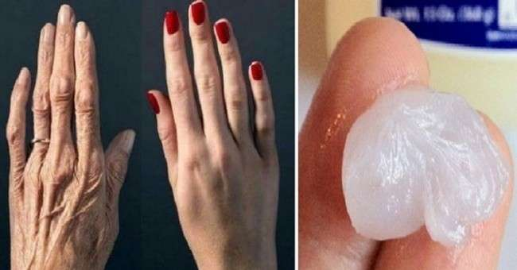
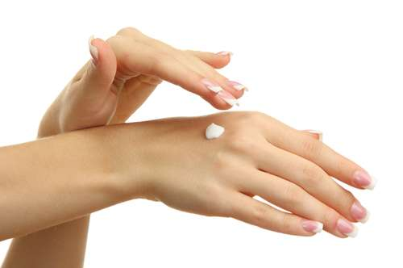

# Гарын арьс арчлах, үр дүнтэй арга

Энэхүү жор нь, маш энгийн боловч үр дүнтэй. Бидний гар, өдөр бүр гадны таагүй үйлчлэлд өртөж байдаг. Тиймээс хамгийн түрүүнд, хөгшрөлтийн шинжүүд гарч ирж ирдэг гэж экспертүүд үздэг. Гарын арьс маш нимгэн, маш бага өөхөн давхаргатай тул, коллаген, эластинууд амархан устдаг учраас, хөгшрөлтийн шинж тэмдэг хамгийн түрүүнд илэрдэг байна. Ингээд багахан санаа тавиад, гарын арьсаа залуужуулах жоруудыг танилцуулъя.

-1 өндөгний цагааныг, 1 цайны халбага, зөгийн балтай хутгаж түрхээд, хатмагц бүлээн усаар угаана.\
-3 ширхэг төмс чанаж нухашлаад, 2 халбага оливын тос, сүүтэй хольж, хөргөгчинд, хадгалан, 7 хоногт 2-3 удаа түрхэж 15 минут болгоод угааж байх.\
-лимоныг шахаж гарсан шүүсэн дээрээ, шүүснийхээ хэмжээний элсэн чихэр хийж хутгаад, гартаа үрэх маягаар түрхэнэ. Эхлээд бүлээн усаар угаагаад, хүйтэн усаар зайлна.\
- багахан хэмжээний вазелин түрхээд, хөвөн даавуун бээлий өмсөөд унтдаг. Зөөлөн сайхан болно.

Халуун усаар гараа угаах нь, гарыг усгүйжүүлж, хуурайшуулдаг. Хүйтэн сэрүүний улиралд, байнга бээлий өмсөж бай. Гар, хамгийн түрүүнд нүдэнд тусдаг, хүний арчаа, насыг тодорхойлдог эрхтэн гэдгийг, үргэлж санаж явах хэрэгтэй.
