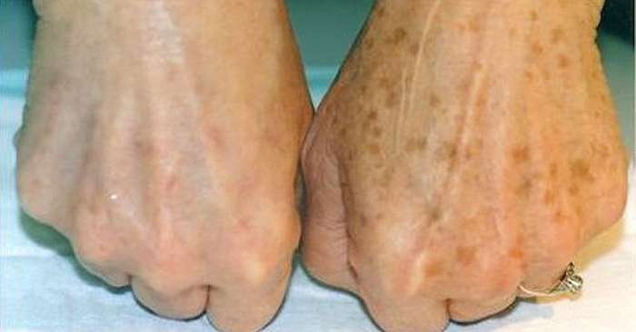
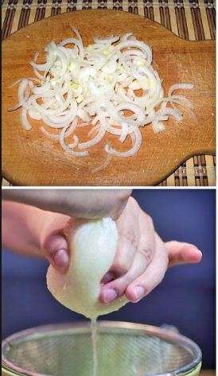

# Гарын арьсан дээрх, нөсөө толбо арилгах хялбар арга

40 наснаас хүний арьсан дээр, нөсөө толбууд гарах нь олширдог бөгөөд хамгийн түрүүн гарын арьсан дээр бий болдог. Эдгээр нөсөө толбоноос салах хамгийн хялбар, ердийн бөөрөнхий сонгино ашигладаг аргыг танилцуулъя.

#### Хэрэглэх арга:

-2 хоолны халбага сонгинын шүүс\
-2 хоолны халбага цагаан цуу /уксус/\
Энэхүү гайхалтай цайруулах үйлчилгээтэй бэлдмэлийг хийхэд маш амархан. Сонгинын шүүс уксус хоёроо холиод асуудалтай газрууд буюу нөсөө толбууд дээрээ түрхнэ. Залхуурч, марталгүй тогтмол түрхсэнээр, нөсөө толбо ор мөргүй арилдаг байна. Гарын толбууд хоёр долоо хоногт арилдаг гэнэ. Таагүй үнэрийг нь гараас үнэртүүлэхгүй тулд лимоны хальсаар гараа үрдэг.
