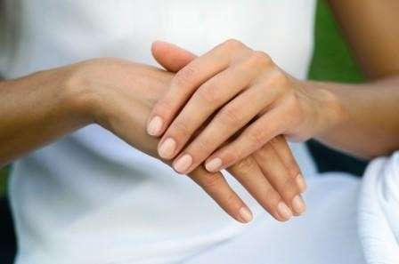
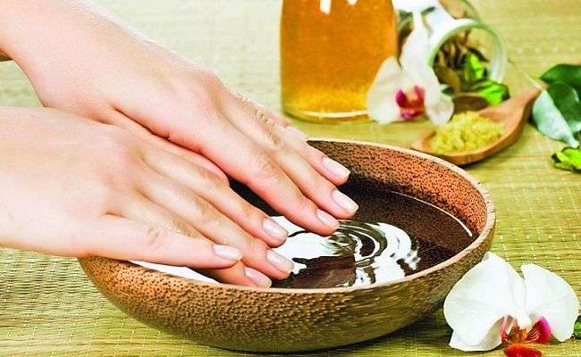

# Гарын арьсыг залуугаар нь хадгалах арга

Гарын арьс маш нимгэн өөхөн давхаргатай байдгаас, мөн байнгын гадны нөлөөлөлд өртөж байдгаас хамгийн амархан гэмтэж, үрчийх, хөгшрөх хандлагатай байдаг. Хамгийн хялбар, гарын дорх зүйлсээр арчилах аргуудыг хүргэе.

#### Өндөг, зөгийн балны маска:

Өндөгний цагаан 1 ширхэг\
Зөгийн бал 1 хоолны халбага\
Хооронд нь хольж гартаа түрхээд, хаттал нь байлгаад бүлээн усаар угаана. Өндөгний цагаан арьсны уян хатан байдлыг сайжруулдаг тул шууд үр дүнгээ үзүүлдэг. Энэ масканы дараа кокосын тос түрхэх хэрэгтэй. 

#### Төмсний маска:

Чанасан төмсийг нухаж, зөгийн бал, оливын тос, сүү нэмж, уг холимгоо 7 хоногт 2-3 удаа, 15 минутын хугацаатай гартаа түрхэж байх.

#### Нимбэг сахарын маска:

Нимбэгээ шахаж шүүсийг нь гаргаад, уг шүүсний хэмжээний элсэн чихэр нэмж хутгаад гартаа иллэг хийнэ. Дараа нь, эхлээд бүлээн усаар угаагаад, хүйтэн усанд булхах хэрэгтэй. Гарын цусны эргэлт сайжирдаг.

#### Миндальное масло. Бүйлсийн тос.

Гарандаа түрхээд, хүйтэн усанд дүрж 5 минут байлгаад, дараа нь тослог тэжээлийн тос түрхнэ. Хөвөн даавуун бээлий өмсөж тайлахгүй унтдаг. Гар маш сайхан зөөлөрдөг.
