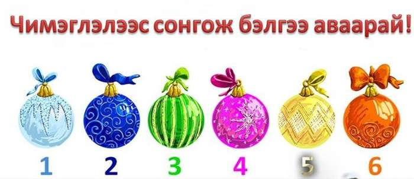

# Гацуур модны чимэглэлээс таалагдсанаа сонгож 2017 оны бэлгээ аваарай

Би бэлгэнд дуртай. Бид бэлгэнд дуртай. Бүгд бэлгэнд дуртай. 2017 оны бэлгээ сонгоорой!

1. 2017 он, танд, эд баялаг, чинээлэг байдлыг бэлэглэж байна. Та үлгэрийн юм шиг баялаг дунд умбах нь. Гал тахиа жил, таны, өнгө үзэмжний сонголтыг тань үнэхээр мэдэрч, олз омог дүүрэн бэлгээр мялаах аж.\
2. Харин танд аз хийморийг өгч байна. Энэ ондоо хүссэн бүхэн тань биелж, аз араас тань мөрдөөд салахгүй байх нь. Аз хийморь үргэлж амжилт орлогыг дагуулдаг. \
3. Эрх мэдэл. Энэ ондоо туйлын эрх мэдэлтэй байх нь. Бүгд үг дуугүй, үйлчилж, бөхөлзсөн жил болно доо. \
4. Цэцэглэлтийг гардан аваарай. Ажил үйлс цэцэглэхээс илүү сайхан зүйл үгүй билээ. Мөрөөдөж болох бүх зүйл чинь бэлэн байх болно. \
5. Хайрыг бэлэглэж байгаа аж. 2017 ондоо хайраар бялхсан жил болно. Хүсэх л юм бол шүтэн бишрэгчид тань сөхөрч унаад л. Гал тахиа жил, давтагдашгүй сайхан бэлэг өгч байна. \
6. 2017 он, танд амжилтыг атгуулж байна. Амжилтын билэгдэл улбар шар чимэглэлээ, хайрлаж хадгалаарай. Та, маш амжилттай байна. Бодсон бүхнээ гүйцэлдүүлэх сайхан жил золгож байна.

Тус тусын бэлгээ авцгаагаад, эвтэй найртай хуваалцаж, дэм дэмэндээ, ирж буй шинэ ондоо, аз жаргалтай байхын ерөөл дэвшүүлж байна. Минийх 5. Та нартаа, хуваалцлаа.
