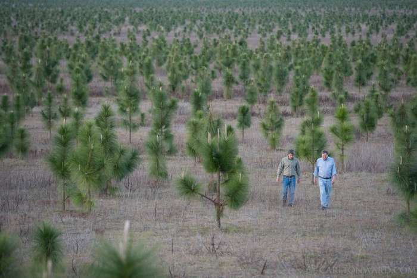
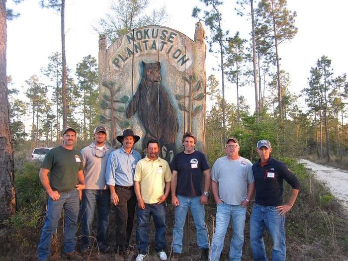

# Гайхалтай бизнесмен

Америк бизнесмен Дэвис.М.С, 20 жилийн турш 90 000 доллараа, мод бэлтгэлийн компаниудаас, мод бэлтгэж буй газрыг нь худалдан авах, 100-д жилийн өмнө мод нь тайрагдаж хувхайрсан газруудад мод тарьж ургуулахад зориулжээ. Тэр өөрийн энэ төслийг, Nokuse гэж нэрлэсэн бөгөөд энэ нь, индиан хэлний “Хар байвгай” гэсэн үг аж.

Дэвис, худалдаж авсан газрууддаа, тухайн газруудад ургаж байсан тэр л моднуудыг нь олж тарьдаг. Тэр, энэ үйл ажиллагаагаа явуулж эхэлснээсээ хойш хэдэн саяар нь суулгац тарьснаар, 1930-д оны үед, мод бэлтгэлийн үйл ажиллагаанд тайрагдаж хядуулсан ойг бүрэн сэргээж, эко систем нь ч мөн сэргэлээ гэж бахархан ярьдаг. Энэ бизнесмен, 100 жилийн өмнө тайруулж сүйдсэн ойг сэргээхийн тулд 8 000 000 гаран мод тарьжээ. Одоо түүний тарьж ургуулсан ойд, бүргэд, шилүүс, үнэг, илбэнх, жирх амьдардаг болжээ.\
Ийм бизнесмен, буянтанууд олшроосой гэсэн хүслээр, энэхүү мэдээгээ хүргэлээ. Нэг мод тарихад нэгэн насны буян гэдэг.
