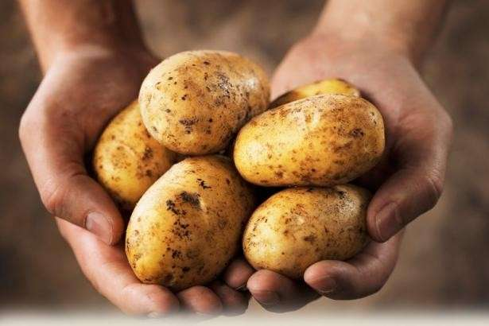
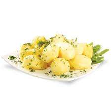

# Гайхалтай! Төмс!  жимс, самарнаас ашигтай

Английн зөв хооллолтын мэргэжилтэн, судлаачид төмс нь жимс жимсгэнэ, самарнаас илүү ашигтай гэсэн гайхалтай таатай, мэдэгдэл хийжээ.

Medik Forum сэтгүүл, төмсөнд, бусад олон төрлийн жимс жимсгэнэ, самар, хүнсний ногоонд байдгаас илүү их, хүний биед ашигтай , чухал орцууд байдаг гэсэн дүгнэлтэд мэргэжилтэн судлаачид хүрсэнийг нийтэлжээ. Судлаач Сиана Портер, Сигрид Гибсон нарын туршилтаар, төмс нь селен гэдэг бодисын өндөр агууламжтай байдаг бөгөөд, нэг булцуу төмсөндөх селены агууламж, самар, үрний орцондох селенээс илүү, мөн эслэг чанараараа гадил жимсийг ч давах чанартай нь батлагджээ. Түүнээс гадна, төмс, бусад өндөр үнэтэй хүнснүүдийн адил С амин дэмээр баялаг бөгөөд, энэ нь мөн давуу тал болж өгөх юм гэж дурджээ. Жишээ нь, авокадоноос 3 дахин өндөр С амин дэмийн агууламжтай аж. Эмч, мэргэжилтнүүд, төмсийг өдөр тутам хэрэглэх нь, бие организмаа, жинхэнэ байгалийн амин дэмийн цогцоор хангаад зогсохгүй, мөн хамгийн танил ердийн төмс маань хүнд хэрэгтэй бараг бүхий л микроэлементүүдийг агуулдаг гэж үзэж байна. Урд өмнө хийгдэж байсан судалгаануудад, төмсийг хөхний хорт хавдарын үед тустай, мөн ямар ч хорт хавдарыг эхний үед эмчлэх үйлчлэлтэй гэж батлагдаж байсан талаар дурдсан байна. Зөв хооллолтын мэргэжилтэн Портер, Гибсон нар, өндөр даралттай хүмүүсийг өдөрт 2 удаа чанасан төмс хэрэглэхийг зөвлөж байна. Хэрэв таргалалтаас болгоомжилж байгаа бол ямар ч хольцгүй хэрэглэхгүй байхыг сануулсан байна. Мөн, төмсний өдөр тутмын хэрэглээ нь, илүүдэл жинд хүргэхгүй харин цусны даралтыг тогтворжуулах үйлчлэл үзүүлдэг гэсэн байна.

Бидний байнгын хэрэглээ, хамгийн дуртай төмс маань ийнхүү эмчилгээний ашигтай болох нь батлагдсан нь, ямар таатай вэ? Эрүүл мэнддээ ашигтай зүйл хэрэглэж байсан маань ч бас сайхан байна. Бас таргалахгүй! Баярлацгаая!
