# Гайхамшигт байгаль дэлхий

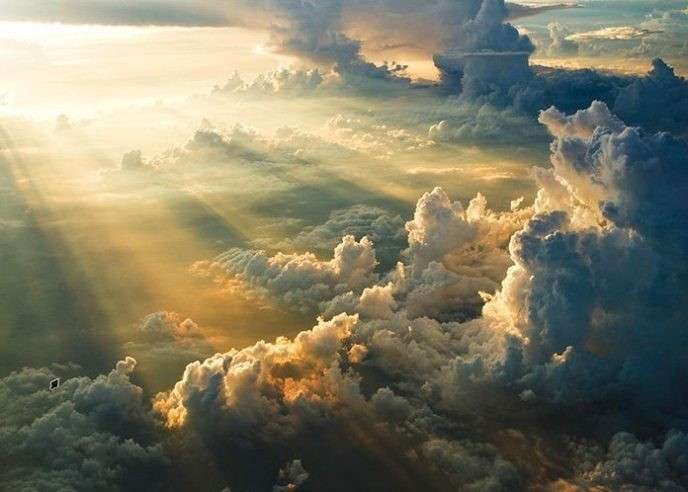

Бид, жинхэнэ гоо үзэсгэлэн төгс, байгаль дэлхий дээр амьдардгаа дараах зургуудаас олж хараарай. Байгаль өөрөө гайхалтай зураач юм. Гайхалтай сайхан, хосгүй үзэсгэлэнт үзэгдэл, юмс, зүйлсийг нь биширмээр, сүрдмээр...

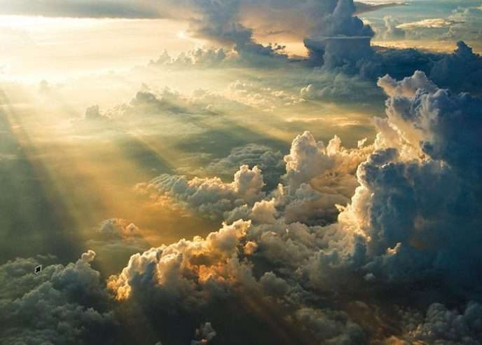

10 000 метрийн өндөрөөс үүр цайх үе

---

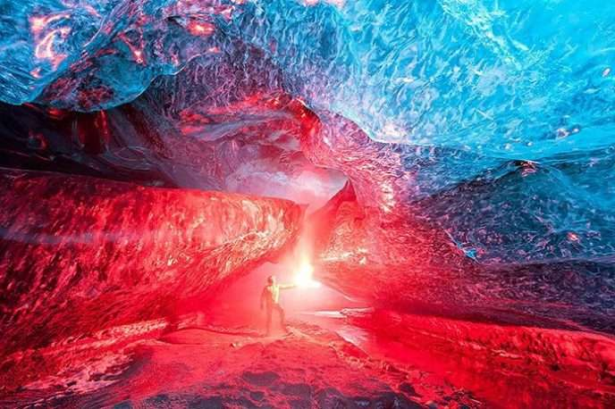

Мөсөн агуй бамбарын гэрэлд

---

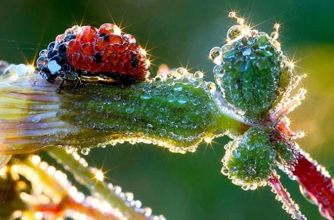

Шүүдэрт дарагдсан цох хорхой

---

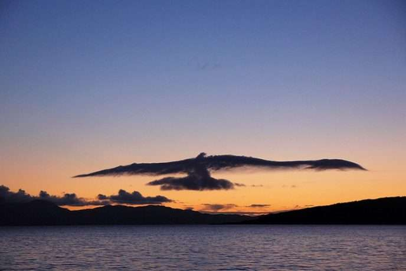

Гайхалтай үүл

---

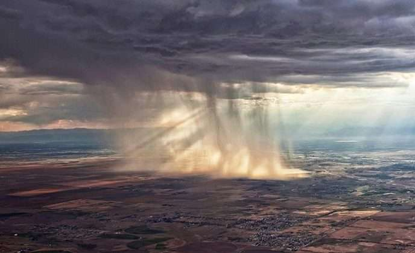

Тал газар дээр орох бороо, онгоцноос

---

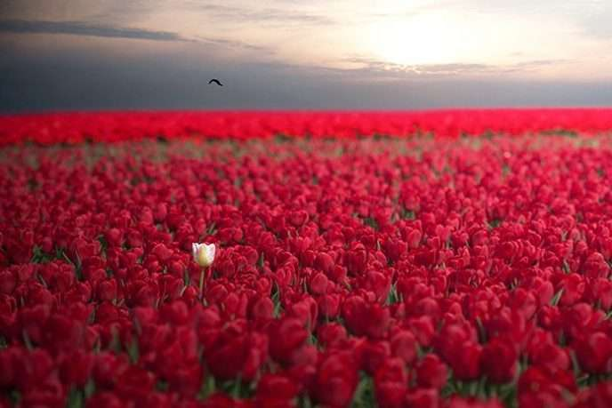

Саяын дундах ганц

---

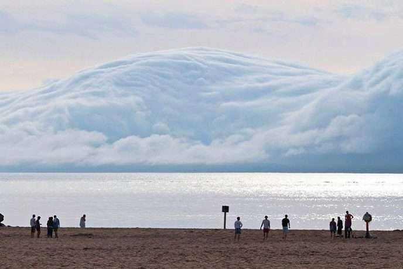

Үүлсийн цунами

---

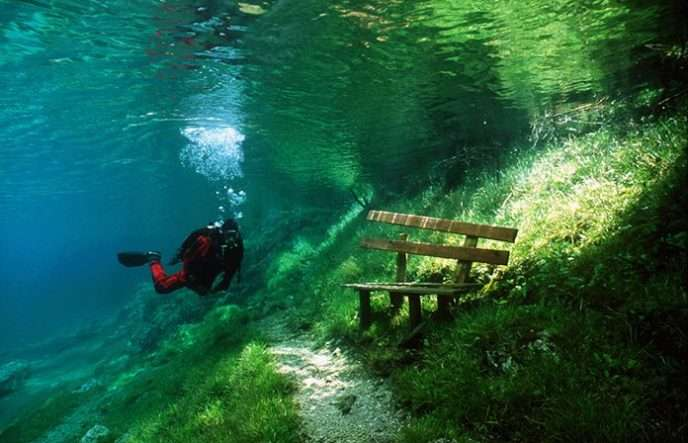

Австрийн, хавар нь усны гүнд ордог гайхалтай парк

---

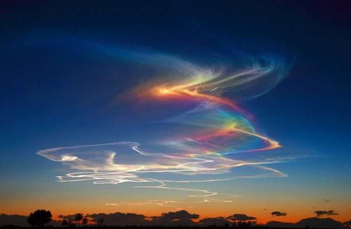

Ховор тохиолддог галт солонго

---

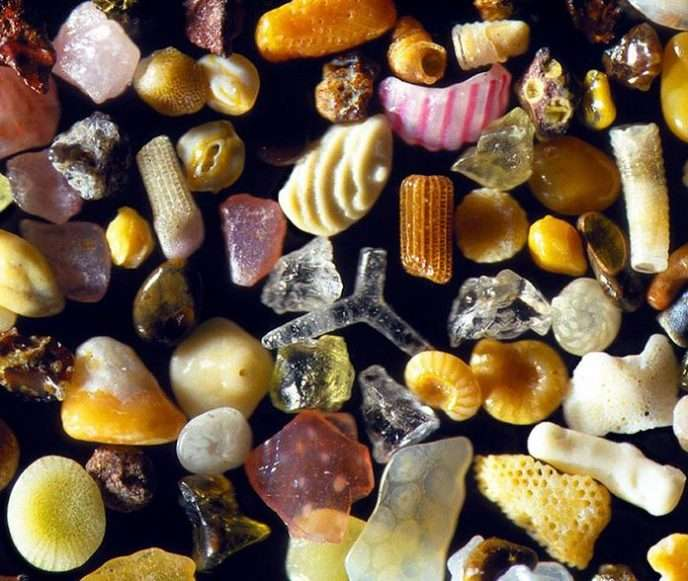

300 дахин томруулсан далайн элсний ширхэгүүд

---

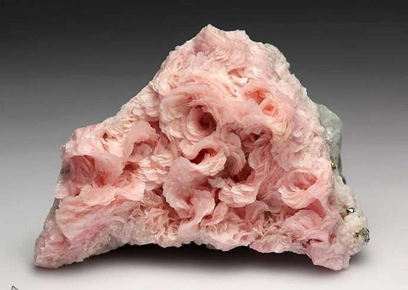

Родохрозит буюу инкүүдийн сарнай гэх эрдэст чулуулаг

---

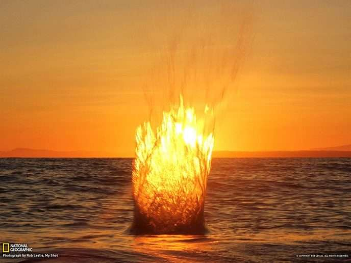

---

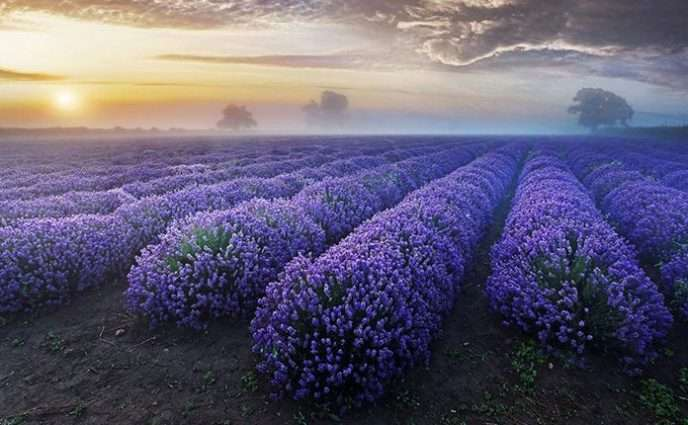

Лаванд цэцгийн тариалан үүрээр. Анхилуун үнэрийг нь төсөөлдөө...

---

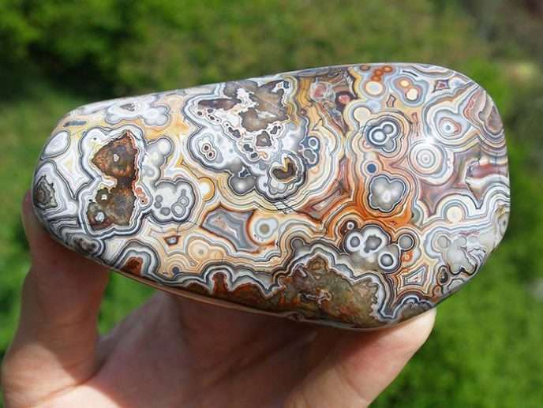

Байгаль, гайхалтай зураач гэж үнэн юм

---

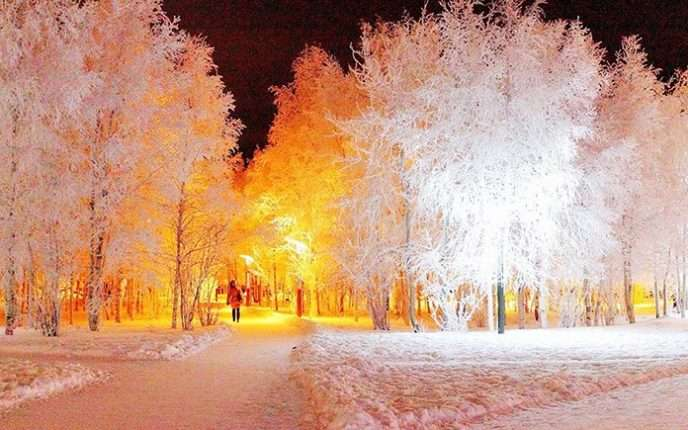

Үлгэрийн өвөл
