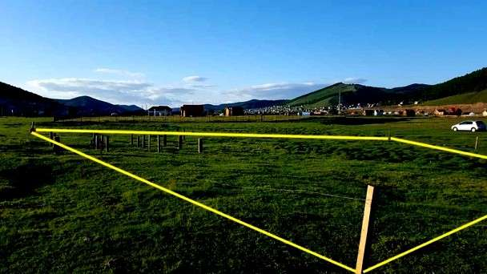

# Газар авахад, шинжих арга

Монголчууд, амьдарч оршин суух газраа нарийвчлан шинжиж, бууриа засан, амьдарч ирсэн бөгөөд эдгээр шинжүүдээр газар сонгохыг, аж амьдрал дэгжиж дэвжихийн үндэс гэж ихэд нухацтай ханддаг байжээ.

Сонгох гэж буй газар тань хойд зүг рүү налуу бол эд баялаг, зүүн тийш налуу бол амжилтыг авчирна. Мөн газрын чичиргээг мэдэр, 1-2 минутын турш, нүдээ аньж зогсоод, ямар нэг мэдрэмж авахыг хичээ. Эерэг мэдрэмж төрж байвал сайн. Хойноосоо урагш сунасан газар ээлтэй байдаг. Хоёр том хашааны голд жижиг газар бүү ав. Гол хэсэгтээ төвгөр газар муу, баруун тийш налуу алдагдал, урагш налуу газар хоосролд хүргэнэ гэдэг. Баруун урд талаараа, ухаа толгод, уул, өндөрлөг газраар хүрээлэгдсэн бол маш сайн, эрүүл мэнд, хөгжил дэвшил авчирдаг аж. Хойд болон зүүн талаараа уул толгодоор хүрээлэгдсэн бол татгалз. Ямар ч газрыг сонгохдоо, хойд, зүүн хэсэг нь урд талаасаа нам байвал сайн гэж үздэг. Зүүн хойд талд нь намаг, гол, суваг, худаг байвал маш сайн. Зам араар гарсан бол сайн, баруун талаар боломжийн, зүүн талд тааламжтай, зүүн хойд буланд зам төгссөн байвал маш сайн гэдэг байна. Хашаа хороогоо хатгахдаа зүүн хойд тал руу нь үл ялиг хурц өнцөг гаргаж барих нь өндөр алдар нэр хүнд, эд баялагт хүргэнэ гэдэг. Хашаан дотроо, орон гэрээ, аль болох зүүн талдаа, илүү зай үлдэхээр барих хэрэгтэй. Өөрөөр хэлбэл, байшингаа баруун талдаа барь. Баруун талдаа их зайтай байх нь эрчүүлд халгаатай гэдэг байна. Хэрхэвч зүүн, зүүн хойд талдаа, хашаандаа тулгаж барьж болохгүй.

Энэхүү шинжих аргуудыг амьдралдаа хэрэгжүүлээрэй. Эргэн тойрондох айл амьтны хашаа, газрыг харж сонжоод, амьдралыг нь анзаараарай. Энэ шинжүүд маш үнэн байдаг. Хууччуулын ажиглалт дээр, нотлогдсон үнэн гэдгийг та, ойлгох болно. Эдгээр зөвлөмжийг, 1966 онд хэвлэгдсэн номноос,олзуурхан өөртөө зориулан товчлон хуулж авсанаа хуваалцах ялдамд, эх сурвалж болох уг номын нэрийг санахгүй байгаадаа хүлцэл өчье.
