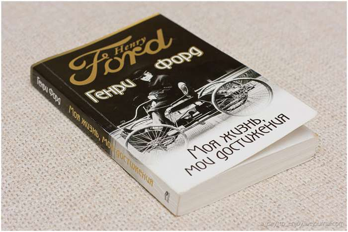

# Генри Фордын философ

Генри Форд, ажил хэргийнхээ дагуу Англид иржээ. Тэрээр, онгоцноос буумагцаа, нисэх буудлын лавлахын ажилтнаас, хотын хамгийн хямд зочид буудлын хаягийг асуув. Уг ажилтан, урд өдөр нь Генри Форд ирж байгаа тухай бичсэн сонин хэвлэлд нийтлэгдсэн зургууд болон нэртэй баян хүн гэдгээр нь дэлхий нийтээр мэддэг байсан тул түүнийг шууд таньсан бөгөөд өмнө нь зогсох наснаас нь өндөр гэмээр, хуучирсан цувтай эрхмийг харж гайхсан даа, -“Хэрэв, би андуураагүй бол, та ноён Генри Форд байна. Би таныг сайн таньж байна”, гэхэд, Форд, -“Тийм” гэж жишим ч үгүй хариулаад гайхан харахад, түүнээс илүүтэй гайхсан лавлахын ажилтан –“Та, хамгийн хямд буудал асуугаад, мөн, өөрийнхөө наснаас ч ах харагдах цувтай! Таны хүүг ирэх үед би байнга байж таардаг. Тэр хамгийн үнэтэй буудал захиалж, маш үнэтэй хувцасласан байдаг шүү дээ” гэчихэж. Форд хариуд нь, -“Харин, тиймээ хүү минь, залуу туршлагагүй байгаа, хямд буудалд буувал хүмүүс юу гэж бодох бол гэж айдаг бололтой. Харин, миний хувьд, хямд ч бай, үнэтэй ч бай хаана ч буусан би Генри Форд. Мөн, энэ цув бол үнэхээр надаас ах, миний аавын цув. Энэ ямар ач холбогдолтой юм? Би юу ч өмссөн, бүр нүцгэн байсан ч Генри Форд. Өөр бусад зүйлс чухал гэж үү?” хэмээн тайван хэлсэн гэдэг.

